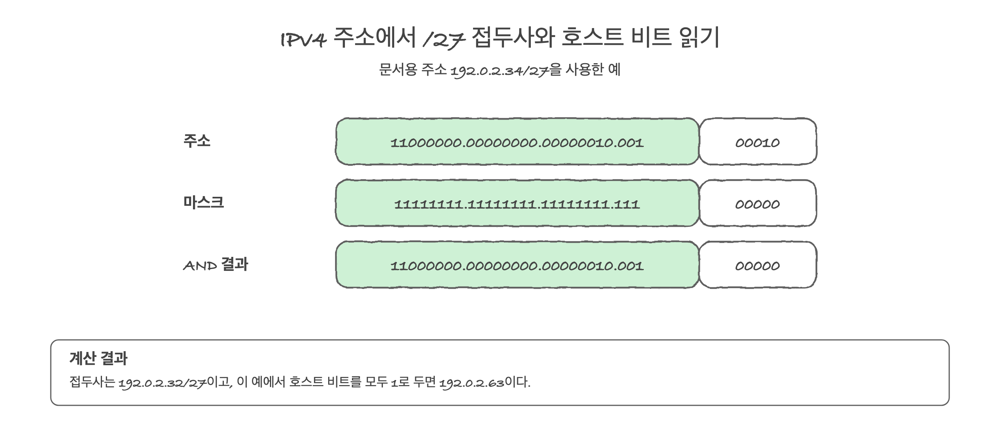
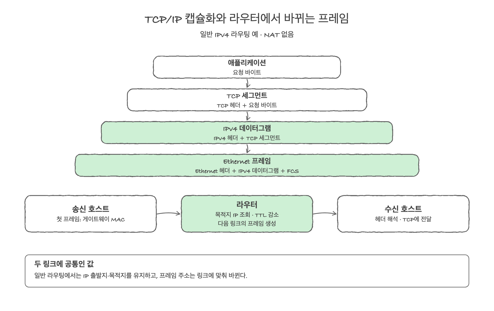
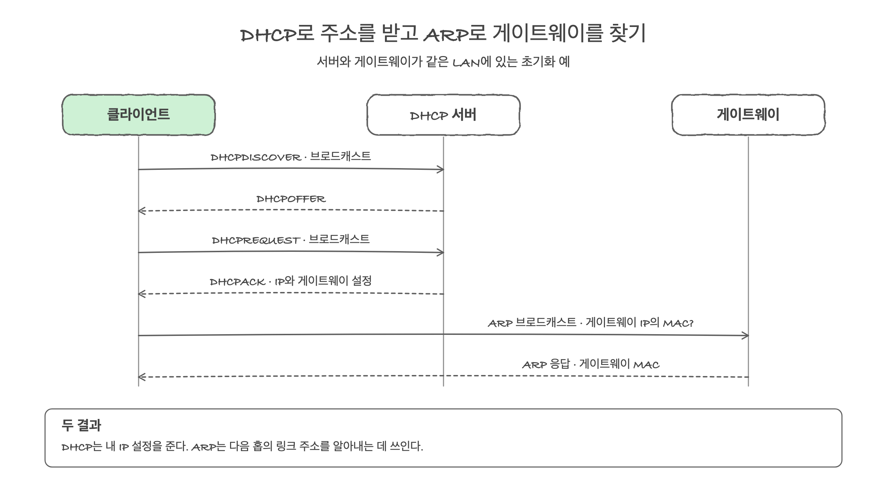

# IPv4 주소와 패킷 송수신

## 1. IPv4 주소, 서브넷 마스크와 CIDR

IPv4 주소는 32비트이며, 일반적으로 8비트씩 잘라 점으로 구분한 10진수 네 개로 표기한다. CIDR의 `/n`은 왼쪽부터 네트워크 접두사가 차지하는 비트 수다. `192.0.2.34/27`의 마스크는 `255.255.255.224`이고, 주소와 마스크를 비트 AND 하면 접두사 `192.0.2.32/27`을 얻는다. 일반 브로드캐스트 서브넷을 가정하면 마지막 주소인 `192.0.2.63`이 해당 서브넷의 브로드캐스트 주소다. 점대점 링크의 `/31`에는 두 주소를 모두 끝점에 쓰는 별도 규칙이 있다. [RFC 791 §2.3 · IPv4 주소 지정](https://www.rfc-editor.org/rfc/rfc791.html#section-2.3) · [RFC 4632 §3.1 · CIDR 접두사와 최장 접두사 일치](https://www.rfc-editor.org/rfc/rfc4632.html#section-3.1) · [RFC 1122 §3.2.1.3 · 제한·지향 브로드캐스트](https://www.rfc-editor.org/rfc/rfc1122.html#section-3.2.1.3) · [RFC 3021 §2.1 · 점대점 링크의 /31 주소](https://www.rfc-editor.org/rfc/rfc3021.html#section-2.1) · [RFC 5737 §3 · IPv4 문서용 주소 대역](https://www.rfc-editor.org/rfc/rfc5737.html#section-3)

라우팅 테이블에 목적지와 일치하는 여러 접두사가 있으면 가장 긴 접두사를 우선한다. 예를 들어 목적지가 `192.0.2.34`이면 `192.0.2.0/24`보다 `192.0.2.32/27`이 더 구체적이다. `0.0.0.0/0` 기본 경로는 더 구체적인 경로가 없을 때 일치한다. [RFC 4632 §3.1 · CIDR 접두사와 최장 접두사 일치](https://www.rfc-editor.org/rfc/rfc4632.html#section-3.1) · [RFC 1812 §5.2 · IPv4 패킷 전달](https://www.rfc-editor.org/rfc/rfc1812.html#section-5.2)

접두사와 일반 서브넷의 브로드캐스트 주소를 비트로 계산한 예다. [RFC 4632 §3.1 · CIDR 접두사와 최장 접두사 일치](https://www.rfc-editor.org/rfc/rfc4632.html#section-3.1) · [RFC 1122 §3.2.1.3 · 제한·지향 브로드캐스트](https://www.rfc-editor.org/rfc/rfc1122.html#section-3.2.1.3) · [RFC 5737 §3 · IPv4 문서용 주소 대역](https://www.rfc-editor.org/rfc/rfc5737.html#section-3)

## 2. 캡슐화와 TCP/IP 송수신 흐름

애플리케이션이 소켓에 쓴 바이트는 TCP 세그먼트의 페이로드가 될 수 있다. IPv4는 세그먼트를 데이터그램에 싣고, Ethernet은 데이터그램을 프레임의 페이로드에 담는다. 이 과정을 캡슐화라고 한다. UDP를 사용하는 경우 전송 계층 단위는 UDP 데이터그램이다. `send()` 호출 한 번, TCP 세그먼트 하나, 수신 앱이 읽는 범위는 각각 독립적이다. [RFC 1122 §1.1.3 · 인터넷 프로토콜 계층](https://www.rfc-editor.org/rfc/rfc1122.html#section-1.1.3) · [RFC 9293 §2.2 · TCP 연결과 전송 특성](https://www.rfc-editor.org/rfc/rfc9293.html#section-2.2) · [RFC 768 · UDP 데이터그램과 헤더](https://www.rfc-editor.org/rfc/rfc768.html) · [RFC 894 · IPv4의 Ethernet 캡슐화](https://www.rfc-editor.org/rfc/rfc894.html) · [Linux send(2) · 소켓 송신](https://man7.org/linux/man-pages/man2/send.2.html#DESCRIPTION) · [Linux recv(2) · 소켓 수신](https://man7.org/linux/man-pages/man2/recv.2.html#DESCRIPTION)

목적지가 다른 네트워크에 있다면 첫 Ethernet 프레임은 다음 홉인 라우터의 MAC을 목적지로 삼을 수 있다. 라우터는 들어온 프레임에서 IPv4 패킷을 꺼내 목적지 IP를 조회하고 TTL을 줄인다. 이후 다음 링크에 맞는 프레임에 다시 담아 보낸다. 이 예는 일반 라우팅이므로 출발지와 목적지 IP는 그대로다. 수신 호스트는 링크 헤더와 IPv4 헤더를 해석한 뒤 전송 프로토콜에 넘기고, TCP는 순서에 맞는 바이트를 앱이 읽을 수 있게 한다. [RFC 1122 §1.1.3 · 인터넷 프로토콜 계층](https://www.rfc-editor.org/rfc/rfc1122.html#section-1.1.3) · [RFC 1812 §5.2 · IPv4 패킷 전달](https://www.rfc-editor.org/rfc/rfc1812.html#section-5.2) · [RFC 894 · IPv4의 Ethernet 캡슐화](https://www.rfc-editor.org/rfc/rfc894.html) · [RFC 9293 §2.2 · TCP 연결과 전송 특성](https://www.rfc-editor.org/rfc/rfc9293.html#section-2.2)

한 패킷이 여러 링크를 지날 때 유지되는 IP 주소와 다시 만들어지는 프레임을 비교했다. [RFC 1122 §1.1.3 · 인터넷 프로토콜 계층](https://www.rfc-editor.org/rfc/rfc1122.html#section-1.1.3) · [RFC 1812 §5.2 · IPv4 패킷 전달](https://www.rfc-editor.org/rfc/rfc1812.html#section-5.2) · [RFC 894 · IPv4의 Ethernet 캡슐화](https://www.rfc-editor.org/rfc/rfc894.html) · [RFC 9293 §2.2 · TCP 연결과 전송 특성](https://www.rfc-editor.org/rfc/rfc9293.html#section-2.2)

## 3. IPv4 헤더에서 읽을 필드

- **버전, 헤더 길이(IHL), 전체 길이.** 버전은 IPv4에서 4다. IHL은 32비트 단위로 헤더 길이를 기록하며, 옵션 없는 최소 헤더는 20바이트다. 전체 길이에는 헤더와 IPv4 페이로드가 모두 포함된다. [RFC 791 §3.1 · IPv4 헤더](https://www.rfc-editor.org/rfc/rfc791.html#section-3.1)
- **주소와 프로토콜.** 출발지·목적지 주소는 IPv4 주소이며, Protocol은 안쪽 데이터를 어떤 프로토콜로 넘길지 알려 준다. 대표 값은 ICMP 1, TCP 6, UDP 17이다. [RFC 791 §3.1 · IPv4 헤더](https://www.rfc-editor.org/rfc/rfc791.html#section-3.1) · [IANA · IP Protocol Numbers](https://www.iana.org/assignments/protocol-numbers/protocol-numbers.xhtml)
- **전달 및 단편화 정보.** TTL은 전달 한도를 정하고 헤더 체크섬은 IPv4 헤더를 보호한다. Identification, DF(Don’t Fragment), MF(More Fragments), Fragment Offset은 단편화와 재조립에 쓰인다. DF가 설정된 패킷은 경로의 MTU를 넘는 경우 단편화 대신 폐기될 수 있다. [RFC 791 §3.1 · IPv4 헤더](https://www.rfc-editor.org/rfc/rfc791.html#section-3.1) · [RFC 1812 §5.3.1 · 라우터의 TTL 처리](https://www.rfc-editor.org/rfc/rfc1812.html#section-5.3.1) · [RFC 1191 §2 · IPv4 경로 MTU 탐색](https://www.rfc-editor.org/rfc/rfc1191.html#section-2)

## 4. 브로드캐스트와 자기 자신을 가리키는 주소

`255.255.255.255`는 제한 브로드캐스트 주소이며 라우터가 다른 네트워크로 전달하지 않는다. `192.0.2.63`은 `192.0.2.32/27`에서 사용할 수 있는 지향 브로드캐스트 주소라는 별도 예다. 라우터는 지향 브로드캐스트 전달을 기본적으로 비활성화해야 한다. Ethernet 브로드캐스트는 프레임의 목적지 MAC에 관한 표현이며, IPv4 브로드캐스트는 IP 목적지에 관한 표현이다. [RFC 1122 §3.2.1.3 · 제한·지향 브로드캐스트](https://www.rfc-editor.org/rfc/rfc1122.html#section-3.2.1.3) · [RFC 2644 §2 · 지향 브로드캐스트의 기본 정책](https://www.rfc-editor.org/rfc/rfc2644.html#section-2) · [IANA · IPv4 특수 목적 주소 공간](https://www.iana.org/assignments/iana-ipv4-special-registry) · [Cisco Catalyst · Ethernet MAC Address Learning](https://www.cisco.com/c/en/us/td/docs/switches/lan/catalyst6500/ios/15-3SY/config_guide/sup2T/15_2_sy_swcg_2T/ethernet_virtual_connection.html)

`127.0.0.0/8`은 IPv4 루프백 범위이고 `127.0.0.1`이 대표 주소다. 루프백 목적지로 보내는 데이터는 물리 링크로 내보내지 않는다. `0.0.0.0`은 초기 주소 설정에서 아직 특정 주소가 없을 때 출발지로 쓰일 수 있다. Linux에서 서버 소켓을 `0.0.0.0`에 바인딩하면 로컬의 IPv4 인터페이스 주소 전반에서 수신하는 와일드카드 의미다. 접속 가능한 범위에는 방화벽 규칙과 라우팅 조건도 영향을 준다. [RFC 1122 §3.2.1.3 · IPv4 주소 지정](https://www.rfc-editor.org/rfc/rfc1122.html#section-3.2.1.3) · [IANA · IPv4 특수 목적 주소 공간](https://www.iana.org/assignments/iana-ipv4-special-registry) · [Linux ip(7) · INADDR_ANY와 로컬 주소](https://man7.org/linux/man-pages/man7/ip.7.html#Address_format)

## 5. TTL, MTU와 단편화

IPv4 라우터는 패킷을 전달할 때 TTL을 적어도 1 줄인다. TTL이 소진되면 패킷을 폐기하고 적용 조건에 따라 출발지에 ICMP Time Exceeded를 반환한다. 라우터를 여러 번 잘못 순환하는 패킷도 이 한도를 넘겨 전달되지는 않는다. [RFC 1812 §5.3.1 · 라우터의 TTL 처리](https://www.rfc-editor.org/rfc/rfc1812.html#section-5.3.1) · [RFC 792 · ICMP Echo와 오류 메시지](https://www.rfc-editor.org/rfc/rfc792.html)

전달할 링크의 MTU보다 큰 IPv4 데이터그램은 DF가 꺼져 있으면 라우터에서 여러 단편으로 나뉠 수 있다. 목적지 호스트는 단편을 재조립한다. DF가 켜져 단편화할 수 없으면 라우터는 패킷을 폐기하고, 조건에 맞으면 단편화가 필요하다는 ICMP 응답을 돌려준다. IPv4 경로 MTU 탐색은 그 신호를 이용해 해당 경로에 맞는 크기를 찾는다. [RFC 791 §3.1 · IPv4 헤더](https://www.rfc-editor.org/rfc/rfc791.html#section-3.1) · [RFC 1191 §2 · IPv4 경로 MTU 탐색](https://www.rfc-editor.org/rfc/rfc1191.html#section-2) · [RFC 792 · ICMP Echo와 오류 메시지](https://www.rfc-editor.org/rfc/rfc792.html)

## 6. DHCP로 IPv4 설정 받기

주소가 없는 클라이언트의 전형적인 초기 임대 흐름은 `DHCPDISCOVER → DHCPOFFER → DHCPREQUEST → DHCPACK`이다. 서버는 주소를 제안하고 클라이언트가 선택한 제안을 요청하면 할당을 확인한다. DHCP 옵션으로 서브넷 마스크, 기본 라우터, DNS 서버 주소도 받을 수 있다. 라우터 너머의 DHCP 서버를 쓰는 경우 로컬 릴레이 에이전트가 메시지를 중계할 수 있다. 기존 임대 갱신은 초기 흐름과 다를 수 있다. [RFC 2131 §3.1 · 새 주소 할당](https://www.rfc-editor.org/rfc/rfc2131.html#section-3.1) · [RFC 2132 §3 · 마스크·라우터·DNS 옵션](https://www.rfc-editor.org/rfc/rfc2132.html#section-3)

## 7. ARP로 다음 홉의 MAC 주소 찾기

호스트는 먼저 IPv4 라우팅으로 목적지가 같은 링크에 있는지 판단한다. 같은 링크라면 목적지 호스트의 MAC을, 외부 네트워크라면 다음 홉 IP의 MAC을 찾는다. 캐시에 답이 없으면 Ethernet 링크에 ARP 요청을 브로드캐스트하고 해당 주소의 장치가 보낸 응답을 사용한다. DHCP는 IP 설정을 얻는 과정이고, ARP는 IPv4 주소에 대응하는 로컬 링크 주소를 알아내는 과정이다. [RFC 1122 §3.3.1 · 송신 경로 선택](https://www.rfc-editor.org/rfc/rfc1122.html#section-3.3.1) · [RFC 826 · Ethernet 주소 해석](https://www.rfc-editor.org/rfc/rfc826.html) · [RFC 2131 §3.1 · 새 주소 할당](https://www.rfc-editor.org/rfc/rfc2131.html#section-3.1)

초기 연결에서 내 주소를 얻는 단계와 다음 홉의 MAC을 얻는 단계를 이어 그렸다. [RFC 2131 §3.1 · 새 주소 할당](https://www.rfc-editor.org/rfc/rfc2131.html#section-3.1) · [RFC 2132 §3 · 마스크·라우터·DNS 옵션](https://www.rfc-editor.org/rfc/rfc2132.html#section-3) · [RFC 826 · Ethernet 주소 해석](https://www.rfc-editor.org/rfc/rfc826.html)

## 8. ping에서 보는 RTT와 판단 범위

IPv4 `ping`은 ICMP Echo Request를 보내고 Echo Reply의 도착을 확인한다. RTT(Round-Trip Time)는 요청을 보내고 응답을 받을 때까지의 왕복 시간이다. 성공하면 그 시점에 ICMP 왕복이 됐음을 확인할 수 있다. ICMP를 별도로 차단하거나 제한할 수 있고, TCP 포트의 상태나 HTTP 처리 지연은 해당 서비스 프로토콜로 확인해야 한다. [RFC 792 · ICMP Echo와 오류 메시지](https://www.rfc-editor.org/rfc/rfc792.html) · [Linux iputils ping(8) · Echo와 RTT](https://man7.org/linux/man-pages/man8/ping.8.html#DESCRIPTION) · [RFC 9293 §2.2 · TCP 연결과 전송 특성](https://www.rfc-editor.org/rfc/rfc9293.html#section-2.2) · [RFC 9110 §3.4 · HTTP 메시지](https://www.rfc-editor.org/rfc/rfc9110.html#section-3.4)
