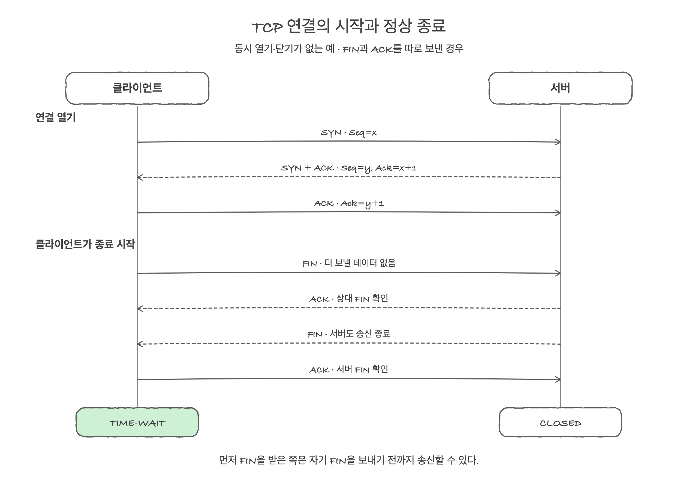
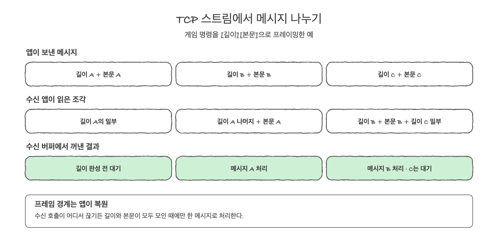

# TCP·UDP의 차이와 TCP 연결 수명주기

## 1. TCP 바이트 스트림과 UDP 데이터그램

TCP는 연결 양쪽에 순서가 있는 신뢰성 있는 바이트 스트림을 제공한다. 시퀀스 번호, ACK, 재전송 등을 사용하고, 헤더의 윈도 값은 수신 측 흐름 제어에 쓰인다. UDP는 메시지 경계를 유지하는 데이터그램을 보내며 전달·순서·중복 제거를 보장하지 않는다. UDP를 선택한 애플리케이션은 필요한 복구와 혼잡 제어를 자체 프로토콜에서 다룬다. 두 프로토콜 모두 출발지·목적지 포트를 사용한다. [RFC 9293 §2.2 · TCP 연결과 전송 특성](https://www.rfc-editor.org/rfc/rfc9293.html#section-2.2) · [RFC 768 · UDP 데이터그램과 헤더](https://www.rfc-editor.org/rfc/rfc768.html) · [RFC 8085 §3 · UDP 애플리케이션 설계 지침](https://www.rfc-editor.org/rfc/rfc8085.html#section-3)

TCP 헤더에는 포트, 시퀀스 번호, ACK 번호, 헤더 길이, 플래그, 윈도, 체크섬 등의 필드가 있다. 옵션이 없으면 20바이트다. UDP 헤더는 출발지 포트, 목적지 포트, 길이와 체크섬으로 구성되며 8바이트다. 애플리케이션이 보낸 메시지를 TCP 수신 측에서 구분하려면 길이 필드나 구분자처럼 명시적인 프레이밍이 필요하다. [RFC 9293 §3.1 · TCP 헤더 형식](https://www.rfc-editor.org/rfc/rfc9293.html#section-3.1) · [RFC 768 · UDP 데이터그램과 헤더](https://www.rfc-editor.org/rfc/rfc768.html) · [Linux recv(2) · 소켓 수신](https://man7.org/linux/man-pages/man2/recv.2.html#DESCRIPTION)

## 2. SYN, SYN-ACK, ACK로 연결 열기

일반적인 능동 열기에서 클라이언트는 초기 시퀀스 번호 `x`를 담은 SYN을 보낸다. 서버는 자기 번호 `y`와 확인 번호 `x+1`을 담은 SYN-ACK를 돌려준다. 클라이언트는 `y+1`을 확인하는 ACK를 보낸다. SYN은 시퀀스 공간을 하나 사용한다. 클라이언트는 `SYN-SENT`, 서버는 `SYN-RECEIVED`를 거쳐 정상 흐름에서 `ESTABLISHED`에 도달한다. [RFC 9293 §3.5 · TCP 연결 수립](https://www.rfc-editor.org/rfc/rfc9293.html#section-3.5) · [RFC 9293 §3.3.2 · TCP 연결 상태](https://www.rfc-editor.org/rfc/rfc9293.html#section-3.3.2)

한 연결에서 각 방향의 송신을 독립적으로 닫는 경우다. [RFC 9293 §3.5 · TCP 연결 수립](https://www.rfc-editor.org/rfc/rfc9293.html#section-3.5) · [RFC 9293 §3.6 · TCP 연결 종료](https://www.rfc-editor.org/rfc/rfc9293.html#section-3.6) · [RFC 9293 §3.3.2 · TCP 연결 상태](https://www.rfc-editor.org/rfc/rfc9293.html#section-3.3.2)

## 3. 연결 종료, 반쪽 닫힘과 TIME-WAIT

FIN은 자신이 더 보낼 데이터가 없음을 알린다. 상대는 FIN을 ACK로 확인하고 자기 방향의 송신을 계속할 수 있다. 상대 방향도 FIN으로 닫히면 마지막 ACK를 보낸다. 일반적인 능동 종료의 경로는 `FIN-WAIT-1 → FIN-WAIT-2 → TIME-WAIT`이며, 먼저 FIN을 받은 쪽은 보통 `CLOSE-WAIT → LAST-ACK → CLOSED`를 지난다. FIN과 ACK는 한 세그먼트에 함께 실릴 수 있고 동시 종료의 상태 경로는 달라진다. [RFC 9293 §3.6 · TCP 연결 종료](https://www.rfc-editor.org/rfc/rfc9293.html#section-3.6) · [RFC 9293 §3.3.2 · TCP 연결 상태](https://www.rfc-editor.org/rfc/rfc9293.html#section-3.3.2)

`TIME-WAIT`에서는 상대가 재전송한 FIN을 다시 확인할 수 있고, 이전 연결의 지연된 세그먼트가 같은 주소·포트 조합의 새 연결에 섞일 가능성을 줄인다. 애플리케이션이 받은 EOF는 보통 상대가 정상적으로 송신 방향을 닫았음을 뜻한다. RST는 연결을 중단하는 경로다. [RFC 9293 §3.6 · TCP 연결 종료](https://www.rfc-editor.org/rfc/rfc9293.html#section-3.6) · [RFC 9293 §3.3.2 · TCP 연결 상태](https://www.rfc-editor.org/rfc/rfc9293.html#section-3.3.2) · [Linux recv(2) · 소켓 수신](https://man7.org/linux/man-pages/man2/recv.2.html#DESCRIPTION)

## 4. 연결 상태와 애플리케이션 처리 결과

TCP 연결 상태는 양 끝의 프로토콜 상태다. 중간 경로가 끊기거나 상대 호스트가 전원 장애로 정지해도 다른 쪽의 소켓은 곧바로 그 사실을 알지 못할 수 있다. 데이터 전송에서의 재전송, 설정한 TCP keepalive, 또는 앱이 정한 heartbeat와 응답 기한은 서로 다른 관찰 수단이다. TCP ACK는 상대 TCP가 확인한 바이트를 나타내며 게임 서버의 처리 완료나 DB 커밋은 업무 응답으로 판단한다. [RFC 9293 §2.2 · TCP 연결과 전송 특성](https://www.rfc-editor.org/rfc/rfc9293.html#section-2.2) · [RFC 9293 §3.8.4 · TCP keepalive](https://www.rfc-editor.org/rfc/rfc9293.html#section-3.8.4) · [Linux send(2) · 소켓 송신](https://man7.org/linux/man-pages/man2/send.2.html#DESCRIPTION)

## 5. 게임 서버에서 보이는 메시지 경계와 재접속 문제

매치 참가나 보상 지급처럼 순서와 처리 결과가 중요한 명령은 TCP 기반이라도 애플리케이션에서 요청 경계와 처리 응답을 설계해야 한다. 예를 들어 `[길이][메시지]` 프레임이라면 한 번 읽었을 때 길이 필드나 메시지가 일부만 들어오거나 여러 프레임이 붙어 들어올 수 있으므로 필요한 길이가 모인 뒤에 완성된 메시지를 꺼낸다. 연결이 끊겨 서버의 처리 여부를 모르면, 서버에서 안정적인 요청 ID로 동일한 명령을 식별하도록 설계할 수 있다. 이 재접속 예는 HTTP의 재시도 원칙을 게임 명령에 적용한 설계 예다. [RFC 9293 §2.2 · TCP 연결과 전송 특성](https://www.rfc-editor.org/rfc/rfc9293.html#section-2.2) · [Linux recv(2) · 소켓 수신](https://man7.org/linux/man-pages/man2/recv.2.html#DESCRIPTION) · [RFC 9110 §9.2.2 · 멱등성과 재시도](https://www.rfc-editor.org/rfc/rfc9110.html#section-9.2.2)

위치처럼 새 상태가 이전 상태를 대체할 수 있는 갱신은 UDP를 쓰는 설계도 가능하다. 이때 데이터그램에 순서를 판단할 값을 싣고 오래된 갱신을 처리하는 정책을 앱에서 정해야 한다. 반대로 TCP에서 앞선 세그먼트의 손실을 복구하는 동안 이후 바이트의 앱 전달이 지연될 수 있다. 프로토콜의 선택은 명령의 손실 허용 범위와 필요한 순서 보장에 따라 정한다. [RFC 9293 §2.2 · TCP 연결과 전송 특성](https://www.rfc-editor.org/rfc/rfc9293.html#section-2.2) · [RFC 768 · UDP 데이터그램과 헤더](https://www.rfc-editor.org/rfc/rfc768.html) · [RFC 8085 §3 · UDP 애플리케이션 설계 지침](https://www.rfc-editor.org/rfc/rfc8085.html#section-3)

한 번 읽은 바이트가 한 메시지보다 적거나 많을 수 있는 예다. [RFC 9293 §2.2 · TCP 연결과 전송 특성](https://www.rfc-editor.org/rfc/rfc9293.html#section-2.2) · [Linux recv(2) · 소켓 수신](https://man7.org/linux/man-pages/man2/recv.2.html#DESCRIPTION)
