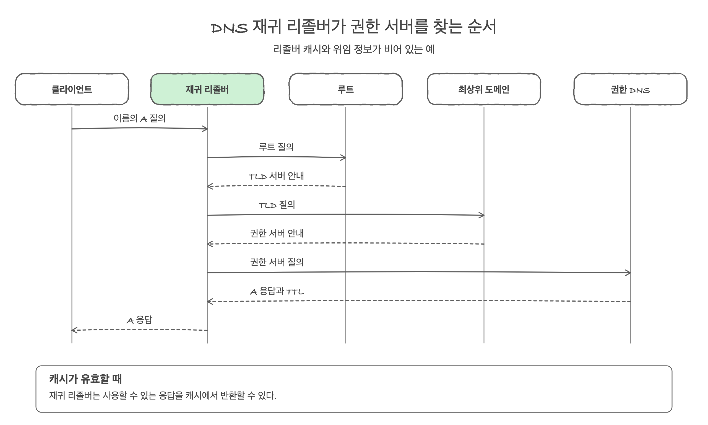
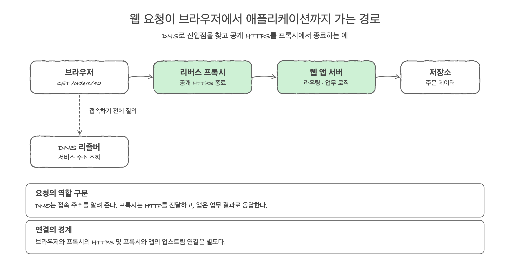

# DNS, HTTP와 웹 서비스의 구조

## 1. 브라우저가 도메인 이름을 주소로 찾는 흐름

앱은 이름 해석을 요청하고, 로컬의 스텁 리졸버는 보통 재귀 리졸버에 질의한다. 재귀 리졸버는 유효한 캐시를 먼저 본다. 캐시와 필요한 위임 정보를 모두 비워 둔 예라면 루트 서버에서 최상위 도메인 서버를, 최상위 도메인 서버에서 해당 도메인의 권한 서버를 안내받아 최종 레코드를 얻는다. A는 IPv4 주소, AAAA는 IPv6 주소를 나타낸다. TTL은 레코드 데이터를 캐시에 보관할 수 있는 시간에 관여한다. DNS는 UDP와 TCP를 모두 사용할 수 있다. [RFC 1034 §5.3.3 · DNS 리졸버의 해석 과정](https://www.rfc-editor.org/rfc/rfc1034.html#section-5.3.3) · [RFC 9499 §6 · DNS 서버와 리졸버](https://www.rfc-editor.org/rfc/rfc9499.html#section-6) · [RFC 9499 §5 · DNS 레코드와 TTL](https://www.rfc-editor.org/rfc/rfc9499.html#section-5) · [RFC 1035 §3.4.1 · A 레코드](https://www.rfc-editor.org/rfc/rfc1035.html#section-3.4.1) · [RFC 3596 §2 · AAAA 레코드](https://www.rfc-editor.org/rfc/rfc3596.html#section-2) · [RFC 9210 §3 · DNS의 UDP·TCP 전송](https://www.rfc-editor.org/rfc/rfc9210.html#section-3)

같은 서비스 이름이어도 설정한 정책과 리졸버 캐시 상태에 따라 새 연결이 쓰는 주소가 달라질 수 있다. 연결 장애를 볼 때는 실제 사용자가 질의한 리졸버의 답과 그 주소에 대한 새 연결 성공 여부를 각각 확인한다. [DNS 기반 GSLB](03_understanding_l4_load_balancing_and_gslb.md)에서 지역 전환의 예를 볼 수 있다. [RFC 9499 §5 · DNS 레코드와 TTL](https://www.rfc-editor.org/rfc/rfc9499.html#section-5) · [RFC 9293 §2.2 · TCP 연결과 전송 특성](https://www.rfc-editor.org/rfc/rfc9293.html#section-2.2)

콜드 캐시를 가정해 위임과 최종 응답이 오가는 순서를 표시했다. [RFC 1034 §5.3.3 · DNS 리졸버의 해석 과정](https://www.rfc-editor.org/rfc/rfc1034.html#section-5.3.3) · [RFC 9499 §6 · DNS 서버와 리졸버](https://www.rfc-editor.org/rfc/rfc9499.html#section-6) · [RFC 9499 §5 · DNS 레코드와 TTL](https://www.rfc-editor.org/rfc/rfc9499.html#section-5)

## 2. 웹의 시작과 한국 인터넷

팀 버너스리가 1989년 CERN에서 인터넷 기반 하이퍼텍스트 시스템을 제안했고, 1990년에 로베르 카이오와 함께 제안을 구체화했다. 그해 CERN에서 초기 웹 서버와 브라우저가 구현되었다. 웹은 인터넷 위에서 연결된 문서를 탐색하는 방식으로 시작했다. 한국에서는 1982년 서울대와 한국전자기술연구소 사이에 TCP/IP 기반 SDN이 구축됐고, 1994년에 상용 인터넷 서비스가 시작됐다. 이는 각각 웹과 인터넷 인프라의 역사다. [CERN · World Wide Web at 35](https://home.cern/world-wide-web-35/) · [한국인터넷백서 2013 · 한국 인터넷 역사](https://www.nia.or.kr/ebook/report/data/LS3S7MV7IQXZ/2013_kor.pdf)

## 3. URI와 URL을 읽는 방법

URI(Uniform Resource Identifier)는 리소스를 식별하는 구문이다. RFC 3986에서 URL은 리소스의 위치 또는 접근 방법도 알려 주는 URI의 범주다. 예를 들어 `https://api.example.com:8443/orders/42?detail=full#summary`에서 `https`는 스킴, `api.example.com:8443`은 권한부, `/orders/42`는 경로, `detail=full`은 쿼리, `summary`는 프래그먼트다. 브라우저는 프래그먼트를 클라이언트 측에서 해석하며 일반 HTTP 요청 대상으로 서버에 보내지 않는다. [RFC 3986 §1.1.3 · URI와 URL](https://www.rfc-editor.org/rfc/rfc3986.html#section-1.1.3) · [RFC 3986 §3 · URI 구성요소](https://www.rfc-editor.org/rfc/rfc3986.html#section-3) · [RFC 9110 §7.1 · HTTP 요청 대상](https://www.rfc-editor.org/rfc/rfc9110.html#section-7.1)

## 4. HTTP 요청·응답과 전송 방식

HTTP 메서드는 요청의 의미를 나타낸다. 예를 들어 `GET /orders/42`는 리소스 표현의 전송을 요청한다. 응답의 상태 코드는 처리 결과의 의미를, 헤더는 표현이나 캐시 등에 대한 메타데이터를 전달한다. HTTP 메시지는 내용이 있는 경우 그 데이터를 함께 전달한다. 프로토콜의 요청 의미가 유지되는 가운데 버전에 따라 전송 형식은 달라진다. [RFC 9110 §3.4 · HTTP 메시지](https://www.rfc-editor.org/rfc/rfc9110.html#section-3.4) · [RFC 9110 §6 · HTTP 메시지의 구성](https://www.rfc-editor.org/rfc/rfc9110.html#section-6) · [RFC 9110 §9.3.1 · GET 요청](https://www.rfc-editor.org/rfc/rfc9110.html#section-9.3.1)

HTTP/1.1은 시작 줄과 헤더 필드 등을 사용하며, HTTP/2는 여러 스트림의 프레임을 한 TCP 연결에 실을 수 있다. HTTP/3은 QUIC 위에서 HTTP를 사용한다. 일반적인 브라우저의 HTTPS 연결에서 HTTP/1.1과 HTTP/2는 TCP 위의 TLS를 사용하며, HTTP/3의 기반인 QUIC은 UDP 데이터그램을 사용하고 TLS를 통합한다. [RFC 9112 §2 · HTTP/1.1 메시지 형식](https://www.rfc-editor.org/rfc/rfc9112.html#section-2) · [RFC 9113 §2 · HTTP/2 개요](https://www.rfc-editor.org/rfc/rfc9113.html#section-2) · [RFC 9114 §2 · HTTP/3 개요](https://www.rfc-editor.org/rfc/rfc9114.html#section-2) · [RFC 9000 §1 · QUIC 전송 개요](https://www.rfc-editor.org/rfc/rfc9000.html#section-1) · [RFC 9846 §1 · TLS 1.3과 상위 프로토콜](https://www.rfc-editor.org/rfc/rfc9846.html#section-1)

## 5. 웹 서비스에서 요청이 지나가는 곳

웹 서비스의 한 구성에서는 브라우저가 DNS로 공개 진입점 주소를 찾은 뒤 HTTPS로 리버스 프록시에 접속한다. 프록시는 자신이 종료한 TLS 연결에서 HTTP 요청을 해석하고, 경로에 맞는 애플리케이션 서버로 별도 연결을 통해 보낸다. 앱은 주문 조회에 필요한 데이터를 저장소에서 읽고 HTTP 응답을 만들어 같은 논리 경로로 반환한다. TLS를 종료하는 위치와 백엔드 연결의 암호화 여부는 시스템 구성에서 결정한다. [RFC 1034 §5.3.3 · DNS 리졸버의 해석 과정](https://www.rfc-editor.org/rfc/rfc1034.html#section-5.3.3) · [RFC 9110 §3.7 · HTTP 중개자와 게이트웨이](https://www.rfc-editor.org/rfc/rfc9110.html#section-3.7) · [NGINX · proxy_pass를 통한 업스트림 전송](https://nginx.org/en/docs/http/ngx_http_proxy_module.html#proxy_pass) · [Apache Tomcat 11 · Architecture Overview](https://tomcat.apache.org/tomcat-11.0-doc/architecture/overview.html)

DNS 조회와 HTTP 요청 흐름을 분리해 웹 서비스 구성 요소의 역할을 표시했다. [RFC 1034 §5.3.3 · DNS 리졸버의 해석 과정](https://www.rfc-editor.org/rfc/rfc1034.html#section-5.3.3) · [RFC 9110 §3.7 · HTTP 중개자와 게이트웨이](https://www.rfc-editor.org/rfc/rfc9110.html#section-3.7) · [NGINX · proxy_pass를 통한 업스트림 전송](https://nginx.org/en/docs/http/ngx_http_proxy_module.html#proxy_pass) · [Apache Tomcat 11 · Architecture Overview](https://tomcat.apache.org/tomcat-11.0-doc/architecture/overview.html)

## 6. WAS, REST와 JVM의 역할

WAS(웹 애플리케이션 서버)는 예를 들어 동적 HTTP 요청을 받아 애플리케이션 로직의 실행을 담당한다. Java 구성의 한 예인 Apache Tomcat 11.0은 Java 17 이상에서 동작하며 Jakarta Servlet 6.1을 구현한다. HTTP 커넥터가 요청을 받아 컨테이너에 전달하고, 컨테이너는 요청을 처리할 웹 애플리케이션과 서블릿을 찾아 실행한다. JVM은 그 서버와 애플리케이션의 Java 코드가 실행되는 환경이다. [Apache Tomcat 11.0 · 지원 Java 및 Servlet 버전](https://tomcat.apache.org/migration-11.0.html) · [Apache Tomcat 11 · Architecture Overview](https://tomcat.apache.org/tomcat-11.0-doc/architecture/overview.html) · [JVMS Java SE 25 §2 · JVM 구조](https://docs.oracle.com/javase/specs/jvms/se25/html/jvms-2.html)

REST는 분산 하이퍼미디어 시스템에 적용하는 아키텍처 스타일이다. 균일한 인터페이스, 무상태, 캐시 가능성 등의 제약이 있다. 예를 들어 `GET /orders/42`로 주문 리소스의 표현을 조회하고 `200 OK` 또는 `404 Not Found`를 반환할 수 있다. 무상태 통신에서는 요청을 이해하는 데 필요한 맥락을 요청에 포함한다. 주문 같은 리소스의 상태는 서버의 저장소에 보관할 수 있다. [Fielding §5.1 · REST 제약](https://ics.uci.edu/~fielding/pubs/dissertation/rest_arch_style.htm#sec_5_1) · [RFC 9110 §9.3.1 · GET 요청](https://www.rfc-editor.org/rfc/rfc9110.html#section-9.3.1) · [RFC 9110 §15 · HTTP 응답 상태 코드](https://www.rfc-editor.org/rfc/rfc9110.html#section-15)
