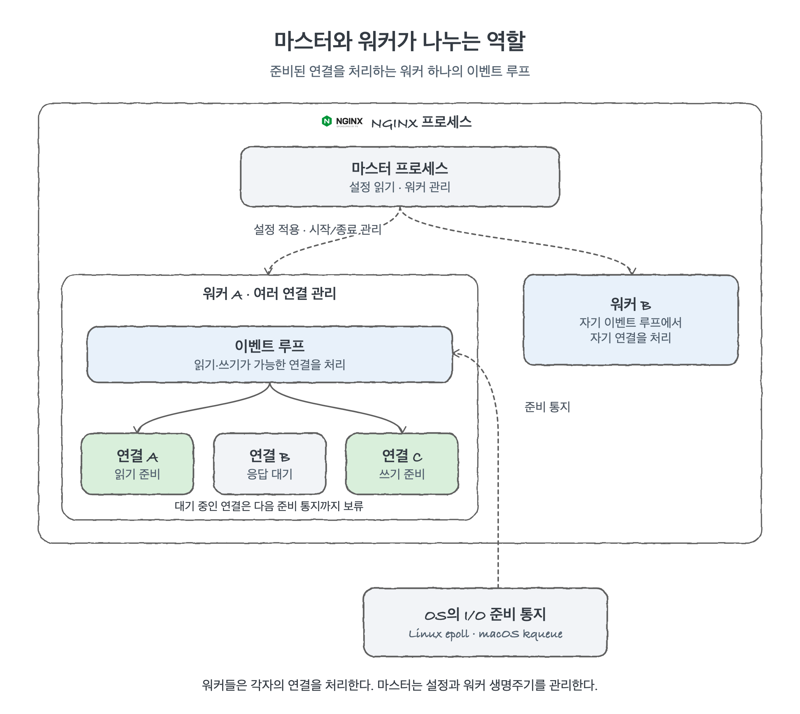
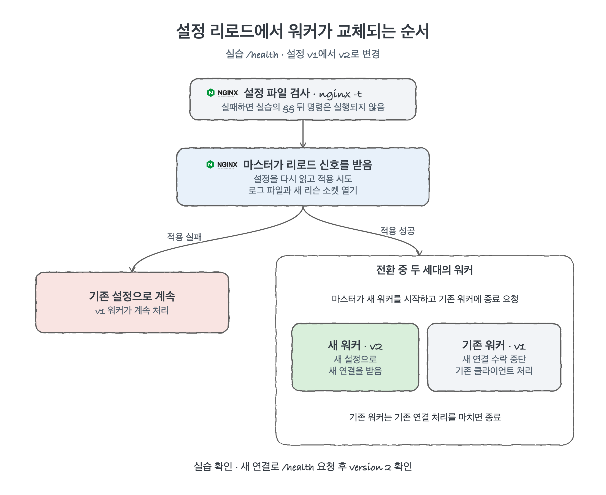

# NGINX Architecture, Setup, and Graceful Reloads

NGINX의 이벤트 기반 요청 처리를 Apache HTTP Server의 MPM과 비교한다. 이어서 로컬에서 NGINX를 띄우고, 설정을 검사한 뒤 프로세스를 재시작하지 않고 응답을 바꿔 본다.

## 1. Apache와 NGINX의 연결 처리 방식

Apache는 MPM(Multi-Processing Module)에 따라 프로세스와 스레드를 다르게 사용한다. 레거시 환경에서 흔히 비교하는 `prefork`의 동작과 Apache 2.4의 `event` MPM을 구분하면 NGINX가 어떤 비용을 줄이는지 이해하기 쉽다.

| 처리 모델 | 동시 연결을 다루는 방식 |
| --- | --- |
| Apache `prefork` | 자식 프로세스가 한 번에 연결 하나를 맡는다. 동시 처리량을 늘리기 위해 프로세스를 늘리면 메모리 사용량도 커질 수 있다. |
| Apache `worker` | 여러 자식 프로세스 안에 여러 스레드를 만들고, 스레드가 연결을 처리한다. |
| Apache `event` | `worker`와 같은 스레드 모델을 바탕으로, 유휴 keep-alive 연결의 대기를 리스너 스레드로 넘겨 작업 스레드가 다른 요청을 처리할 수 있게 한다. |
| NGINX | 각 워커 프로세스의 이벤트 루프가 여러 연결을 관리한다. 연결이 읽거나 쓸 준비가 되면 해당 작업을 진행하고, 대기하는 동안 다른 연결을 처리한다. |

NGINX의 마스터 프로세스는 설정을 읽고 워커를 관리한다. 실제 HTTP 요청은 워커가 처리한다. 워커는 Linux의 `epoll`, macOS의 `kqueue` 같은 이벤트 통지 방식을 사용할 수 있다. 느린 클라이언트나 업스트림 응답을 기다리는 연결이 많을 때에도 워커가 다른 연결을 처리할 수 있는 이유다.

`worker_processes auto`는 워커 수를 사용 가능한 CPU 코어 수에 맞춰 구성할 때 쓴다. `worker_connections`에는 클라이언트와의 연결과 업스트림 서버와의 연결이 모두 포함된다. 실제 동시 연결 수에는 열린 파일 디스크립터 한도도 영향을 주므로, 이 값을 그대로 동시 사용자 수로 해석하기 어렵다.

**공식 문서** [Apache prefork](https://httpd.apache.org/docs/2.4/mod/prefork.html) · [Apache worker](https://httpd.apache.org/docs/2.4/mod/worker.html) · [Apache event](https://httpd.apache.org/docs/2.4/mod/event.html) · [NGINX 시작 가이드](https://nginx.org/en/docs/beginners_guide.html) · [NGINX 연결 처리 방식](https://nginx.org/en/docs/events.html) · [NGINX 코어 지시어](https://nginx.org/en/docs/ngx_core_module.html#worker_connections)



그림의 근거 · [마스터와 워커의 역할](https://nginx.org/en/docs/beginners_guide.html) · [연결 처리 방식](https://nginx.org/en/docs/events.html)

## 2. 설치와 로컬 실습 환경 구성

Ubuntu 배포판 패키지는 `sudo apt update` 후 `sudo apt install nginx`로 설치한다. macOS에서는 `brew install nginx`를 사용할 수 있다. `nginx -v`로 설치 여부를 확인한다. 기본 설정 경로는 패키지와 빌드에 따라 달라지며, `nginx -V`의 빌드 옵션에서 `--conf-path`를 확인할 수 있다.

실습에서는 임시 디렉터리의 설정과 PID 파일을 사용한다. `127.0.0.1:18080`에만 바인딩하므로 기본 서비스와 별개로 실행할 수 있다. 포트가 이미 사용 중이면 설정과 아래 요청 URL의 포트를 함께 바꾼다.

```sh
lab_dir="$(mktemp -d)"
cd "$lab_dir" || exit 1

cat > nginx.conf <<'CONF'
worker_processes 1;
pid nginx.pid;
error_log error.log notice;

events {
    worker_connections 128;
}

http {
    access_log off;

    server {
        listen 127.0.0.1:18080;

        location = /health {
            default_type text/plain;
            return 200 "version 1\n";
        }
    }
}
CONF

nginx -p "$lab_dir/" -c nginx.conf -t &&
    nginx -p "$lab_dir/" -c nginx.conf &&
    curl -fsS http://127.0.0.1:18080/health
```

`-p`로 실습용 경로를 지정하고 `-c`로 읽을 설정 파일을 선택한다. `events`에는 연결 처리에 관한 설정을, `http`에는 HTTP 서버 설정을 둔다. 마지막 명령에서 `version 1`이 출력되면 응답을 확인한 것이다.

**공식 문서** [Ubuntu NGINX 설치](https://documentation.ubuntu.com/server/how-to/web-services/install-nginx/) · [Homebrew NGINX 패키지](https://formulae.brew.sh/formula/nginx) · [NGINX 명령줄 옵션](https://nginx.org/en/docs/switches.html)

### 설정을 검사하고 무중단으로 반영하기

같은 터미널에서 `nginx.conf`의 `version 1`을 `version 2`로 고친 뒤 아래 명령을 실행한다.

```sh
nginx -p "$lab_dir/" -c nginx.conf -t &&
    nginx -p "$lab_dir/" -c nginx.conf -s reload
```

1. `-t`는 문법을 검사하고 설정이 참조하는 파일을 열 수 있는지 확인한다. 검사에 실패하면 `&&` 뒤의 명령은 실행되지 않는다.
2. 리로드 요청을 받은 마스터는 새 설정을 적용하고 새 워커를 시작한다. 적용에 실패하면 기존 설정으로 서비스를 계속한다.
3. 기존 워커는 새 연결을 받는 일을 멈추고 처리 중인 요청을 마친 뒤 종료한다.



그림의 근거 · [설정 리로드](https://nginx.org/en/docs/control.html#reconfiguration) · [설정 검사 옵션](https://nginx.org/en/docs/switches.html)

리로드 신호를 보낸 직후에는 새 워커가 준비되는 중일 수 있다. 같은 URL에 새로 접속해 `version 2`가 응답되는지 확인한다. 반영되지 않으면 실습 디렉터리의 `error.log`를 확인한다.

```sh
curl -fsS http://127.0.0.1:18080/health
nginx -p "$lab_dir/" -c nginx.conf -s quit
```

Ubuntu에서 systemd로 관리하는 NGINX에는 `sudo nginx -t && sudo systemctl reload nginx`를 사용할 수 있다. 설정 리로드는 NGINX 워커를 교체한다. 프록시 뒤의 애플리케이션도 함께 배포한다면 새 인스턴스가 요청을 받을 준비를 마쳤는지, 기존 인스턴스의 처리 중인 요청이 끝났는지 확인하는 절차가 별도로 필요하다.

**공식 문서** [NGINX 설정 리로드와 종료 신호](https://nginx.org/en/docs/control.html#reconfiguration) · [NGINX 명령줄 옵션](https://nginx.org/en/docs/switches.html) · [Ubuntu NGINX 설정 반영](https://documentation.ubuntu.com/server/how-to/web-services/configure-nginx/)
