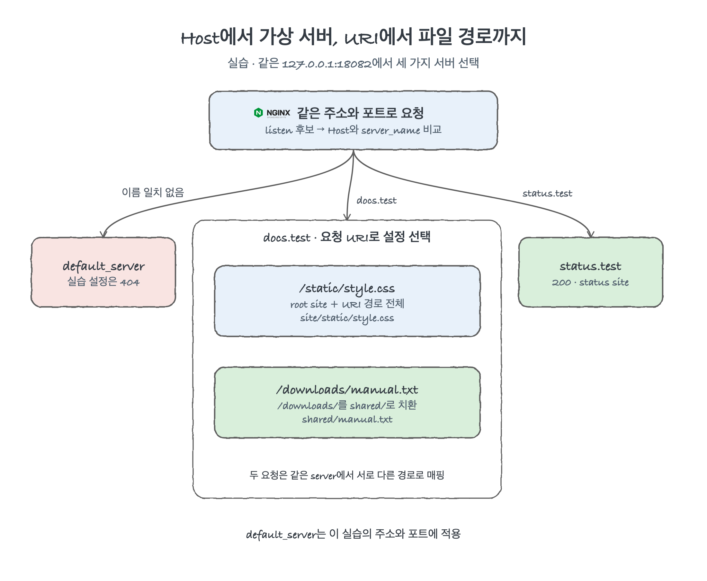
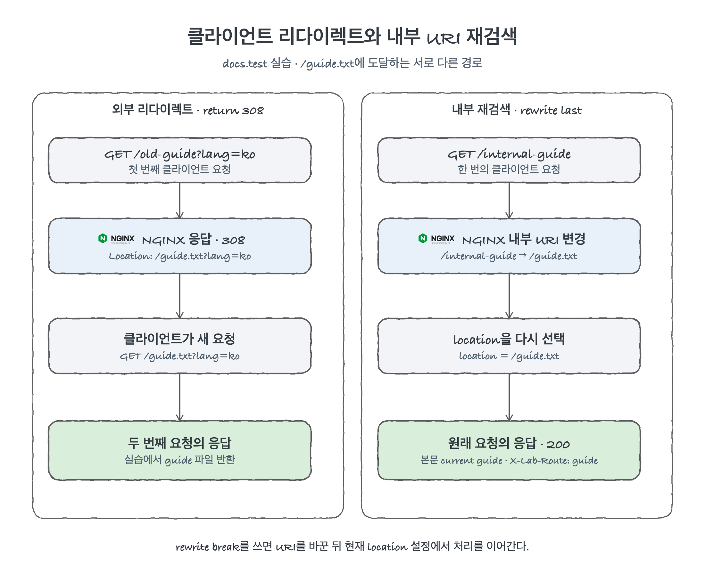

# NGINX Static Files, Virtual Hosts, and URL Rewriting

NGINX가 요청을 처리할 때 어느 `server`를 고르는지, 선택한 URI를 파일 경로로 어떻게 바꾸는지, 클라이언트를 다른 URL로 보낼지 내부에서 경로만 바꿀지를 정리한다.

## 1. 정적 파일 경로 매핑 · root와 alias

`location`은 요청 URI에 맞는 설정을 고른다. 설정이 선택되면 `root`나 `alias`를 기준으로 실제 파일 경로를 계산한다.

| 설정 | 요청 URI | 파일 경로 | 동작 |
| --- | --- | --- | --- |
| `root site;` | `/static/style.css` | `site/static/style.css` | 기준 디렉터리 뒤에 URI 경로 전체를 붙인다. |
| `location /downloads/ { alias shared/; }` | `/downloads/manual.txt` | `shared/manual.txt` | 매칭된 `/downloads/`를 `shared/`로 치환한다. |

URL 구조가 디렉터리 구조와 같으면 `root`가 간단하다. URL 접두어와 실제 디렉터리 이름이 다르면 `alias`로 매핑할 수 있다. 디렉터리 접두어를 매핑할 때는 예제처럼 `location /downloads/`와 `alias shared/` 양쪽을 `/`로 끝낸다. 여기서 상대 파일 경로는 실습에서 `nginx -p`로 지정한 디렉터리를 기준으로 한다.

**공식 문서** [root](https://nginx.org/en/docs/http/ngx_http_core_module.html#root) · [alias](https://nginx.org/en/docs/http/ngx_http_core_module.html#alias) · [location 매칭](https://nginx.org/en/docs/http/ngx_http_core_module.html#location)

## 2. 여러 도메인을 호스팅하는 가상 서버

같은 IP와 포트를 여러 `server` 블록이 공유할 수 있다. 일반 HTTP 요청에서 NGINX는 먼저 요청이 들어온 주소와 포트에 맞는 `listen`을 고르고, 후보 블록의 `server_name`을 요청의 `Host`와 비교한다.

- `server_name docs.test;`와 `server_name status.test;`는 같은 포트에서 서로 다른 사이트를 선택한다.
- 일치하는 이름이 없으면 해당 주소와 포트의 `default_server`가 요청을 맡는다. 명시하지 않으면 그 주소와 포트에 대해 처음 선언된 `server`가 기본 서버가 된다.
- 실습의 `server_name _;`는 예시 이름이다. 미등록 호스트를 받는 동작은 `listen`의 `default_server`가 결정한다.

**공식 문서** [NGINX의 요청 처리 순서](https://nginx.org/en/docs/http/request_processing.html) · [server_name 규칙](https://nginx.org/en/docs/http/server_names.html) · [listen과 default_server](https://nginx.org/en/docs/http/ngx_http_core_module.html#listen)



그림의 근거 · [가상 서버 선택](https://nginx.org/en/docs/http/request_processing.html) · [root 경로 매핑](https://nginx.org/en/docs/http/ngx_http_core_module.html#root) · [alias 경로 매핑](https://nginx.org/en/docs/http/ngx_http_core_module.html#alias)

## 3. 클라이언트 리다이렉트와 내부 rewrite

| 목적 | 지시어 | 동작 |
| --- | --- | --- |
| 이전 URL을 새 URL로 안내 | `return 308 /guide.txt$is_args$args;` | `Location` 헤더와 308을 응답한다. 클라이언트가 새 URL로 다시 요청한다. |
| 바뀐 URI에 맞는 location에서 처리 | `rewrite ^ /guide.txt last;` | URI를 내부에서 바꾸고 새 URI에 맞는 `location`을 다시 찾는다. |
| 현재 location에서 URI만 바꿔 처리 | `rewrite ^ /guide.txt break;` | 현재 rewrite 지시어 실행을 멈추고 같은 `location` 설정에서 처리를 이어간다. |

고정 주소로 보낼 때는 `return`이 간결하다. 301과 308은 영구 이동, 302와 307은 임시 이동을 나타낸다. 307과 308은 클라이언트가 리다이렉트를 따를 때 요청 메서드를 유지해야 한다. 예제에서 `$is_args$args`는 쿼리 문자열이 있을 때 `?`와 인수를 새 URL에 붙인다.

정규식으로 URI를 바꾸는 `rewrite`는 `last`로 새 `location`을 찾게 하거나 `break`로 현재 블록에서 처리를 이어갈 수 있다. `last`로 돌아간 위치에서 같은 규칙이 반복 적용되면, NGINX는 URI 재검색을 최대 10회 시도한 뒤 500을 반환할 수 있다.

**공식 문서** [NGINX rewrite 모듈](https://nginx.org/en/docs/http/ngx_http_rewrite_module.html) · [$args와 $is_args](https://nginx.org/en/docs/http/ngx_http_core_module.html#variables) · [RFC 9110 리다이렉션 상태 코드](https://www.rfc-editor.org/rfc/rfc9110.html#name-redirection-3xx)



그림의 근거 · [rewrite 동작](https://nginx.org/en/docs/http/ngx_http_rewrite_module.html) · [HTTP 308](https://www.rfc-editor.org/rfc/rfc9110.html#name-308-permanent-redirect) · [상대 Location](https://nginx.org/en/docs/http/ngx_http_core_module.html#absolute_redirect)

## 4. 실습 · 같은 포트에서 두 사이트와 URL 두 가지 처리하기

NGINX가 설치된 환경에서 실행한다. 임시 디렉터리를 사용하며 `127.0.0.1:18082`에만 바인딩한다. 포트가 사용 중이면 아래 설정과 요청의 포트를 함께 바꾼다.

```sh
lab_dir="$(mktemp -d)"
cd "$lab_dir" || exit 1
mkdir -p site/static shared

printf 'body { color: #333; }\n' > site/static/style.css
printf 'downloadable manual\n' > shared/manual.txt
printf 'current guide\n' > site/guide.txt

cat > nginx.conf <<'CONF'
worker_processes 1;
pid nginx.pid;
error_log error.log warn;

events {
    worker_connections 128;
}

http {
    default_type text/plain;
    types {
        text/css css;
    }
    access_log off;

    server {
        listen 127.0.0.1:18082 default_server;
        server_name _;
        return 404;
    }

    server {
        listen 127.0.0.1:18082;
        server_name docs.test;
        root site;

        # 실습에서 Location 헤더에 상대 URL을 보낸다.
        absolute_redirect off;

        location /downloads/ {
            alias shared/;
        }

        location = /old-guide {
            return 308 /guide.txt$is_args$args;
        }

        location = /internal-guide {
            rewrite ^ /guide.txt last;
        }

        location = /guide.txt {
            add_header X-Lab-Route guide;
        }
    }

    server {
        listen 127.0.0.1:18082;
        server_name status.test;
        return 200 "status site\n";
    }
}
CONF

nginx -p "$lab_dir/" -c nginx.conf -t &&
    nginx -p "$lab_dir/" -c nginx.conf
```

로컬 주소로 요청하고 `Host` 헤더를 바꿔 사이트를 선택한다. DNS나 hosts 파일을 수정할 필요가 없다.

```sh
base="http://127.0.0.1:18082"

curl -fsS -H 'Host: docs.test' "$base/static/style.css"
curl -fsS -H 'Host: docs.test' "$base/downloads/manual.txt"
curl -fsS -H 'Host: status.test' "$base/"
curl -sS -o /dev/null -w '%{http_code}\n' -H 'Host: unknown.test' "$base/"

curl -sS -D - -o /dev/null -H 'Host: docs.test' "$base/old-guide?lang=ko"
curl -fsS -i -H 'Host: docs.test' "$base/internal-guide"

nginx -p "$lab_dir/" -c nginx.conf -s quit
```

정적 파일 두 개가 각각 `root`와 `alias` 경로에서 제공되고, `status.test`에는 별도 응답이 나온다. 등록하지 않은 호스트는 404를 받는다. `/old-guide`는 308과 `Location: /guide.txt?lang=ko`를 반환한다. `/internal-guide`는 200과 `current guide` 본문을 반환한다. 이때 `X-Lab-Route: guide` 헤더는 NGINX가 변경된 URI로 `location = /guide.txt`를 다시 선택했음을 보여준다.

**공식 문서** [absolute_redirect](https://nginx.org/en/docs/http/ngx_http_core_module.html#absolute_redirect) · [NGINX 명령줄 옵션](https://nginx.org/en/docs/switches.html)
