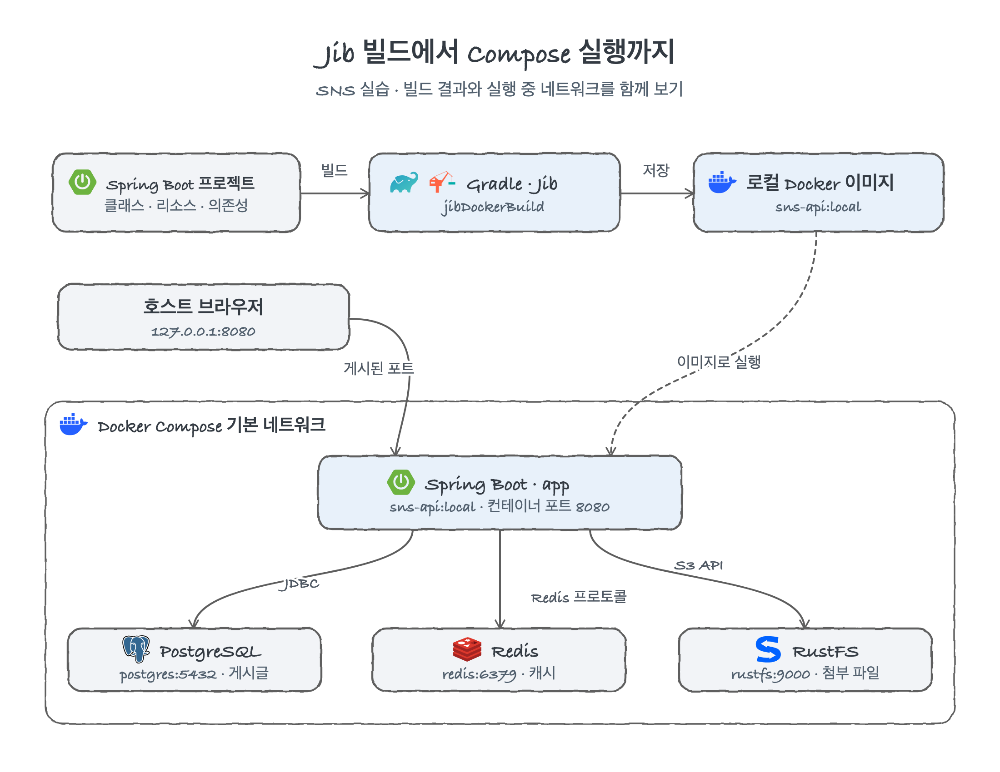

# Containerizing Spring Boot with Jib and Docker Compose

## 1. SNS 앱의 이미지와 실행 환경을 나눈다

이 실습의 SNS는 게시글과 첨부 파일을 다루는 Spring Boot 애플리케이션이다. Spring Boot 이미지는 Jib으로 만들고, Compose에서 PostgreSQL·Redis·RustFS와 함께 실행한다. 앱은 게시글 데이터를 PostgreSQL에 저장하고, Redis를 캐시에 사용하며, 첨부 파일은 S3 호환 스토리지인 RustFS에 저장한다고 가정한다. [컨테이너와 이미지](../kubernetes/01_container.md), [Compose 네트워크](https://docs.docker.com/compose/how-tos/networking/)

| 요청을 보내는 곳 | 목적지 | 주소 예시 |
| :--- | :--- | :--- |
| 호스트 브라우저·터미널 | Spring Boot | `http://127.0.0.1:8080` |
| Spring Boot 컨테이너 | PostgreSQL | `jdbc:postgresql://postgres:5432/sns` |
| Spring Boot 컨테이너 | Redis | `redis:6379` |
| Spring Boot 컨테이너 | RustFS S3 API | `http://rustfs:9000` |

Compose는 프로젝트의 기본 네트워크에서 서비스 이름을 DNS로 해석한다. 앱 컨테이너 안의 `localhost`는 앱 컨테이너 자신을 가리킨다. 호스트에서 DB에 접속할 일이 생기면 실습용 포트를 따로 게시하고, 컨테이너 간 연결에는 서비스 이름과 컨테이너 포트를 계속 사용한다. [Compose 네트워크](https://docs.docker.com/compose/how-tos/networking/)



그림의 근거 · [Jib Gradle 3.5.4](https://github.com/GoogleContainerTools/jib/blob/v3.5.4-gradle/jib-gradle-plugin/README.md) · [Docker Compose 네트워크](https://docs.docker.com/compose/how-tos/networking/)

## 2. Jib으로 로컬 Docker 이미지 만들기

Gradle과 Java 21을 사용하는 기존 Spring Boot 프로젝트의 `build.gradle`에 아래 설정을 추가한다. Jib은 Java 클래스·리소스·의존성을 레이어로 나뉜 이미지에 담는다. `jibDockerBuild`는 로컬 Docker 데몬에 저장하고, CI에서 사용할 `jib` 태스크는 레지스트리로 직접 게시한다. [Jib Gradle 문서](https://github.com/GoogleContainerTools/jib/blob/master/jib-gradle-plugin/README.md), [Gradle Plugin Portal](https://plugins.gradle.org/plugin/com.google.cloud.tools.jib)

```groovy
plugins {
    id 'com.google.cloud.tools.jib' version '3.5.4'
}

dependencies {
    implementation 'org.springframework.boot:spring-boot-starter-actuator'
}

jib {
    from {
        image = 'eclipse-temurin:21-jre-jammy'
    }
    to {
        image = 'sns-api:local'
    }
    container {
        ports = ['8080']
    }
}
```

```bash
./gradlew test
./gradlew -Djib.from.platforms=linux/amd64 jibDockerBuild
docker image inspect sns-api:local --format '{{.Os}}/{{.Architecture}}'
```

ARM64 Docker 환경에서는 빌드 명령의 `linux/amd64`를 `linux/arm64`로 바꾼다. `container.ports`는 이미지 메타데이터이고, 호스트에 포트를 여는 작업은 Compose의 `ports`에서 한다. 이 예시의 Temurin Jammy 이미지는 아래 앱 헬스체크에서 사용하는 `curl`을 제공한다. [Jib 플랫폼 설정](https://github.com/GoogleContainerTools/jib/blob/master/docs/faq.md#how-do-i-specify-a-platform-in-the-manifest-list-or-oci-index-of-a-base-image), [Temurin 이미지 Dockerfile](https://github.com/adoptium/containers/blob/main/21/jre/ubuntu/jammy/Dockerfile)

## 3. Compose에서 앱과 의존 서비스 연결하기

앱에 PostgreSQL JDBC 드라이버와 Redis 연동을 추가하고, 앱의 S3 클라이언트에서 `S3_ENDPOINT`, `S3_ACCESS_KEY`, `S3_SECRET_KEY`를 읽도록 설정한다. S3 클라이언트는 실습용 DNS 이름에서 버킷 경로를 쓰도록 path-style로 구성한다. `.env.local`에 실습용 `POSTGRES_PASSWORD`, `S3_ACCESS_KEY`, `S3_SECRET_KEY` 값을 넣고 Git 추적에서 제외한다. [RustFS Docker 설치](https://docs.rustfs.com/en/installation/container/docker), [Compose 환경변수 보간](https://docs.docker.com/compose/how-tos/environment-variables/variable-interpolation/)

아래를 `compose.yaml`로 저장한다. 앱용 포트만 루프백에 게시하고, PostgreSQL과 RustFS는 이름 있는 볼륨에 저장한다. Redis는 재생성 가능한 캐시로 사용한다. [PostgreSQL 공식 이미지](https://hub.docker.com/_/postgres), [Redis 공식 이미지](https://hub.docker.com/_/redis), [RustFS 이미지 태그](https://hub.docker.com/r/rustfs/rustfs/tags)

```yaml
services:
  app:
    image: sns-api:local
    pull_policy: never
    ports:
      - "127.0.0.1:8080:8080"
    environment:
      SPRING_DATASOURCE_URL: jdbc:postgresql://postgres:5432/sns
      SPRING_DATASOURCE_USERNAME: sns
      SPRING_DATASOURCE_PASSWORD: ${POSTGRES_PASSWORD:?set POSTGRES_PASSWORD}
      SPRING_DATA_REDIS_HOST: redis
      S3_ENDPOINT: http://rustfs:9000
      S3_ACCESS_KEY: ${S3_ACCESS_KEY:?set S3_ACCESS_KEY}
      S3_SECRET_KEY: ${S3_SECRET_KEY:?set S3_SECRET_KEY}
      MANAGEMENT_ENDPOINT_HEALTH_PROBES_ENABLED: "true"
    depends_on:
      postgres:
        condition: service_healthy
      redis:
        condition: service_healthy
      rustfs:
        condition: service_healthy
    healthcheck:
      test: ["CMD", "curl", "-fsS", "http://127.0.0.1:8080/actuator/health/readiness"]
      interval: 5s
      timeout: 3s
      retries: 12
      start_period: 20s
  postgres:
    image: postgres:17
    environment:
      POSTGRES_DB: sns
      POSTGRES_USER: sns
      POSTGRES_PASSWORD: ${POSTGRES_PASSWORD:?set POSTGRES_PASSWORD}
    volumes:
      - postgres-data:/var/lib/postgresql/data
    healthcheck:
      test: ["CMD", "pg_isready", "-h", "127.0.0.1", "-U", "sns", "-d", "sns"]
      interval: 5s
      timeout: 3s
      retries: 12
  redis:
    image: redis:7-alpine
    healthcheck:
      test: ["CMD", "redis-cli", "ping"]
      interval: 5s
      timeout: 3s
      retries: 12
  rustfs:
    image: rustfs/rustfs:1.0.3
    command: ["/data"]
    environment:
      RUSTFS_ACCESS_KEY: ${S3_ACCESS_KEY:?set S3_ACCESS_KEY}
      RUSTFS_SECRET_KEY: ${S3_SECRET_KEY:?set S3_SECRET_KEY}
    volumes:
      - rustfs-data:/data
    healthcheck:
      test: ["CMD", "curl", "-fsS", "http://127.0.0.1:9000/health"]
      interval: 5s
      timeout: 3s
      retries: 12
volumes:
  postgres-data:
  rustfs-data:
```

## 4. 시작 순서와 실제 기능을 각각 확인한다

`depends_on`의 `service_healthy`는 Compose가 앱을 시작하기 전에 의존 서비스의 초기 헬스체크를 기다리게 한다. 실행 중 연결이 끊기면 앱의 타임아웃·재연결·오류 처리가 동작한다. Compose의 헬스체크는 컨테이너 상태를 표시하며, 재시작 정책은 프로세스 종료에 따라 작동한다. [Compose 시작 순서](https://docs.docker.com/compose/how-tos/startup-order/), [Compose 서비스 설정](https://docs.docker.com/reference/compose-file/services/)

```bash
docker compose --env-file .env.local config --quiet
docker compose --env-file .env.local up -d --wait
docker compose --env-file .env.local ps
curl -fsS http://127.0.0.1:8080/actuator/health
curl -fsS http://127.0.0.1:8080/actuator/health/readiness
docker compose --env-file .env.local logs --tail=100 app
```

`/actuator/health`에는 활성화한 상태 지표가 집계된다. `/actuator/health/readiness`는 기본 설정에서 앱의 요청 수락 상태를 검사한다. Spring Security 규칙을 직접 정의했다면 헬스체크 요청이 허용되는지 확인한다. PostgreSQL 연결과 스키마 초기화, Redis 캐시 읽기·쓰기, RustFS 버킷 생성과 첨부 파일 업로드·다운로드는 실제 앱 기능으로 검증한다. [Spring Boot Actuator 헬스 엔드포인트](https://docs.spring.io/spring-boot/reference/actuator/endpoints.html#actuator.endpoints.kubernetes-probes), [쿠버네티스 Probe](../kubernetes/04_probe.md)

실습을 끝낼 때는 `docker compose --env-file .env.local down`으로 컨테이너와 네트워크를 정리한다. 이름 있는 볼륨은 기본적으로 보존된다. 같은 이미지를 kind 노드로 옮겨 Pod로 실행하는 흐름은 다음 편에서 이어진다. [Compose down](https://docs.docker.com/reference/cli/docker/compose/down/), [kind와 Gateway API 실습](02_deploying_spring_boot_on_kind_with_gateway_api.md)
