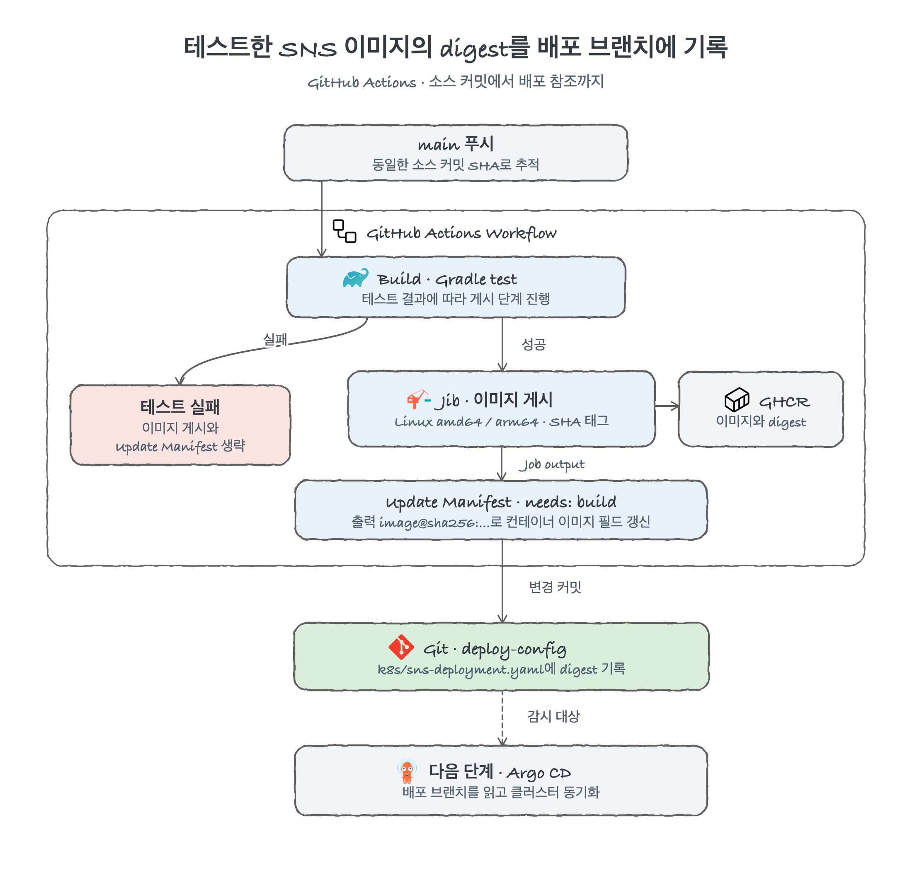

# Building Container CI with GitHub Actions

## 1. 소스 변경을 이미지와 배포 명세로 연결한다

Workflow는 저장소의 `.github/workflows/`에 두는 자동화 정의이다. 이벤트가 일어나면 runner가 Job을 실행하고, 각 Job 안에서 Step을 순서대로 실행한다. 이 예시에서 `main`에 변경을 푸시하면 **Build**가 테스트를 실행하고 Jib으로 이미지를 GHCR에 게시한다. **Update Manifest**는 게시한 이미지의 digest를 배포용 브랜치에 기록한다. [GitHub Actions Workflow 문법](https://docs.github.com/en/actions/reference/workflows-and-actions/workflow-syntax), [Jenkins 빌드·배포 흐름](../kubernetes/07_jenkins_pipeline_from_basics_to_blue_green.md)

| 단계 | 입력 | 검증할 결과 |
| :--- | :--- | :--- |
| Build | `main`의 소스 커밋 | Gradle 테스트 성공, GHCR 이미지와 digest |
| Update Manifest | Build에서 전달한 `image@sha256:…` | `deploy-config`의 Deployment 이미지 필드 변경 |
| 배포 | `deploy-config`의 원하는 상태 | Kubernetes 롤아웃과 SNS API 응답 |

CI는 변경을 통합할 때 테스트를 실행하고 배포 가능한 이미지를 만든다. 매니페스트 커밋은 배포에 사용할 이미지를 선택한다. 이후 GitOps 컨트롤러가 브랜치를 감시하거나 배포 작업이 명세를 클러스터에 적용하면 CD가 실제 롤아웃까지 이어진다. [GitHub Actions로 Docker 이미지 게시하기](https://docs.github.com/en/actions/tutorials/publish-packages/publish-docker-images), [Kubernetes Deployment](https://kubernetes.io/docs/concepts/workloads/controllers/deployment/)



그림의 근거 · [GitHub Actions Job 출력](https://docs.github.com/en/actions/how-tos/write-workflows/choose-what-workflows-do/pass-job-outputs) · [Workflow 의존성](https://docs.github.com/en/actions/reference/workflows-and-actions/workflow-syntax#jobsjob_idneeds) · [GitHub Container Registry](https://docs.github.com/en/packages/working-with-a-github-packages-registry/working-with-the-container-registry)

## 2. Build에서 테스트하고 이미지를 게시한다

`main`에는 Gradle Wrapper와 Jib 설정을 두고, `deploy-config` 브랜치는 먼저 만든 다음 `k8s/sns-deployment.yaml`에 Deployment 한 개를 저장한다. 이 Deployment의 컨테이너 이름은 `sns-api`이다. 아래 예시는 같은 저장소의 GHCR 패키지와 `deploy-config` 브랜치에 Job별 쓰기 권한을 부여할 수 있는 실습 환경을 가정한다. [Jib 설정](01_containerizing_spring_boot_with_jib_and_docker_compose.md), [SNS Deployment 예시](02_deploying_spring_boot_on_kind_with_gateway_api.md), [GHCR 인증](https://docs.github.com/en/packages/working-with-a-github-packages-registry/working-with-the-container-registry)

`jib`이 Linux의 amd64·arm64용 이미지를 한 이름으로 GHCR에 올린다. 커밋 SHA 태그로 이미지의 출처를 찾고, 매니페스트에는 업로드 결과에서 읽은 digest를 기록해 실제 내용을 고정한다. `build/jib-image.digest`는 예시처럼 루트 Gradle 프로젝트에 Jib 플러그인을 적용했을 때의 기본 경로이다. [Jib Gradle 문서](https://github.com/GoogleContainerTools/jib/blob/master/jib-gradle-plugin/README.md), [Jib 플랫폼 설정](https://github.com/GoogleContainerTools/jib/blob/master/docs/faq.md#how-do-i-specify-a-platform-in-the-manifest-list-or-oci-index-of-a-base-image)

```yaml
name: SNS container CI

on:
  push:
    branches: [main]

concurrency:
  group: sns-container-main
  cancel-in-progress: true

defaults:
  run:
    shell: bash

jobs:
  build:
    name: Build
    runs-on: ubuntu-24.04
    permissions:
      contents: read
      packages: write
    outputs:
      image: ${{ steps.publish.outputs.image }}
    steps:
      - uses: actions/checkout@v6
        with:
          persist-credentials: false
      - uses: actions/setup-java@v5
        with:
          distribution: temurin
          java-version: '21'
          cache: gradle
      - name: Test
        run: ./gradlew --no-daemon test
      - name: Build and push image
        id: publish
        env:
          GHCR_TOKEN: ${{ secrets.GITHUB_TOKEN }}
        run: |
          image="ghcr.io/${GITHUB_REPOSITORY,,}"
          printf '%s' "$GHCR_TOKEN" |
            docker login ghcr.io --username "$GITHUB_ACTOR" --password-stdin
          ./gradlew --no-daemon \
            -Djib.from.platforms=linux/amd64,linux/arm64 \
            jib -Djib.to.image="$image:$GITHUB_SHA"
          digest="$(cat build/jib-image.digest)"
          [[ "$digest" =~ ^sha256:[0-9a-f]{64}$ ]]
          printf 'image=%s@%s\n' "$image" "$digest" >> "$GITHUB_OUTPUT"
          printf 'Published %s@%s\n' "$image" "$digest"

  update-manifest:
    name: Update Manifest
    needs: build
    runs-on: ubuntu-24.04
    permissions:
      contents: write
    steps:
      - uses: actions/checkout@v6
        with:
          ref: deploy-config
      - name: Record published digest
        env:
          IMAGE_REF: ${{ needs.build.outputs.image }}
        run: |
          manifest=k8s/sns-deployment.yaml
          updated_manifest="$RUNNER_TEMP/sns-deployment.yaml"
          main_head="$(git ls-remote --exit-code origin refs/heads/main | cut -f1)"
          if [[ "$main_head" != "$GITHUB_SHA" ]]; then
            echo 'A newer commit is on main.'
            exit 0
          fi

          kubectl set image --local -f "$manifest" \
            "sns-api=$IMAGE_REF" -o yaml > "$updated_manifest"
          if [[ ! -s "$updated_manifest" ]]; then
            exit 0
          fi
          mv "$updated_manifest" "$manifest"
          git diff --check
          if git diff --quiet -- "$manifest"; then
            exit 0
          fi
          git config user.name "github-actions[bot]"
          git config user.email "41898282+github-actions[bot]@users.noreply.github.com"
          git add -- "$manifest"
          git commit -m "Deploy SNS from $GITHUB_SHA"
          git push origin HEAD:refs/heads/deploy-config
```

테스트가 실패하면 이미지 게시 Step이 건너뛰어지고, Build가 실패하면 `needs: build`로 연결한 Update Manifest도 건너뛴다. Build의 `GITHUB_OUTPUT`에서 Job output으로 전달된 이미지값은 별도 runner에서 `needs.build.outputs.image`로 읽는다. PR 테스트를 추가할 때는 `contents: read`만 부여한 Workflow에서 먼저 검증할 수 있다. [GitHub Actions Workflow 문법](https://docs.github.com/en/actions/reference/workflows-and-actions/workflow-syntax), [GitHub Actions 토큰 권한](https://docs.github.com/en/actions/concepts/security/github_token)

## 3. Update Manifest에서 배포 버전을 기록한다

`kubectl set image --local`은 로컬 Deployment 파일을 읽어 대상 컨테이너의 이미지가 바뀐 YAML을 생성한다. 위 Workflow는 출력이 있는 경우에만 원본 파일을 교체하고 Git diff를 검사한다. 같은 digest로 다시 실행할 때는 기존 파일과 커밋을 그대로 사용한다. [kubectl set image](https://kubernetes.io/docs/reference/kubectl/generated/kubectl_set/kubectl_set_image/), [Ubuntu runner 설치 도구](https://github.com/actions/runner-images/blob/main/images/ubuntu/Ubuntu2404-Readme.md)

같은 Workflow의 새 실행은 이전 실행을 취소한다. 과거 실행을 수동으로 다시 실행하는 경우에는 `main`의 현재 HEAD를 비교해 이전 커밋의 digest가 배포 브랜치에 반영되는 것을 줄인다. 배포 브랜치의 직접 푸시가 제한된 저장소에서는 배포 변경을 PR로 올리는 흐름에 연결한다. 같은 저장소의 `GITHUB_TOKEN`으로 푸시한 커밋은 일반적인 `push` Workflow를 새로 실행하지 않으므로, 다음 단계의 자동 배포를 연결할 때 감시 방식이나 이벤트 조건을 확인한다. [동시 실행 제어](https://docs.github.com/en/actions/reference/workflows-and-actions/workflow-syntax#concurrency), [GITHUB_TOKEN 이벤트 규칙](https://docs.github.com/en/actions/concepts/security/github_token#when-github_token-triggers-workflow-runs)

## 4. 이미지 게시, 명세 변경과 롤아웃을 확인한다

1. GitHub의 **Actions**에서 소스 커밋에 대응하는 **Build**의 테스트와 **Build and push image** 로그를 확인한다. 로그의 `ghcr.io/…@sha256:…`가 GHCR에 존재하고, 대상 노드의 플랫폼이 게시된 이미지에 포함되어 있는지 확인한다. [GHCR 이미지 조회](https://docs.github.com/en/packages/working-with-a-github-packages-registry/working-with-the-container-registry)
2. **Update Manifest**에서 기록한 커밋을 열고, `deploy-config`의 `k8s/sns-deployment.yaml`에 같은 digest가 들어갔는지 확인한다. 테스트만 실패하도록 만든 실습 변경에서는 배포 브랜치가 갱신되지 않는지도 확인한다. [Workflow의 Job 의존성](https://docs.github.com/en/actions/reference/workflows-and-actions/workflow-syntax#jobsjob_idneeds)
3. GitOps 동기화 또는 실습 클러스터에 매니페스트를 적용한 뒤 아래를 실행한다. GHCR 패키지가 비공개이면 클러스터가 이미지를 받을 수 있도록 읽기 자격 증명을 준비한다. [Kubernetes 비공개 레지스트리 이미지](https://kubernetes.io/docs/tasks/configure-pod-container/pull-image-private-registry/), [kubectl rollout status](https://kubernetes.io/docs/reference/kubectl/generated/kubectl_rollout/kubectl_rollout_status/)

```bash
kubectl -n sns rollout status deploy/sns-api --timeout=120s
kubectl -n sns get deploy sns-api \
  -o jsonpath='{.spec.template.spec.containers[?(@.name=="sns-api")].image}{"\n"}'
kubectl -n sns get pods -l app=sns-api
curl -fsS -H 'Host: sns.localhost' http://127.0.0.1:8081/api/posts
```

마지막 요청은 앞 편의 Traefik 포트 포워딩을 실행한 상태에서 사용한다. 새 버전에서 바꾼 SNS 동작을 직접 호출하고 결과까지 확인한다. 문제가 생기면 직전에 정상 동작한 digest로 배포 브랜치의 매니페스트를 되돌린 뒤 같은 검증을 반복한다. [kind Gateway API 검증](02_deploying_spring_boot_on_kind_with_gateway_api.md), [Kubernetes Deployment 롤백](https://kubernetes.io/docs/concepts/workloads/controllers/deployment/#rolling-back-a-deployment)
