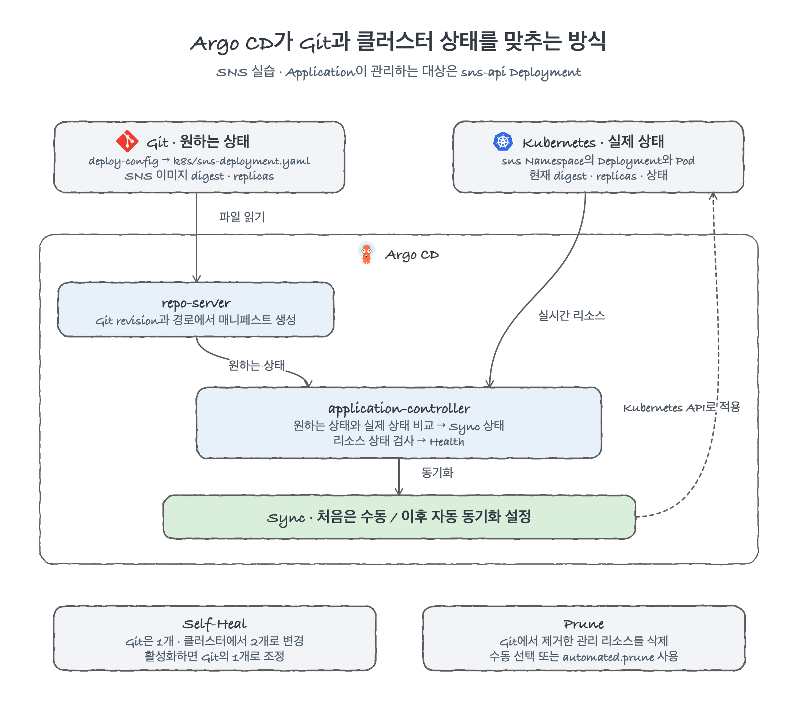

# Deploying Applications with Argo CD and GitOps

GitOps는 원하는 배포 상태를 Git에 선언하고, 컨트롤러가 그 상태를 클러스터에 계속 맞추는 방식이다. 03번의 GitHub Actions는 이미지를 게시하고 `deploy-config` 브랜치의 이미지 digest를 갱신한다. Argo CD는 이 브랜치를 읽어 SNS Deployment를 동기화한다. [이미지 게시와 매니페스트 갱신](03_building_container_ci_with_github_actions.md) · [Argo CD · Core Concepts](https://argo-cd.readthedocs.io/en/stable/core_concepts/)

## 1. Sync, Prune, Self-Heal

| 동작 | 적용 범위 |
| --- | --- |
| Sync | Git에서 렌더링한 매니페스트를 클러스터에 적용한다. 화면에서 수동으로 시작하거나 자동 동기화를 설정할 수 있다. |
| Prune | Git의 원하는 상태에서 제거된 리소스를 동기화할 때 삭제한다. 자동으로 실행하려면 `automated.prune`을 활성화한다. |
| Self-Heal | 운영 중 클러스터에서 바뀐 필드를 Git의 선언으로 되돌린다. 자동 동기화의 `selfHeal`을 활성화해야 한다. |

`OutOfSync`는 Git과 클러스터의 상태 차이를 뜻한다. `Healthy`는 리소스의 상태 검사 결과다. 이미지가 Git과 같아 `Synced`여도 Pod가 시작되지 않으면 앱은 `Healthy`가 아닐 수 있다. 변경 적용 완료와 실제 API 응답을 함께 확인한다. [Argo CD · Automated Sync Policy](https://argo-cd.readthedocs.io/en/stable/user-guide/auto_sync/) · [Argo CD · Resource Health](https://argo-cd.readthedocs.io/en/stable/operator-manual/health/)



그림의 근거 · [Argo CD 3.5 아키텍처](https://argo-cd.readthedocs.io/en/release-3.5/operator-manual/architecture/) · [Argo CD 3.5 자동 동기화](https://argo-cd.readthedocs.io/en/release-3.5/user-guide/auto_sync/) · [Argo CD 상태 개념](https://argo-cd.readthedocs.io/en/stable/core_concepts/)

## 2. kind에서 이미지와 노드 아키텍처 확인하기

02번 실습의 `kind-sns` 컨텍스트를 사용한다. Apple Silicon에서 ARM64 노드가 이미지의 ARM64 변형을 받을 수 있는지 확인한다. 03번 CI의 멀티플랫폼 이미지라면 digest를 조회해 노드의 플랫폼이 목록에 있는지 본다. 인증 오류나 이미지 경로 오타도 `ImagePullBackOff`의 원인이므로 Pod 이벤트를 함께 확인한다. [kind SNS 클러스터](02_deploying_spring_boot_on_kind_with_gateway_api.md) · [Kubernetes · Multi-architecture Images](https://kubernetes.io/docs/concepts/containers/images/#multi-architecture-images-with-image-indexes) · [Docker · imagetools inspect](https://docs.docker.com/reference/cli/docker/buildx/imagetools/inspect/)

```bash
kubectl --context kind-sns get nodes \
  -o custom-columns='NAME:.metadata.name,ARCH:.status.nodeInfo.architecture'

# IMAGE_REF에 deploy-config의 ghcr.io/...@sha256:... 값을 지정한 뒤
docker buildx imagetools inspect "$IMAGE_REF"
kubectl --context kind-sns -n sns describe pod -l app=sns-api
```

로컬 전용 `sns-api:local`을 사용할 때는 아키텍처에 맞춰 Jib으로 이미지를 빌드하고 `kind load docker-image sns-api:local --name sns`로 노드에 넣는다. CI 이미지로 전환하면 해당 GHCR 패키지에 대한 클러스터의 pull 권한을 확인한다. [Jib 로컬 이미지](01_containerizing_spring_boot_with_jib_and_docker_compose.md) · [kind · Loading an Image](https://kind.sigs.k8s.io/docs/user/quick-start/#loading-an-image-into-your-cluster)

## 3. Git 브랜치를 Argo CD Application에 연결하기

로컬 클러스터에 Argo CD를 설치한다. 이 실습의 SNS Service, Gateway, 의존 서비스는 02번에서 준비하고, Argo CD는 03번 CI가 갱신하는 SNS Deployment만 관리한다. 비공개 저장소를 쓴다면 Application을 등록하기 전에 Argo CD에 접근 권한을 설정한다. [Argo CD · Getting Started](https://argo-cd.readthedocs.io/en/stable/getting_started/) · [Argo CD · v3.5.7](https://github.com/argoproj/argo-cd/releases/tag/v3.5.7) · [Argo CD · Private Repositories](https://argo-cd.readthedocs.io/en/stable/user-guide/private-repositories/)

```bash
kubectl --context kind-sns create namespace argocd --dry-run=client -o yaml |
  kubectl --context kind-sns apply -f -
kubectl --context kind-sns -n argocd apply --server-side -f \
  https://raw.githubusercontent.com/argoproj/argo-cd/v3.5.7/manifests/install.yaml
kubectl --context kind-sns -n argocd rollout status deploy/argocd-server --timeout=180s
```

아래를 `sns-application.yaml`로 저장하고 `repoURL`을 실습 저장소로 바꾼다. `directory.include`는 같은 경로의 Helm 값 파일이 포함되지 않도록 대상 파일을 지정한다. 첫 동기화는 화면에서 변경점을 확인한 뒤 수동으로 실행한다. [Argo CD · Application Specification](https://argo-cd.readthedocs.io/en/stable/user-guide/application-specification/) · [Argo CD · Directory Applications](https://argo-cd.readthedocs.io/en/stable/user-guide/directory/)

```yaml
apiVersion: argoproj.io/v1alpha1
kind: Application
metadata:
  name: sns-api
  namespace: argocd
spec:
  project: default
  source:
    repoURL: https://github.com/OWNER/REPO.git
    targetRevision: deploy-config
    path: k8s
    directory:
      include: sns-deployment.yaml
  destination:
    server: https://kubernetes.default.svc
    namespace: sns
  syncPolicy:
    automated:
      enabled: false
      prune: false
      selfHeal: false
```

```bash
kubectl --context kind-sns apply -f sns-application.yaml
kubectl --context kind-sns -n argocd port-forward svc/argocd-server 18081:443
```

브라우저에서 `https://localhost:18081`에 접속한다. 기본 설치에서는 공식 가이드의 초기 관리자 인증 절차로 로그인한다. [Argo CD · Getting Started](https://argo-cd.readthedocs.io/en/stable/getting_started/)

## 4. 변경과 복구 확인하기

1. Argo CD 화면에서 Diff와 대상 revision을 확인하고 Sync한다. `kubectl --context kind-sns -n sns rollout status deploy/sns-api`로 롤아웃을 확인한다.
2. Application에서 `automated.enabled: true`로 바꾼 뒤 03번 CI가 새 digest를 기록하면 Sync 상태와 실행 중인 Deployment의 이미지가 새 digest로 바뀌는지 확인한다.
3. `selfHeal: true`로 바꾼 뒤 실습 Deployment에만 `kubectl --context kind-sns -n sns scale deployment/sns-api --replicas=2`를 적용한다. Git이 `replicas: 1`을 선언하고 있다면 잠시 후 클러스터의 원하는 값이 `1`로 돌아간다.
4. Prune은 실습용 ConfigMap으로 확인한다. `directory.include`에 별도 ConfigMap 파일을 추가하고 먼저 Sync한다. Git에서 그 파일을 제거하면 Prune을 끈 상태에서는 리소스가 남는다. Diff에서 삭제 대상이 맞는 것을 확인한 뒤 수동 Sync의 Prune을 선택하거나 `automated.prune: true`를 시험한다. [Argo CD · Automated Sync Policy](https://argo-cd.readthedocs.io/en/stable/user-guide/auto_sync/)

문제가 발생한 배포는 `deploy-config`에 직전 정상 digest를 다시 기록해 원하는 상태를 수정한다. 롤아웃 후 이전과 같은 호스트와 경로로 SNS API를 호출하고 응답까지 확인한다. [SNS Gateway 검증](02_deploying_spring_boot_on_kind_with_gateway_api.md) · [Argo CD · Best Practices](https://argo-cd.readthedocs.io/en/stable/user-guide/best_practices/)
