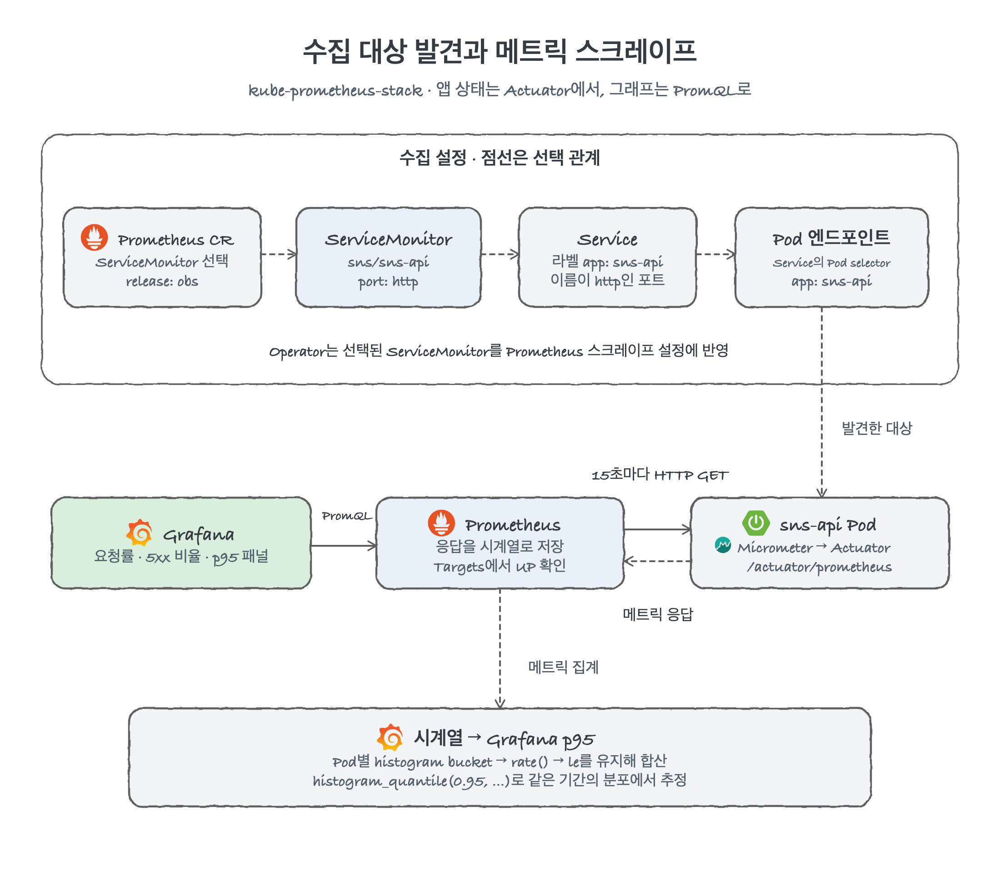

# Monitoring Spring Boot with Prometheus and Grafana

## 1. SNS API에서 수집할 메트릭 정하기

Micrometer가 HTTP 요청과 JVM 상태를 계측하고, Spring Boot Actuator가 `/actuator/prometheus`로 메트릭을 노출한다. Prometheus는 이 엔드포인트를 주기적으로 스크레이프해 시계열을 저장하고, Grafana는 PromQL로 조회한 결과를 시각화한다. 시계열은 메트릭 이름과 라벨 조합으로 구분된다. `uri="/api/posts/{id}"`처럼 라우트 템플릿을 사용하면 여러 게시글 요청을 함께 집계할 수 있다. [Spring Boot 3.5 Actuator Metrics](https://docs.spring.io/spring-boot/3.5/reference/actuator/metrics.html), [Prometheus 데이터 모델](https://prometheus.io/docs/concepts/data_model/)

| 유형 | SNS API에서 볼 값 | 읽는 방법 |
| :--- | :--- | :--- |
| Counter | `http_server_requests_seconds_count` | 처리한 요청의 누적 횟수다. `rate()`로 초당 평균 요청 수를 구한다. |
| Gauge | `jvm_memory_used_bytes` | JVM이 현재 사용 중인 메모리다. |
| Histogram | `http_server_requests_seconds_bucket` | 처리 시간 구간별 누적 횟수다. 버킷을 합쳐 여러 Pod의 p95를 추정할 수 있다. |

## 2. Actuator와 Micrometer Prometheus Registry 연결하기

컨테이너 빌드 실습에서 사용한 Gradle 의존성에 Prometheus Registry를 추가한다. [컨테이너 빌드 실습](01_containerizing_spring_boot_with_jib_and_docker_compose.md), [Spring Boot 3.5 Actuator Endpoints](https://docs.spring.io/spring-boot/3.5/reference/actuator/endpoints.html)

```groovy
dependencies {
    implementation 'org.springframework.boot:spring-boot-starter-actuator'
    runtimeOnly 'io.micrometer:micrometer-registry-prometheus'
}
```

`application.yml`에 HTTP 엔드포인트 노출과 히스토그램 설정을 추가한다. 새 태그로 이미지를 빌드해 kind에 로드하고 `sns-api` Deployment에 반영한다. [kind 앱 배포](02_deploying_spring_boot_on_kind_with_gateway_api.md), [Spring Boot 히스토그램 설정](https://docs.spring.io/spring-boot/3.5/reference/actuator/metrics.html#actuator.metrics.customizing.per-meter-properties)

```yaml
management:
  endpoints:
    web:
      exposure:
        include: health,prometheus
  metrics:
    distribution:
      percentiles-histogram:
        http.server.requests: true
```

```bash
kubectl --context kind-sns -n sns port-forward svc/sns-api 8080:8080
```

다른 터미널에서 앱 요청을 보낸 뒤 메트릭을 읽는다. Spring Security 설정을 직접 관리하는 앱이라면 Prometheus의 접근 권한도 확인한다. 앞 편의 Gateway는 `/api`만 라우팅하므로 수집에는 클러스터 내부 Service를 사용한다. [Spring Boot Actuator 보안](https://docs.spring.io/spring-boot/3.5/reference/actuator/endpoints.html#actuator.endpoints.security)

```bash
curl -fsS http://127.0.0.1:8080/api/posts
curl -fsS http://127.0.0.1:8080/actuator/prometheus |
  rg '^(jvm_memory_used_bytes|http_server_requests_seconds_(count|bucket))'
```

## 3. Prometheus Operator로 ServiceMonitor 등록하기

로컬 kind 클러스터의 `monitoring` Namespace에 `obs` 릴리스를 설치한다. 차트는 Prometheus Operator, Prometheus, Alertmanager, Grafana와 관련 CRD를 함께 설치한다. 아래를 `k8s/monitoring-values.yaml`로 저장한다. [kube-prometheus-stack 92.10.0](https://github.com/prometheus-community/helm-charts/releases/tag/kube-prometheus-stack-92.10.0), [차트 설정](https://github.com/prometheus-community/helm-charts/blob/kube-prometheus-stack-92.10.0/charts/kube-prometheus-stack/values.yaml)

```yaml
fullnameOverride: obs
grafana:
  fullnameOverride: obs-grafana
```

```bash
helm upgrade --install obs oci://ghcr.io/prometheus-community/charts/kube-prometheus-stack \
  --version 92.10.0 --kube-context kind-sns \
  --namespace monitoring --create-namespace \
  -f k8s/monitoring-values.yaml --wait --timeout 10m
kubectl --context kind-sns wait --for=condition=Established \
  crd/servicemonitors.monitoring.coreos.com --timeout=90s
```

Prometheus는 차트 기본 설정에서 `release: obs`가 붙은 ServiceMonitor를 여러 Namespace에서 찾는다. ServiceMonitor는 자신과 같은 `sns` Namespace에서 `metadata.labels.app: sns-api`가 붙은 Service를 찾는다. 기존 Service가 가진 `spec.selector.app`은 Pod 선택에도 계속 쓰인다. 다음 명령으로 Service 자체에 라벨을 추가하고 재배포에 쓰는 `k8s/sns-service.yaml`의 `metadata.labels`에도 반영한다. `endpoints.port`는 Service에 선언한 포트 이름인 `http`를 가리킨다. [Prometheus 차트 리소스 템플릿](https://github.com/prometheus-community/helm-charts/blob/kube-prometheus-stack-92.10.0/charts/kube-prometheus-stack/templates/prometheus/prometheus.yaml), [ServiceMonitor API](https://prometheus-operator.dev/docs/api-reference/api/#monitoring.coreos.com/v1.ServiceMonitor)



그림의 근거 · [Prometheus Operator의 ServiceMonitor](https://prometheus-operator.dev/docs/getting-started/design/) · [Spring Boot 3.5 Actuator Metrics](https://docs.spring.io/spring-boot/3.5/reference/actuator/metrics.html) · [PromQL 히스토그램 함수](https://prometheus.io/docs/prometheus/latest/querying/functions/#histogram_quantile)

```bash
kubectl --context kind-sns -n sns label svc sns-api app=sns-api --overwrite
```

다음을 `k8s/sns-servicemonitor.yaml`로 저장한다.

```yaml
apiVersion: monitoring.coreos.com/v1
kind: ServiceMonitor
metadata:
  name: sns-api
  namespace: sns
  labels: {release: obs}
spec:
  selector:
    matchLabels: {app: sns-api}
  endpoints:
    - port: http
      path: /actuator/prometheus
      interval: 15s
```

```bash
kubectl --context kind-sns apply -f k8s/sns-servicemonitor.yaml
kubectl --context kind-sns -n monitoring port-forward svc/obs-prometheus 9090:9090
```

`http://127.0.0.1:9090/targets`에서 `sns-api`가 `UP`인지 확인한다. `up{namespace="sns",service="sns-api"}`가 Pod별로 `1`이면 스크레이프가 성공한 것이다. 대상이 보이지 않으면 ServiceMonitor의 릴리스 라벨, Service 라벨, Service 포트 이름, EndpointSlice를 확인한다. 대상이 `DOWN`이면 Targets 화면의 스크레이프 오류와 Actuator 응답을 확인한다. [Prometheus Operator 문제 해결](https://prometheus-operator.dev/docs/platform/troubleshooting/)

## 4. Grafana에서 요청률·오류율·p95 대시보드 만들기

Grafana를 포트 포워딩하고 `http://127.0.0.1:3000`에 접속한다. 기본 관리자 계정 정보는 로컬 클러스터의 `obs-grafana` Secret에 있다. Explore에서 차트가 등록한 Prometheus 데이터 소스를 선택해 쿼리를 확인한다. Dashboards에서 새 대시보드를 만들고 Add visualization으로 시계열 패널 세 개를 추가한다. [Grafana Prometheus 데이터 소스](https://grafana.com/docs/grafana/latest/datasources/prometheus/), [Grafana 대시보드 만들기](https://grafana.com/docs/grafana/latest/visualizations/dashboards/build-dashboards/create-dashboard/)

```bash
kubectl --context kind-sns -n monitoring port-forward svc/obs-grafana 3000:80
```

**요청률**은 최근 5분의 초당 평균 요청 수를 라우트별로 보여 준다.

```promql
sum by (uri) (
  rate(http_server_requests_seconds_count{namespace="sns",service="sns-api",uri=~"/api/.*"}[5m])
)
```

**5xx 오류율**은 전체 요청률에서 5xx가 차지하는 비율이다. `or`의 오른쪽에서 요청이 있는 라우트마다 0을 만들어 5xx 시계열이 생기기 전에도 0%를 표시한다. 단위는 Grafana의 `Percent (0.0-1.0)`을 선택한다.

```promql
(
  sum by (uri) (
    rate(http_server_requests_seconds_count{namespace="sns",service="sns-api",uri=~"/api/.*",status=~"5.."}[5m])
  )
  or
  0 * sum by (uri) (
    rate(http_server_requests_seconds_count{namespace="sns",service="sns-api",uri=~"/api/.*"}[5m])
  )
)
/
sum by (uri) (
  rate(http_server_requests_seconds_count{namespace="sns",service="sns-api",uri=~"/api/.*"}[5m])
)
```

**p95 응답 시간**은 최근 5분 동안 요청의 약 95%가 완료된 시간의 추정치다. 여러 Pod의 버킷을 합칠 때 `le` 라벨을 유지하고, 패널 단위를 초로 지정한다. `rate()`는 합산 전에 적용해야 Pod 재시작 때 발생하는 카운터 초기화를 각 시계열에서 감지할 수 있다. 샘플이 쌓이는 동안에는 몇 차례 요청과 스크레이프를 기다린다. [PromQL 함수](https://prometheus.io/docs/prometheus/latest/querying/functions/), [Prometheus 히스토그램](https://prometheus.io/docs/practices/histograms/)

```promql
histogram_quantile(
  0.95,
  sum by (uri, le) (
    rate(http_server_requests_seconds_bucket{namespace="sns",service="sns-api",uri=~"/api/.*"}[5m])
  )
)
```

다음 단계에서 같은 메트릭으로 장애 조건을 평가하고 로그·트레이스를 확인한다. [Grafana 알림과 장애 대응](08_alerting_and_responding_to_incidents_with_grafana.md)
