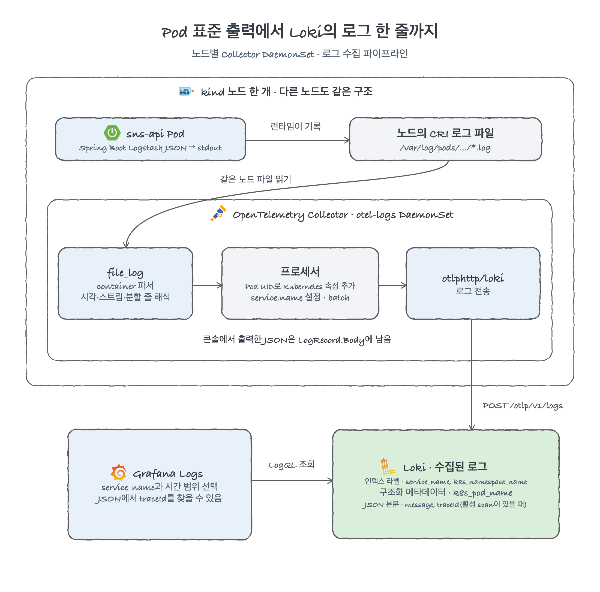

# Centralizing Spring Boot Logs with OpenTelemetry and Loki

## 1. Pod 로그를 Loki에서 한곳에 조회한다

앞서 kind에 배포한 `sns` 네임스페이스의 `sns-api`는 Spring Boot 로그를 표준 출력에 기록한다. 컨테이너 런타임은 이 출력을 노드의 Pod 로그 파일에 저장한다. OpenTelemetry Collector를 DaemonSet으로 실행하면 노드마다 Collector가 하나씩 그 파일을 읽고, Kubernetes 메타데이터를 붙여 같은 Loki로 전송한다. Pod가 교체된 뒤에도 Loki에 수집된 기록은 Grafana에서 서비스와 시간 범위를 지정해 조회할 수 있다. [SNS의 kind 배포](02_deploying_spring_boot_on_kind_with_gateway_api.md), [Kubernetes 로깅 구조](https://kubernetes.io/docs/concepts/cluster-administration/logging/), [Collector Kubernetes 구성](https://opentelemetry.io/docs/platforms/kubernetes/collector/components/)

| 구성 요소 | 역할 |
| :--- | :--- |
| Spring Boot | 로그 이벤트마다 JSON 한 줄을 표준 출력에 기록한다. |
| OpenTelemetry Collector | 노드의 파일을 읽고 CRI 형식을 해석한 뒤 OTLP/HTTP로 전송한다. |
| Loki | 로그 본문과 메타데이터를 저장하고 인덱스 라벨로 조회할 스트림을 찾는다. |
| Grafana Explore | Loki 데이터 소스에 LogQL을 보내고 결과를 표시한다. |

## 2. Spring Boot 로그를 JSON으로 출력한다

Spring Boot 3.5의 기본 콘솔 로깅을 쓰는 `sns-api`에서 아래 설정을 적용한다. kind에서는 Deployment의 컨테이너 환경 변수 `LOGGING_STRUCTURED_FORMAT_CONSOLE=logstash`로 같은 설정을 적용할 수 있다. 자체 `logback-spring.xml`을 쓰는 경우 콘솔 appender가 Boot의 구조화 로그 인코더를 사용하도록 설정한다. [Spring Boot 구조화 로깅](https://docs.spring.io/spring-boot/3.5/reference/features/logging.html#features.logging.structured)

```yaml
logging:
  structured:
    format:
      console: logstash
```

Logstash 형식에서는 `level`, `message`, `logger_name`을 개별 필드로 조회할 수 있다. Micrometer Tracing이 활성화된 요청에서 로그를 기록하면 MDC의 `traceId`와 `spanId`도 아래처럼 최상위 JSON 필드에 들어간다. 앱 시작 로그처럼 활성 span 밖에서 발생한 이벤트는 두 필드 없이도 수집된다. [Spring Boot 구조화 로깅](https://docs.spring.io/spring-boot/3.5/reference/features/logging.html#features.logging.structured), [Spring Boot 로그 상관관계](https://docs.spring.io/spring-boot/3.5/reference/actuator/tracing.html#actuator.micrometer-tracing.logging)

```json
{"@timestamp":"2026-11-21T01:30:00.123Z","@version":"1","message":"게시글 목록 조회 완료","logger_name":"example.sns.PostController","thread_name":"http-nio-8080-exec-1","level":"INFO","level_value":20000,"traceId":"803b448a0489f84084905d3093480352","spanId":"3425f23bb2432450"}
```

## 3. Loki에서 인덱스로 사용할 라벨을 고른다

실습에는 앞서 구성한 kind 클러스터, Helm 3 이상, 클러스터에서 실행 중인 Grafana가 필요하다. 새 Loki를 설치할 때는 공식 Monolithic 가이드의 **Single Replica** 값을 `loki-values.yaml`로 저장한다. 이 값은 단일 복제본, 파일시스템 스토리지, TSDB `v13` 스키마를 사용한다. Loki Gateway는 `ClusterIP`로 둔다. `loki-values.yaml`의 해당 항목에 아래 값을 병합한다. [SNS의 kind 배포](02_deploying_spring_boot_on_kind_with_gateway_api.md), [Loki Monolithic 설치](https://grafana.com/docs/loki/latest/setup/install/helm/install-monolithic/), [Grafana Helm 설치](https://grafana.com/docs/grafana/latest/setup-grafana/installation/helm/)

```yaml
loki:
  auth_enabled: false
  limits_config:
    allow_structured_metadata: true
    otlp_config:
      resource_attributes:
        ignore_defaults: true
        attributes_config:
          - action: index_label
            attributes: [service.name, k8s.namespace.name]
chunksCache:
  enabled: false
resultsCache:
  enabled: false
```

Loki는 `service.name`과 `k8s.namespace.name`을 각각 `service_name`과 `k8s_namespace_name`으로 저장한다. 두 값의 조합이 로그 스트림을 식별한다. Pod 이름은 구조화 메타데이터로, `traceId`는 JSON 본문에 보관한다. 요청마다 달라지는 `traceId`나 배포마다 바뀌는 Pod 이름을 인덱스로 쓰면 스트림 수가 빠르게 증가한다. [Loki OTLP 속성 매핑](https://grafana.com/docs/loki/latest/send-data/otel/), [Loki 라벨 카디널리티](https://grafana.com/docs/loki/latest/get-started/labels/cardinality/)

```bash
helm repo add grafana-community https://grafana-community.github.io/helm-charts
helm repo update grafana-community
helm upgrade --install loki grafana-community/loki --version 18.7.6 \
  -n observability --create-namespace -f loki-values.yaml --wait
kubectl -n observability get svc loki-gateway
```

## 4. Collector가 CRI 로그를 읽고 OTLP로 전송한다

아래를 `otel-logs-values.yaml`로 저장한다. Collector Helm 차트의 `logsCollection` 프리셋이 노드의 `/var/log/pods`를 읽기 전용으로 마운트하고 `file_log` 수신기에 `container` 파서를 넣는다. 이 파서는 CRI 줄의 시각·스트림·부분 기록 표시를 해석하고 분할된 줄을 합친다. 경로에서 얻은 Pod UID로 `k8s_attributes`가 Kubernetes API에서 Pod 정보를 찾아 붙이며, JSON 메시지는 로그 본문에 그대로 남는다. [Collector Helm 차트](https://opentelemetry.io/docs/platforms/kubernetes/helm/collector/), [Collector 컨테이너 로그 파서](https://opentelemetry.io/blog/2024/otel-collector-container-log-parser/)

```yaml
mode: daemonset
fullnameOverride: otel-logs
image:
  repository: otel/opentelemetry-collector-contrib
command:
  name: otelcol-contrib
resources:
  limits:
    memory: 256Mi
presets:
  logsCollection:
    enabled: true
  kubernetesAttributes:
    enabled: true
service:
  enabled: false
ports:
  otlp: {enabled: false}
  otlp-http: {enabled: false}
  jaeger-compact: {enabled: false}
  jaeger-thrift: {enabled: false}
  jaeger-grpc: {enabled: false}
  zipkin: {enabled: false}
config:
  receivers:
    otlp: null
    jaeger: null
    zipkin: null
    prometheus: null
    file_log:
      include:
        - /var/log/pods/sns_sns-api-*_*/sns-api/*.log
        - /var/log/pods/sns_sns-recommend-*_*/sns-recommend/*.log
      start_at: beginning
  processors:
    resource/service:
      attributes:
        - key: service.name
          from_attribute: k8s.container.name
          action: upsert
  exporters:
    debug: null
    otlphttp/loki:
      endpoint: http://loki-gateway.observability.svc:80/otlp
  service:
    pipelines:
      metrics: null
      traces: null
      logs:
        receivers: [file_log]
        processors: [memory_limiter, k8s_attributes, resource/service, batch]
        exporters: [otlphttp/loki]
```

파일 경로는 `/var/log/pods/<namespace>_<pod-name>_<pod-uid>/<container-name>/<restart-count>.log` 형식이다. `sns-api`의 컨테이너 이름을 `service.name`으로 사용한다. 나중에 같은 네임스페이스에 `sns-recommend` Deployment와 동명의 컨테이너를 실행하면 두 번째 경로에서 수집한다. `start_at: beginning`은 처음 보는 파일을 처음부터 읽는다. Collector 재시작 시 읽던 위치를 이어가려면 `presets.logsCollection.storeCheckpoints: true`로 노드에 체크포인트를 저장한다. [Collector Helm 차트 설정](https://github.com/open-telemetry/opentelemetry-helm-charts/blob/opentelemetry-collector-0.179.0/charts/opentelemetry-collector/values.yaml), [Collector Resource Processor](https://github.com/open-telemetry/opentelemetry-collector-contrib/tree/main/processor/resourceprocessor)

`otlphttp/loki`의 `endpoint`에는 `/otlp`까지 넣는다. exporter가 `/v1/logs`를 이어 붙여 `POST /otlp/v1/logs`로 전송한다. Grafana의 Loki URL에는 조회 API의 기준 주소인 `http://loki-gateway.observability.svc:80`을 입력한다. [Loki OTLP 수집](https://grafana.com/docs/loki/latest/send-data/otel/), [Grafana Loki 데이터 소스 설정](https://grafana.com/docs/grafana/latest/datasources/loki/configure/)



그림의 근거 · [Collector Helm Chart의 로그 수집](https://opentelemetry.io/docs/platforms/kubernetes/helm/collector/) · [OpenTelemetry CRI 로그 파서](https://opentelemetry.io/blog/2024/otel-collector-container-log-parser/) · [Loki OTLP 속성 매핑](https://grafana.com/docs/loki/latest/send-data/otel/)

```bash
helm repo add open-telemetry https://open-telemetry.github.io/opentelemetry-helm-charts
helm repo update open-telemetry
helm upgrade --install otel-logs open-telemetry/opentelemetry-collector --version 0.179.0 \
  -n observability -f otel-logs-values.yaml --wait
kubectl -n observability rollout status daemonset/otel-logs --timeout=120s
```

## 5. 앱과 Loki에서 같은 로그를 확인한다

`sns-api`에 JSON 콘솔 로그 설정을 적용해 새 Pod의 시작 로그를 만든다. `kubectl logs`에서 `Started …` 메시지와 `level`을 확인한다. 이미 같은 값으로 설정했다면 `kubectl -n sns rollout restart deploy/sns-api`를 실행해 새 시작 로그를 만든다. [kubectl set env](https://kubernetes.io/docs/reference/kubectl/generated/kubectl_set/kubectl_set_env/), [kubectl logs](https://kubernetes.io/docs/reference/kubectl/generated/kubectl_logs/)

```bash
kubectl -n sns set env deploy/sns-api LOGGING_STRUCTURED_FORMAT_CONSOLE=logstash
kubectl -n sns rollout status deploy/sns-api --timeout=120s
kubectl -n sns logs deploy/sns-api -c sns-api --since=5m |
  jq -Rrc 'fromjson? | objects | select((.message // "") | startswith("Started ")) | {level, message}'
```

Grafana에서 Loki 데이터 소스를 저장하고 **Explore**의 **Code** 모드에서 최근 5분을 조회한다. 먼저 인덱스 라벨로 스트림을 고르고 JSON 본문에서 `level`과 `message`를 추출한다. 같은 시작 메시지가 보이면 `kubectl logs`에서 확인한 이벤트가 Loki까지 도착한 것이다. [Grafana Loki 쿼리 편집기](https://grafana.com/docs/grafana/latest/datasources/loki/query-editor/), [LogQL 로그 쿼리](https://grafana.com/docs/loki/latest/query/log_queries/)

```logql
{service_name="sns-api", k8s_namespace_name="sns"}
  | json level="level", message="message"
  | __error__=""
  | level="INFO"
  | message=~"Started .*"
```

요청 단위로 확인할 때는 `kubectl -n sns port-forward svc/sns-api 8080:8080`을 실행하고, `http://127.0.0.1:8080`에서 앱이 실제로 로그를 남기는 요청을 호출한다. 해당 요청 span의 Trace ID나 JSON 로그의 `traceId`를 복사해 아래 예시 값을 바꾼다. 쿼리가 반환한 각 이벤트의 `spanId`를 보면 같은 요청에서 어느 span이 로그를 남겼는지 확인할 수 있다. [Spring Boot 로그 상관관계](https://docs.spring.io/spring-boot/3.5/reference/actuator/tracing.html#actuator.micrometer-tracing.logging), [LogQL JSON 파서](https://grafana.com/docs/loki/latest/query/log_queries/#json)

```logql
{service_name="sns-api", k8s_namespace_name="sns"}
  | json traceId="traceId"
  | traceId="803b448a0489f84084905d3093480352"
```

`kubectl logs`에 이벤트가 있는데 Loki에서 찾을 수 없으면 최근 시간 범위에서 라벨 셀렉터만 실행한다. 스트림이 비어 있으면 `kubectl -n observability logs daemonset/otel-logs --since=5m`에서 파일 경로와 exporter 오류를 확인한다. HTTP 404는 Gateway의 `/otlp/v1/logs` 경로를, HTTP 400은 Loki의 `allow_structured_metadata`와 TSDB `v13` 설정을 확인할 단서가 된다. [Loki OTLP 수집 설정](https://grafana.com/docs/loki/latest/send-data/otel/), [Loki 수집 오류](https://grafana.com/docs/loki/latest/operations/troubleshooting/troubleshoot-ingest/)
