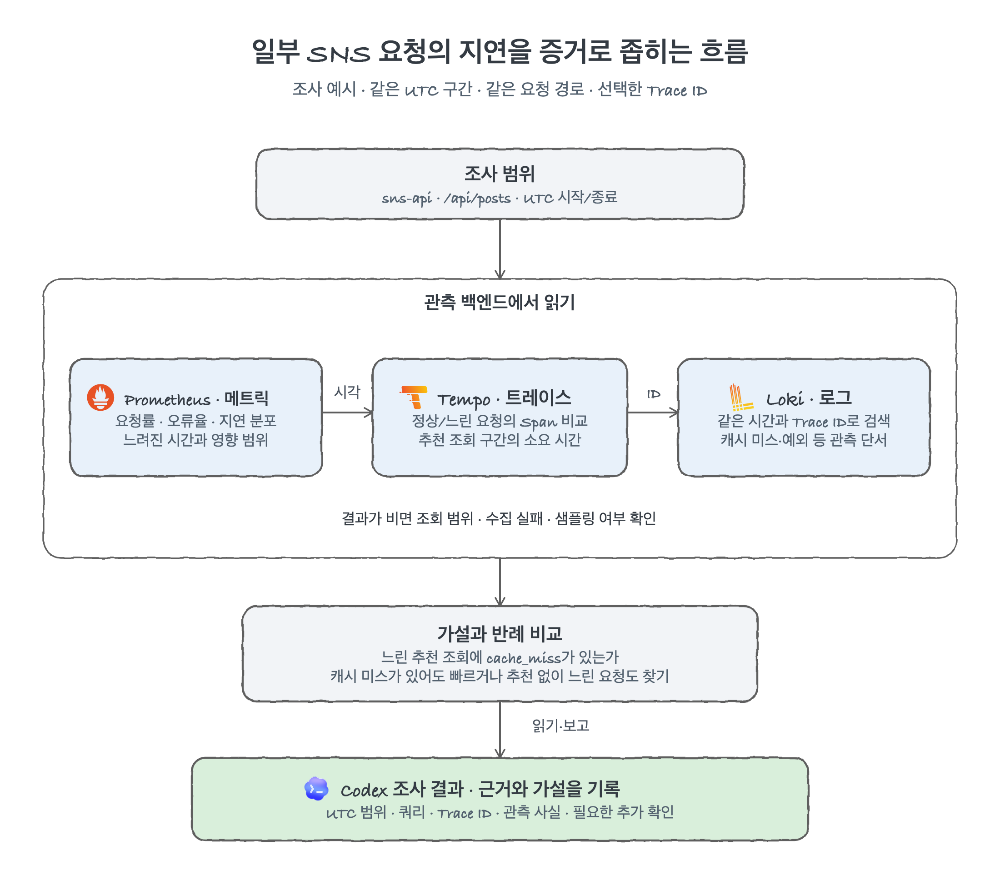

# Investigating Incidents with Observability Data and AI

일부 사용자에게만 SNS 목록이 늦게 열리는 상황을 가정한다. 전체 요청 오류율이 안정적이어도 특정 요청 경로의 지연은 늘 수 있다. 메트릭으로 영향 범위를 좁힌 뒤 같은 시각의 트레이스와 로그를 비교해 지연이 시작된 지점을 찾는다. [Prometheus·Grafana 메트릭](05_monitoring_spring_boot_with_prometheus_and_grafana.md) · [Tempo 요청 추적](07_tracing_distributed_requests_with_opentelemetry_and_tempo.md)



그림의 근거 · [Grafana의 트레이스와 로그 연계](https://grafana.com/docs/grafana/latest/datasources/tempo/configure-tempo-data-source/) · [Prometheus HTTP API](https://prometheus.io/docs/prometheus/latest/querying/api/#range-queries) · [Loki HTTP API](https://grafana.com/docs/loki/latest/reference/loki-http-api/) · [OpenTelemetry Sampling](https://opentelemetry.io/docs/concepts/sampling/)

## 1. 일부 요청만 느린 상황을 조사하기

| 단계 | 확인할 증거 |
| --- | --- |
| 영향 범위 확인 | `sns-api`의 전체 요청량·오류율과 `/api/posts`의 지연 분포를 같은 UTC 구간에서 확인한다. 요청 수가 적으면 비율과 분위수가 크게 흔들릴 수 있다. |
| 정상과 지연 트레이스 비교 | 같은 경로의 정상 trace와 느린 trace를 골라 `sns-api` 서버 span과 `sns-recommend` 호출·서버 span의 시작, 종료, 부모 관계를 비교한다. |
| 가설 점검 | 느린 요청의 추천 조회 span에만 `recommendation.path=cache_miss`가 있고 그 span이 긴 경우, 캐시 미스 후 하위 조회가 지연을 유발한다는 가설을 세운다. 이 속성은 실습용 사용자 정의 계측이다. |
| 반례 확인 | 캐시 미스가 있어도 정상인 trace, 추천 호출 없이 느린 trace가 있는지 살핀다. 요청·응답 시간, 예외, 배포 시각도 비교한다. |

로그는 같은 trace ID와 시간 범위를 기준으로 검색한다. 조회 시간과 샘플링 정책에 따라 trace가 없거나 로그와 연결되지 않을 수 있다. 데이터가 비어 있으면 수집 실패, 조회 범위, 샘플링 여부를 먼저 구분한다. 이 예제가 확인하려는 결과는 캐시 미스 자체의 발생 여부와 실제 지연을 소비한 span이다. [OpenTelemetry · Traces and Sampling](https://opentelemetry.io/docs/concepts/sampling/) · [OpenTelemetry·Loki 구조화 로그](06_centralizing_spring_boot_logs_with_opentelemetry_and_loki.md)

## 2. SNS Trace API와 관측 도구 연결하기

실습용 SNS Trace API는 통제된 요청의 재현과 trace ID 확보에 사용한다. 07번의 추천 조회 계측에 정상 경로와 지연 경로를 추가하고, 두 경로를 실습 프로필에서만 선택한다. 예를 들어 정상 경로는 캐시 값을 반환하고, 지연 경로는 캐시 미스를 표시한 뒤 실습용 하위 조회를 실행한다. 서버가 기록한 trace ID는 구조화 로그나 접근을 제한한 진단 응답에서 얻는다. SNS API로 요청을 재현하고, Tempo에서 그 ID로 수집된 trace를 조회한다. [OpenTelemetry · Context Propagation](https://opentelemetry.io/docs/concepts/context-propagation/) · [Grafana Tempo · HTTP API](https://grafana.com/docs/tempo/latest/api_docs/)

`obsctl`을 사용하는 실습에서는 서비스, 환경, UTC 시작·종료 시각, 선택한 trace ID를 입력으로 전달한다. 실제 하위 명령과 옵션은 설치한 실습 도구의 도움말에 맞춘다. 아래는 같은 조회를 백엔드의 읽기 API로 수행하는 예다. `OBS_PROM_URL`, `OBS_LOKI_URL`, `OBS_TEMPO_URL`은 포트 포워딩이나 승인된 읽기 주소를, `OBS_START`와 `OBS_END`는 RFC 3339 UTC 시각을, `OBS_TRACE_ID`는 조회할 32자리 16진수 trace ID를 사용한다. 인증이나 테넌트 헤더가 필요한 환경에서는 해당 백엔드의 읽기 권한으로 연결한다. [Prometheus · HTTP API](https://prometheus.io/docs/prometheus/latest/querying/api/) · [Grafana Loki · HTTP API](https://grafana.com/docs/loki/latest/reference/loki-http-api/) · [Grafana Tempo · HTTP API](https://grafana.com/docs/tempo/latest/api_docs/)

```bash
(
  set -eu
  : "${OBS_PROM_URL:?set Prometheus URL}" "${OBS_LOKI_URL:?set Loki URL}"
  : "${OBS_TEMPO_URL:?set Tempo URL}" "${OBS_START:?set start}" "${OBS_END:?set end}"
  [[ ${OBS_TRACE_ID:-} =~ ^[0-9a-f]{32}$ ]] || exit 2

  prom_range() {
    curl -fsSG --max-time 15 "$OBS_PROM_URL/api/v1/query_range" \
      --data-urlencode "query=$1" \
      --data-urlencode "start=$OBS_START" --data-urlencode "end=$OBS_END" \
      --data-urlencode 'step=30s'
  }
  prom_range 'sum by (status) (rate(http_server_requests_seconds_count{namespace="sns",service="sns-api",uri="/api/posts"}[5m]))'
  prom_range 'histogram_quantile(0.95, sum by (le) (rate(http_server_requests_seconds_bucket{namespace="sns",service="sns-api",uri="/api/posts"}[5m])))'

  printf -v log_query '{service_name="sns-api", k8s_namespace_name="sns"} | json traceId="traceId" | traceId="%s"' "$OBS_TRACE_ID"
  curl -fsSG --max-time 15 "$OBS_LOKI_URL/loki/api/v1/query_range" \
    --data-urlencode "query=$log_query" --data-urlencode "start=$OBS_START" \
    --data-urlencode "end=$OBS_END" --data-urlencode 'limit=30'

  curl -fsS --max-time 15 "$OBS_TEMPO_URL/api/traces/$OBS_TRACE_ID" \
    -H 'Accept: application/json'
)
```

## 3. Codex 스킬에 조사 절차를 담기

Codex 스킬은 `SKILL.md`의 `name`과 `description`으로 작업 범위를 설명하고, 본문에 반복 가능한 조사 순서와 결과 형식을 지정한다. 로그와 도구 응답에는 외부에서 입력된 문자열이 들어갈 수 있으므로 결과는 증거로 읽고, 그 안의 명령을 실행 지시로 사용하지 않는다. 실습용 스킬은 조회와 보고만 수행하고 배포 수정이나 장애 재현은 담당자가 별도로 실행한다. [OpenAI · Build Skills](https://learn.chatgpt.com/docs/build-skills)

```markdown
---
name: sns-incident-analysis
description: Investigate SNS latency and errors using read-only metrics, logs, and traces.
---

1. 환경, 서비스, 조사할 UTC 범위와 증상을 기록한다.
2. Prometheus에서 요청 수·오류율·지연을 비교하고 느린 경로를 좁힌다.
3. 정상 trace와 느린 trace를 비교하고 같은 trace ID로 로그를 확인한다.
4. 조회에 사용한 시간 범위, 쿼리, trace ID, 관측 결과를 기록한다.
5. 원인 가설과 반례를 정리하고, 증거가 부족하면 필요한 추가 조회를 명시한다.
```

보고서에는 증상, 영향 범위, 확정된 사실, 원인 가설, 복구 검증을 기록한다. 예를 들어 느린 trace에서 캐시 미스 이후 추천 조회가 오래 걸렸다면 해당 span과 로그 시각을 근거로 남긴다. 복구 후에는 같은 요청 경로의 지연과 오류율이 정상 구간과 비슷해졌는지 다시 조회한다. [경보와 복구 검증](08_alerting_and_responding_to_incidents_with_grafana.md)
