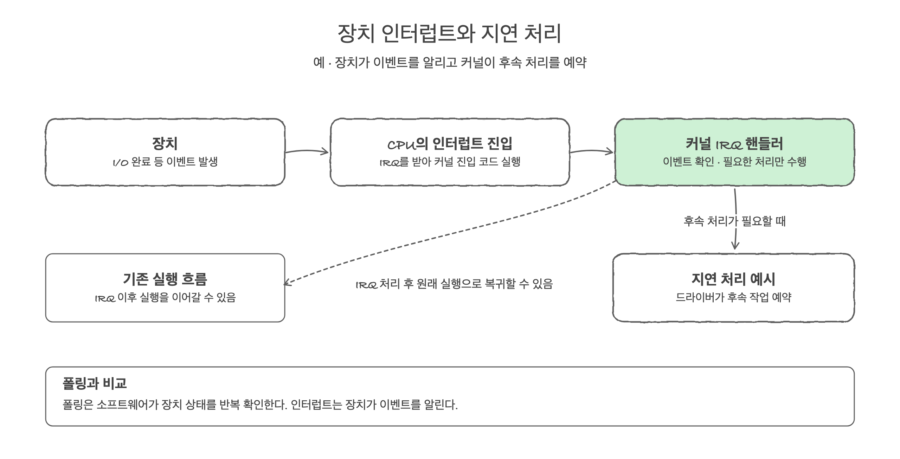
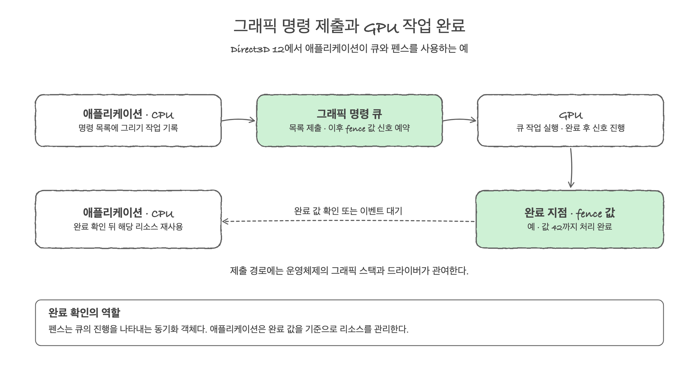
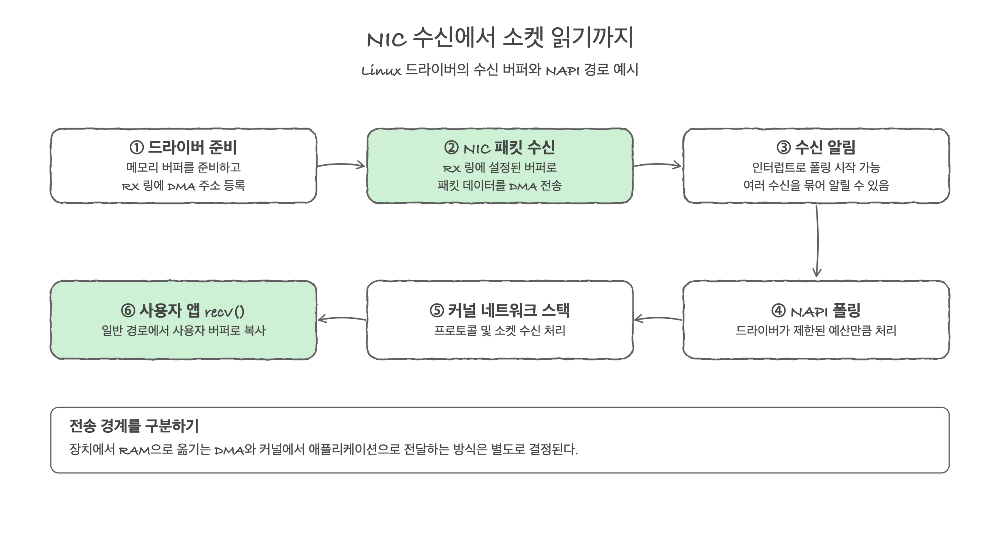

# 인터럽트, DMA와 장치 I/O

## 1. 폴링과 인터럽트

폴링에서는 CPU가 장치의 완료 상태를 반복해서 확인한다. 계속 확인하는 바쁜 대기(busy polling)는 이벤트를 빨리 발견할 수 있지만, 처리할 일이 없는 동안에도 CPU 시간을 쓴다. 인터럽트 방식에서는 장치가 처리할 일이 생겼다고 CPU에 알린다. 그때까지 CPU는 다른 작업을 진행할 수 있다. Linux의 NAPI는 이 두 방식을 결합한다. 장치 인터럽트로 처리를 시작하고, 처리할 패킷이 몰리면 한 번의 알림 뒤에 여러 패킷을 폴링으로 처리한다. [Linux 6.12 NAPI · 기본 동작과 Busy polling](https://docs.kernel.org/6.12/networking/napi.html)

장치 알림과 커널의 지연 처리 흐름이다. [Linux 6.12 Generic IRQ · request_threaded_irq](https://docs.kernel.org/6.12/core-api/genericirq.html#c.request_threaded_irq) · [Linux 6.12 NAPI · Datapath API](https://docs.kernel.org/6.12/networking/napi.html#datapath-api) · [Linux 6.12 커널 진입 · Syscalls와 Interrupts](https://docs.kernel.org/6.12/core-api/entry.html)

장치의 인터럽트 요청(IRQ)이 전달되면 커널이 등록된 인터럽트 서비스 루틴(ISR)을 실행한다. 첫 핸들러는 장치가 알림을 보낸 원인을 확인하고 필요한 장치 상태만 처리한 뒤, 길어질 작업을 후속 처리에 넘긴다. 예를 들어 Linux의 `request_threaded_irq()`에서는 주 핸들러가 공유 IRQ의 출처를 확인한 뒤 `IRQ_WAKE_THREAD`를 반환해 IRQ 스레드에서 `thread_fn`을 실행하게 할 수 있다. 네트워크 드라이버는 보통 NAPI를 예약하고 후속 처리를 소프트웨어 인터럽트 컨텍스트에서 수행한다. [Linux 6.12 Generic IRQ · request_threaded_irq](https://docs.kernel.org/6.12/core-api/genericirq.html#c.request_threaded_irq) · [Linux 6.12 NAPI · Datapath API](https://docs.kernel.org/6.12/networking/napi.html#datapath-api)

시스템 콜은 애플리케이션 스레드가 `read()`처럼 운영체제에 작업을 요청하는 동기적인 커널 진입이다. 장치 인터럽트는 장치 이벤트에 의해 비동기적으로 들어오며 CPU가 사용자 코드를 실행하는 동안이나 이미 커널 안에 있을 때도 처리할 수 있다. 소켓에 데이터가 이미 있다면 `read()`가 같은 스레드로 복귀할 수 있고, 데이터가 없어서 스레드가 대기하면 그사이에 커널이 다른 스레드를 실행할 수 있다. 커널 진입과 스레드 교체의 관계는 [컨텍스트 스위칭과 CPU 스케줄링](../interview/operation-system-interview/03_context_switching_and_cpu_scheduling.md)에서도 다룬다. [Linux 6.12 커널 진입 · Syscalls와 Interrupts](https://docs.kernel.org/6.12/core-api/entry.html) · [Linux read(2)](https://man7.org/linux/man-pages/man2/read.2.html)

## 2. Direct3D 12에서 GPU 작업을 제출하고 기다리는 방법

Windows에서 DirectX의 그래픽 API인 Direct3D 12를 쓰는 애플리케이션은 CPU에서 그리기나 리소스 복사 명령을 명령 목록(command list)에 기록한다. 목록을 닫고 `ID3D12CommandQueue::ExecuteCommandLists()`에 전달하면 큐에 GPU 작업이 제출된다. GPU는 큐에 제출된 일을 실행하는 동안 CPU는 다음 프레임의 명령을 준비할 수 있다. [Microsoft Learn · 명령 목록 기록](https://learn.microsoft.com/en-us/windows/win32/direct3d12/recording-command-lists-and-bundles) · [Microsoft Learn · ExecuteCommandLists](https://learn.microsoft.com/en-us/windows/win32/api/d3d12/nf-d3d12-id3d12commandqueue-executecommandlists)

명령 제출, GPU 실행, 펜스로 확인한 완료 지점을 그렸다. [Microsoft Learn · 명령 목록 기록](https://learn.microsoft.com/en-us/windows/win32/direct3d12/recording-command-lists-and-bundles) · [Microsoft Learn · ExecuteCommandLists](https://learn.microsoft.com/en-us/windows/win32/api/d3d12/nf-d3d12-id3d12commandqueue-executecommandlists) · [Microsoft Learn · Multi-engine synchronization의 Fences](https://learn.microsoft.com/en-us/windows/win32/direct3d12/user-mode-heap-synchronization#fences)

Windows 디스플레이 드라이버 모델(WDDM)에서는 사용자 모드 드라이버와 커널 모드 디스플레이 드라이버가 그래픽 작업을 처리한다. DirectX 그래픽 커널 하위 시스템에는 GPU 스케줄러와 비디오 메모리 관리자가 있다. Direct3D 12의 명령 큐는 이 드라이버 모델 위에서 GPU에 작업을 제출하는 API다. 실제 하드웨어 큐에 작업을 전달하는 경로는 WDDM과 드라이버의 기능에 따라 달라질 수 있다. [Microsoft Learn · WDDM 아키텍처](https://learn.microsoft.com/en-us/windows-hardware/drivers/display/windows-vista-and-later-display-driver-model-architecture) · [Microsoft Learn · 사용자 모드 작업 제출](https://learn.microsoft.com/en-us/windows-hardware/drivers/display/user-mode-work-submission)

같은 큐에서 명령 목록 제출 뒤에 `ID3D12CommandQueue::Signal(fence, 42)`를 넣으면 그 앞의 작업이 끝났을 때 fence 값이 42로 갱신된다. CPU는 `GetCompletedValue()`로 진행 상태를 읽거나 `SetEventOnCompletion(42, event)`로 지정한 값에 도달할 때 이벤트를 받을 수 있다. 예를 들어 프레임의 명령을 담았던 command allocator를 재사용할 때는 이 값으로 GPU 사용이 끝났는지 확인한 후 `Reset()`한다. [Microsoft Learn · Multi-engine synchronization의 Fences](https://learn.microsoft.com/en-us/windows/win32/direct3d12/user-mode-heap-synchronization#fences) · [Microsoft Learn · ID3D12CommandAllocator::Reset](https://learn.microsoft.com/en-us/windows/win32/api/d3d12/nf-d3d12-id3d12commandallocator-reset)

Fence는 CPU나 다른 큐가 기다릴 수 있는 진행 상태 값이다. IRQ는 그 상태가 바뀌었음을 CPU에 알리는 데 쓰일 수 있다. Microsoft가 설명하는 WDDM 명령 버퍼 제출 경로에서는 드라이버가 GPU의 DMA 버퍼 완료 인터럽트를 받은 뒤 스케줄러에 알리고, 나머지 처리를 DPC(Deferred Procedure Call)로 넘긴다. WDDM 3.2의 native GPU fence는 CPU가 기다리는 신호에만 조건부로 인터럽트를 발생시킬 수 있다. 따라서 프레임마다 fence 값을 올리는 코드만 보고 하드웨어 IRQ 발생 횟수를 추정할 수 없다. [Microsoft Learn · WDDM 명령 버퍼 제출 7–11단계](https://learn.microsoft.com/en-us/windows-hardware/drivers/display/submitting-a-command-buffer) · [Microsoft Learn · Native GPU fence object](https://learn.microsoft.com/en-us/windows-hardware/drivers/display/native-gpu-fence-objects)

## 3. Linux NIC의 수신 링과 DMA

DMA(Direct Memory Access)는 장치가 메모리에서 데이터를 읽거나 메모리에 쓰는 방식이다. CPU에서 실행되는 드라이버는 버퍼를 준비하고 장치가 사용할 DMA 주소를 설정한다. 장치는 그 주소로 데이터를 전송한다. DMA 주소는 CPU가 쓰는 가상 주소와 별개다. IOMMU를 사용하는 시스템에서는 IOMMU가 장치의 DMA 주소를 실제 메모리의 물리 주소로 변환한다. [Linux 6.12 Dynamic DMA mapping Guide · CPU and DMA addresses](https://docs.kernel.org/6.12/core-api/dma-api-howto.html#cpu-and-dma-addresses)

NIC 수신에 쓰는 DMA와 일반 소켓 읽기에 쓰는 데이터 전달을 한 그림에 표시했다. [Linux 6.12 igb 드라이버 · 수신 버퍼 할당 및 링 갱신](https://github.com/torvalds/linux/blob/v6.12/drivers/net/ethernet/intel/igb/igb_main.c#L8450-L8555) · [Linux 6.12 NAPI · Scheduling and IRQ masking](https://docs.kernel.org/6.12/networking/napi.html#scheduling-and-irq-masking) · [Linux 6.12 TCP 소스 · tcp_recvmsg_locked](https://github.com/torvalds/linux/blob/v6.12/net/ipv4/tcp.c#L2588-L2602)

1. **버퍼를 준비한다.** 드라이버는 수신 버퍼를 DMA용으로 매핑하고 주소를 수신 디스크립터 링(RX ring)에 적는다. 링은 디스크립터를 순환해서 쓰는 큐다. 패킷을 담는 공간은 각 디스크립터가 가리키는 버퍼다. [Linux 6.12 igb 드라이버 · 수신 버퍼 할당 및 링 갱신](https://github.com/torvalds/linux/blob/v6.12/drivers/net/ethernet/intel/igb/igb_main.c#L8450-L8555)
2. **NIC가 패킷을 수신한다.** 네트워크 인터페이스 카드(NIC)는 수신 프레임을 DMA로 버퍼에 쓰고, 처리한 디스크립터에 길이 같은 완료 정보를 기록한다. CPU는 후속 처리에서 이 정보를 보고 어떤 버퍼를 읽을지 판단한다. [Linux 6.12 DMA 가이드 · DMA 방향](https://docs.kernel.org/6.12/core-api/dma-api-howto.html#dma-direction) · [Linux 6.12 igb 드라이버 · 수신 디스크립터 확인](https://github.com/torvalds/linux/blob/v6.12/drivers/net/ethernet/intel/igb/igb_main.c#L8304-L8347)
3. **IRQ를 받아 NAPI를 예약한다.** 기본 동작에서는 NIC의 알림을 받은 드라이버가 NAPI 인스턴스를 예약한다. 폴링을 계속하는 동안 해당 IRQ를 마스킹해 같은 큐의 알림이 반복되는 일을 줄인다. [Linux 6.12 NAPI · Scheduling and IRQ masking](https://docs.kernel.org/6.12/networking/napi.html#scheduling-and-irq-masking)
4. **완료된 수신 항목을 처리한다.** NAPI의 poll 콜백은 한 번에 `budget` 이하의 수신 패킷을 처리한다. 처리할 항목이 남으면 새 IRQ가 오지 않아도 다시 폴링한다. 기본 경로에서는 처리할 항목을 모두 비우고 `napi_complete_done()`이 성공한 뒤 IRQ 마스킹을 해제한다. 드라이버는 수신 링의 빈 자리에 다음 수신에 사용할 버퍼를 공급한다. [Linux 6.12 NAPI · Datapath API](https://docs.kernel.org/6.12/networking/napi.html#datapath-api) · [Linux 6.12 NAPI · Scheduling and IRQ masking](https://docs.kernel.org/6.12/networking/napi.html#scheduling-and-irq-masking) · [Linux 6.12 igb 드라이버 · 수신 처리 후 버퍼 보충](https://github.com/torvalds/linux/blob/v6.12/drivers/net/ethernet/intel/igb/igb_main.c#L8390-L8447)

장치의 인터럽트 조절(interrupt moderation 또는 coalescing)은 NIC가 패킷을 몇 개 모으거나 지정된 시간까지 기다린 뒤 알림을 보내는 기능이다. IRQ 횟수를 줄일 수 있지만, 다음 알림을 기다리는 패킷의 수신 지연이 늘 수 있다. NAPI의 `budget`은 IRQ 이후 드라이버가 한 번의 poll에서 처리할 수신량을 제어한다. 장치의 알림 설정과 커널의 처리량 제한은 서로 다른 지점에 적용된다. [Linux ethtool Netlink · COALESCE_GET](https://docs.kernel.org/networking/ethtool-netlink.html#coalesce-get) · [Linux 6.12 NAPI · Datapath API와 Software IRQ coalescing](https://docs.kernel.org/6.12/networking/napi.html)

## 4. 소켓 복사와 수신 성능 확인

일반 TCP 소켓에서는 NIC가 커널의 수신 버퍼에 DMA로 프레임을 쓴 뒤, 네트워크 스택이 패킷을 처리한다. 애플리케이션이 `recv()`로 데이터를 가져갈 때 기본 수신 경로에서는 커널이 소켓에 대기 중인 데이터를 호출자가 제공한 버퍼로 복사한다. Linux 6.12의 일반 TCP 경로에서 이 복사가 `tcp_recvmsg_locked()`의 `skb_copy_datagram_msg()`에 해당한다. 장치에서 커널 메모리까지 DMA를 사용해도 소켓에서 사용자 버퍼까지의 복사 비용은 남는다. [Linux 6.12 TCP 소스 · tcp_recvmsg_locked](https://github.com/torvalds/linux/blob/v6.12/net/ipv4/tcp.c#L2588-L2602) · [Linux recv(2)](https://man7.org/linux/man-pages/man2/recv.2.html)

사용자 공간까지의 복사를 줄이는 별도 경로로 AF_XDP가 있다. AF_XDP는 인터페이스의 지정된 큐에 바인딩하고 XDP 프로그램의 리다이렉션을 통해 사용자 공간에 등록한 UMEM과 링으로 프레임을 처리한다. 드라이버가 지원하는 제로 카피 모드를 요구하려면 `XDP_ZEROCOPY`를 지정한다. 해당 모드로 바인딩할 수 없으면 실패한다. 이 경우 제로 카피의 범위는 그 AF_XDP 소켓의 프레임 전송 구간이다. [Linux 6.12 AF_XDP · UMEM과 바인드 플래그](https://docs.kernel.org/6.12/networking/af_xdp.html)

- **IRQ 분포.** `/proc/interrupts`를 같은 간격으로 두 번 읽고 NIC 큐에 대응하는 IRQ의 CPU별 증가량을 비교한다. RX 큐의 처리가 특정 코어에 집중되는지 확인할 수 있다. NIC의 큐와 IRQ 매핑은 드라이버 구성을 기준으로 해석한다. [Linux 네트워킹 확장 · RSS IRQ Configuration](https://docs.kernel.org/networking/scaling.html#rss-irq-configuration) · [Linux 6.12 NAPI · Instance to queue mapping](https://docs.kernel.org/6.12/networking/napi.html#instance-to-queue-mapping)
- **수신 손실.** `ip -s -s link show dev <iface>`로 표준 통계를 확인하고, `ethtool -S <iface>`에서 드라이버가 제공하는 통계의 의미를 대조한다. 표준 `rx_missed_errors`는 수신 버퍼 여유가 부족해 장치에서 놓친 패킷을 나타낸다. 자원 부족이나 미지원 프로토콜 등으로 수신 후 처리하지 못한 패킷은 표준 `rx_dropped`의 범위다. `/proc/net/dev`의 drop 열에는 두 값이 합쳐진다. [Linux Interface statistics · Standard interface statistics와 Statistics definitions](https://docs.kernel.org/networking/statistics.html)
- **조절 효과.** 같은 트래픽 조건에서 IRQ 증가량, 처리량, p99 수신 지연, 수신 손실의 증가량을 함께 본다. 예를 들어 IRQ는 줄었는데 p99가 늘었다면 알림을 모으는 시간이 지연에 기여했는지 확인한다. 코어마다 RX 큐 부하가 다르면 NIC 코얼레싱 설정과 함께 큐 분배와 IRQ 친화성도 확인한다. [Linux ethtool Netlink · COALESCE_GET](https://docs.kernel.org/networking/ethtool-netlink.html#coalesce-get) · [Linux 네트워킹 확장 · RSS Configuration](https://docs.kernel.org/networking/scaling.html#rss-configuration)
