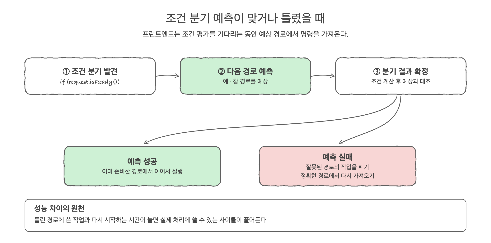
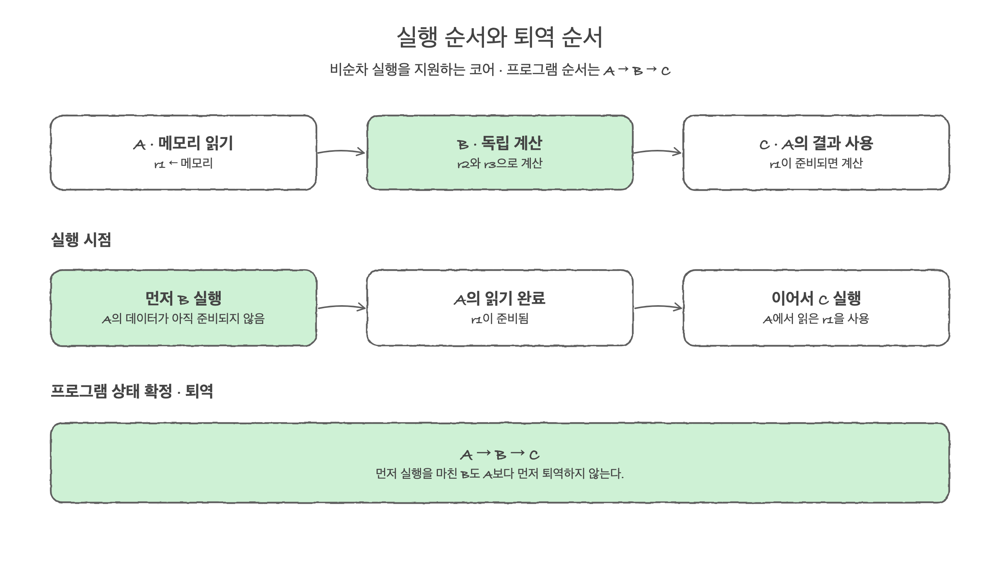

# CPU의 분기 예측, 비순차 실행과 추측 실행

## 1. 분기 결과를 기다리는 동안 다음 명령 가져오기

명령어 파이프라인은 명령 가져오기, 해석, 실행 같은 단계를 겹쳐 진행한다. 조건 분기의 결과가 아직 계산되지 않았을 때, 분기 예측기는 다음에 실행할 경로를 예상한다. 프런트엔드는 그 경로의 명령을 가져와 실행부가 일할 수 있게 준비한다. [Intel 64·IA-32 최적화 매뉴얼 §3.4 Front End Optimization](https://cdrdv2-public.intel.com/814198/248966-Optimization-Reference-Manual-V1-049.pdf)



같은 조건 분기에서 예측 성공과 실패 후 프런트엔드의 흐름을 비교했다. [Intel 64·IA-32 최적화 매뉴얼 §3.4.1 Branch Prediction Optimization](https://cdrdv2-public.intel.com/814198/248966-Optimization-Reference-Manual-V1-049.pdf) · [Intel · Hardware Features and Behaviors Related to Speculative Execution](https://www.intel.com/content/www/us/en/developer/articles/technical/software-security-guidance/technical-documentation/hardware-behavior-related-to-speculative-execution.html)

예를 들어 요청 목록에서 `if (request.isReady())`가 거의 항상 참이라면, CPU는 실행 이력 등에 따라 참 경로의 명령을 미리 가져올 수 있다. 조건 평가가 끝나 예상이 맞으면 이어서 진행한다. 빗나가면 잘못된 경로의 작업을 폐기하고 올바른 경로에서 다시 가져온다. 예측기 구조와 실패 비용은 프로세서 모델, 분기 형태, 주변 명령에 따라 달라진다. [Intel 64·IA-32 최적화 매뉴얼 §3.4.1 Branch Prediction Optimization](https://cdrdv2-public.intel.com/814198/248966-Optimization-Reference-Manual-V1-049.pdf) · [Intel · Hardware Features and Behaviors Related to Speculative Execution](https://www.intel.com/content/www/us/en/developer/articles/technical/software-security-guidance/technical-documentation/hardware-behavior-related-to-speculative-execution.html)

## 2. 비순차 실행과 추측 실행으로 대기 시간 겹치기

비순차 실행(out-of-order execution)을 지원하는 코어에서는 먼저 들어온 명령의 입력이 아직 준비되지 않았을 때, 입력과 실행 자원이 준비된 뒤쪽의 독립 명령을 먼저 실행할 수 있다. 예를 들어 메모리에서 값을 읽는 명령이 지연되는 동안, 그 값과 무관한 레지스터 연산을 수행할 수 있다. 입력이 앞 명령의 결과에 의존하는 연산은 그 결과를 기다려야 한다. [Intel 64·IA-32 최적화 매뉴얼 §2 Microarchitecture, Out-of-Order Engine](https://cdrdv2-public.intel.com/814198/248966-Optimization-Reference-Manual-V1-049.pdf)



입력 준비 순서에 따른 실행과 프로그램 순서에 따른 퇴역을 나눠 그렸다. [Intel 64·IA-32 최적화 매뉴얼 §2 Microarchitecture, Out-of-Order Engine](https://cdrdv2-public.intel.com/814198/248966-Optimization-Reference-Manual-V1-049.pdf) · [Intel · Hardware Features and Behaviors Related to Speculative Execution](https://www.intel.com/content/www/us/en/developer/articles/technical/software-security-guidance/technical-documentation/hardware-behavior-related-to-speculative-execution.html)

추측 실행(speculative execution)은 분기 결과처럼 확정되지 않은 조건을 가정해 실행을 먼저 진행하는 방식이다. 예측에 성공한 명령은 정상적으로 퇴역(retire)할 수 있고, x86의 비순차 실행 코어는 일반적으로 프로그램 순서대로 퇴역시켜 외부에 보이는 상태를 확정한다. 분기 예측은 다음 경로를 고르고, 비순차 실행은 준비된 작업 순서를 조정하며, 퇴역은 실제 프로그램 상태에 반영할 결과를 확정한다. [Intel 64·IA-32 최적화 매뉴얼 §2 Microarchitecture, Out-of-Order Engine](https://cdrdv2-public.intel.com/814198/248966-Optimization-Reference-Manual-V1-049.pdf) · [Intel · Hardware Features and Behaviors Related to Speculative Execution](https://www.intel.com/content/www/us/en/developer/articles/technical/software-security-guidance/technical-documentation/hardware-behavior-related-to-speculative-execution.html)

하드웨어 **프리페치(prefetch)**는 앞으로 읽을 가능성이 있는 데이터를 캐시에 미리 가져온다. 예를 들어 배열의 원소를 연속으로 순회하면 일부 프로세서는 일정한 접근 간격을 알아차려 다음 캐시 라인을 준비할 수 있다. 분기 예측은 실행할 명령 경로를, 데이터 프리페치는 다음 메모리 접근을 예상한다. [Intel 64·IA-32 최적화 매뉴얼 §3.7.2–3.7.3 Hardware Data Prefetching](https://cdrdv2-public.intel.com/814198/248966-Optimization-Reference-Manual-V1-049.pdf)

## 3. 예측 실패가 성능과 격리에 주는 영향

분기 예측이 자주 틀리면 이미 가져오거나 실행한 명령이 폐기되어 실제 처리에 쓰일 수 있는 사이클이 줄어든다. 지원되는 Linux 환경에서는 같은 프로그램을 두 입력 집합으로 실행해 경과 시간과 분기 실패 비율을 비교한다. 알고리즘이나 메모리 접근도 함께 달라졌다면, 분기 실패 수 하나만으로 처리 시간 차이를 설명하기 어렵다. 하드웨어 카운터 지원 여부와 측정 권한은 실행 환경에 따라 달라진다. [Intel 64·IA-32 최적화 매뉴얼 §3.4.1 Branch Prediction Optimization](https://cdrdv2-public.intel.com/814198/248966-Optimization-Reference-Manual-V1-049.pdf) · [Linux perf stat · Events and examples](https://github.com/torvalds/linux/blob/master/tools/perf/Documentation/perf-stat.txt) · [Linux perf 이벤트 보안과 권한](https://docs.kernel.org/admin-guide/perf-security.html)

```bash
perf list hw
perf stat -e cycles,instructions,branches,branch-misses -- ./workload
```

잘못 예측한 명령의 레지스터 결과가 퇴역하지 않아도, 실행 과정에서 캐시나 예측기 같은 내부 상태는 바뀔 수 있다. 이 차이가 관측 시간을 통해 드러날 수 있다는 점이 Spectre 계열 문제의 출발점이다. Linux에서는 `/sys/devices/system/cpu/vulnerabilities/spectre_v1`과 `spectre_v2`에서 현재 커널의 판정과 적용한 완화를 확인할 수 있다. 실제 보호 범위는 CPU, 마이크로코드, 커널 및 가상화 환경에 따라 확인한다. [Intel · Hardware Features and Behaviors Related to Speculative Execution](https://www.intel.com/content/www/us/en/developer/articles/technical/software-security-guidance/technical-documentation/hardware-behavior-related-to-speculative-execution.html) · [Linux 커널 · Spectre sysfs 상태](https://docs.kernel.org/admin-guide/hw-vuln/spectre.html#spectre-system-information)
