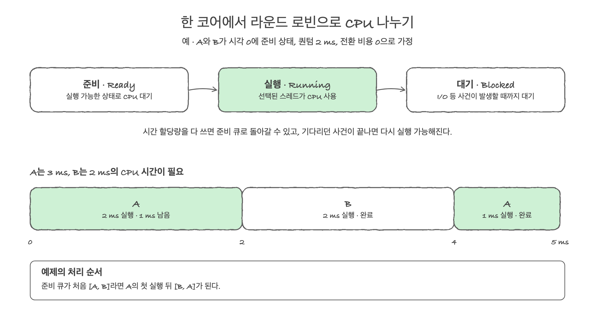
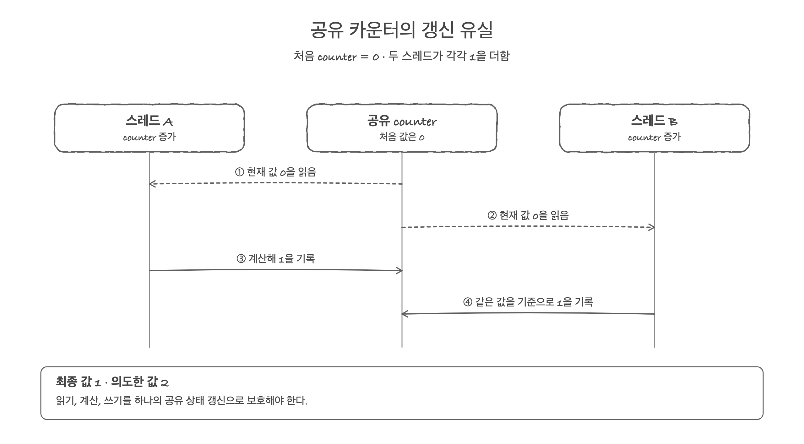
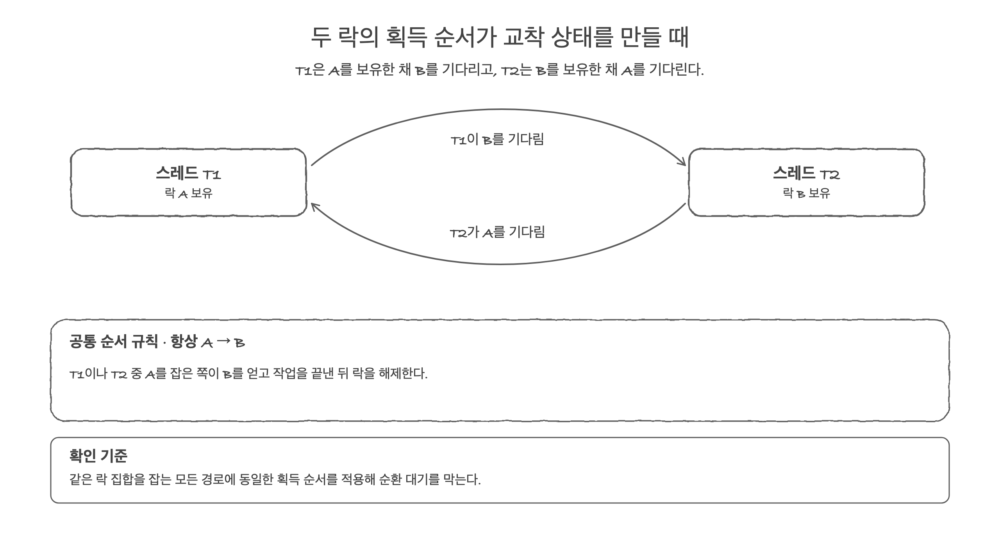

# CPU 스케줄링, IPC와 동기화

운영체제는 실행 가능한 작업에 CPU 시간을 배분한다. 작업이 다른 프로세스와 데이터를 주고받거나 공유 상태를 갱신하면, 누가 언제 진행할 수 있는지를 정하는 규칙도 필요하다. [OSTEP §7 CPU 스케줄링](https://pages.cs.wisc.edu/~remzi/OSTEP/cpu-sched.pdf) · [Linux `shm_overview(7)`](https://man7.org/linux/man-pages/man7/shm_overview.7.html) · [OSTEP §26 동시성](https://pages.cs.wisc.edu/~remzi/OSTEP/threads-intro.pdf)

## 1. CPU 스케줄링과 선점

CPU 스케줄러는 실행할 준비가 된 작업 중 다음에 CPU를 사용할 작업을 선택한다. **준비(ready)** 상태의 작업은 CPU 차례를 기다리고, **실행(running)** 상태의 작업은 CPU에서 명령을 수행한다. 실행 중인 작업이 읽을 데이터가 도착하기를 기다리면 **대기(blocked)** 상태로 이동한다. 데이터가 준비되면 작업이 깨어나 준비 상태로 돌아가고, 스케줄러가 선택할 때 다시 실행된다. [OSTEP §4.4 프로세스 상태](https://pages.cs.wisc.edu/~remzi/OSTEP/cpu-intro.pdf)

스케줄링 상태와 단일 코어 라운드 로빈의 시간표다. [OSTEP §4.4 프로세스 상태](https://pages.cs.wisc.edu/~remzi/OSTEP/cpu-intro.pdf) · [OSTEP §7.7 라운드 로빈](https://pages.cs.wisc.edu/~remzi/OSTEP/cpu-sched.pdf) · [OSTEP §6 실행 제어와 문맥 전환](https://pages.cs.wisc.edu/~remzi/OSTEP/cpu-mechanisms.pdf)

**선점(preemption)**은 커널이 실행 중인 작업에서 CPU를 회수하는 일이다. 예를 들어 타이머 인터럽트로 커널에 제어가 돌아오면 스케줄러가 다음 작업을 선택할 수 있다. 선점된 작업이 계속 실행 가능하면 준비 상태로 돌아간다. 다른 작업을 실행할 때 커널은 이전 작업의 실행 문맥을 보존하고 다음 작업의 문맥을 복원한다. [컨텍스트 스위칭과 CPU 스케줄링](../interview/operation-system-interview/03_context_switching_and_cpu_scheduling.md) · [OSTEP §6 실행 제어와 문맥 전환](https://pages.cs.wisc.edu/~remzi/OSTEP/cpu-mechanisms.pdf)

**라운드 로빈(Round Robin)**은 준비 큐의 맨 앞 작업에 정해진 시간 할당량을 주고, 시간이 끝났을 때 작업이 계속 실행 가능하면 큐 뒤에 넣는다. 단일 코어에서 A와 B가 이 순서로 동시에 준비됐고, A에 3 ms, B에 2 ms의 CPU 시간이 필요하다고 하자. 할당량이 2 ms이고 전환 비용과 I/O 대기가 없으면 0–2 ms에 A, 2–4 ms에 B, 4–5 ms에 A가 실행된다. B는 4 ms, A는 5 ms에 끝난다. 할당량을 줄이면 각 작업의 첫 실행 기회를 앞당길 수 있지만 전환 비용의 비중이 커질 수 있다. [OSTEP §7.7 라운드 로빈](https://pages.cs.wisc.edu/~remzi/OSTEP/cpu-sched.pdf)

POSIX는 라운드 로빈 정책을 `SCHED_RR`로 정의한다. Linux에서는 정책을 개별 스레드에 적용한다. 그중 실시간 정책 `SCHED_RR`은 같은 우선순위의 실행 가능 스레드끼리 라운드 로빈으로 차례를 돌리며, 더 높은 실시간 우선순위의 스레드가 실행 가능해지면 현재 스레드는 선점될 수 있다. 일반 스레드의 기본 정책은 `SCHED_OTHER`다. Linux 커널 문서는 6.6부터 공정 스케줄링 구현이 CFS에서 EEVDF로 전환되기 시작했다고 설명한다. [POSIX `<sched.h>`](https://man7.org/linux/man-pages/man0/sched.h.0p.html) · [Linux `sched(7)`](https://man7.org/linux/man-pages/man7/sched.7.html) · [Linux 커널 EEVDF 문서](https://docs.kernel.org/scheduler/sched-eevdf.html)

## 2. 프로세스 간 통신(IPC)

서로 다른 프로세스는 각자 가상 주소 공간에서 실행된다. 파이프, 소켓, 공유 메모리 같은 **프로세스 간 통신(IPC)** 수단을 통해 데이터를 주고받을 수 있다. [스레드와 동시성 모델](../interview/operation-system-interview/02_threads_and_concurrency_models.md) · [Linux 가상 메모리 개요](https://docs.kernel.org/admin-guide/mm/concepts.html#virtual-memory-primer) · [Linux `pipe(7)`](https://man7.org/linux/man-pages/man7/pipe.7.html) · [Linux `unix(7)`](https://man7.org/linux/man-pages/man7/unix.7.html) · [Linux `shm_overview(7)`](https://man7.org/linux/man-pages/man7/shm_overview.7.html)

- **파이프와 소켓**은 커널이 제공하는 통신 채널이다. 파이프는 한쪽이 쓴 바이트를 다른 쪽이 읽는 단방향 채널이다. 같은 호스트의 두 프로세스가 요청과 응답을 주고받으려면 Unix 도메인 스트림 소켓을 사용할 수 있다. 파이프와 스트림 소켓은 바이트 스트림을 전달하므로 메시지 경계가 필요하면 길이 필드 같은 규칙을 프로토콜에 둔다. [Linux `pipe(7)`](https://man7.org/linux/man-pages/man7/pipe.7.html) · [Linux `unix(7)`](https://man7.org/linux/man-pages/man7/unix.7.html)
- **공유 메모리**를 쓰려면 두 프로세스가 `shm_open()`으로 같은 공유 메모리 객체를 열고 `mmap()`의 `MAP_SHARED`로 같은 영역을 매핑할 수 있다. 각 프로세스는 자신의 주소 공간에 놓인 매핑에서 데이터를 직접 읽고 쓴다. 데이터를 한 번 전달할 때는 초기값이 0인 프로세스 간 공유 세마포어를 두고, 생산자가 버퍼에 데이터를 다 쓴 뒤 `sem_post()`를 호출한다. 소비자는 `sem_wait()`에 성공한 뒤 버퍼를 읽는다. [Linux `shm_overview(7)`](https://man7.org/linux/man-pages/man7/shm_overview.7.html) · [Linux `mmap(2)`](https://man7.org/linux/man-pages/man2/mmap.2.html) · [Linux `sem_init(3)`](https://man7.org/linux/man-pages/man3/sem_init.3.html) · [Linux `sem_wait(3)`](https://man7.org/linux/man-pages/man3/sem_wait.3.html) · [Linux `sem_post(3)`](https://man7.org/linux/man-pages/man3/sem_post.3.html)

## 3. 공유 자원과 임계 구역

스레드가 공유 카운터나 큐를 갱신할 때 접근 순서에 따라 결과가 달라져 프로그램의 규칙이 깨질 수 있다. 이를 **경쟁 상태(race condition)**라고 한다. 공유 상태의 일관성을 지키기 위해 한 번에 하나의 실행 주체만 수행하도록 보호할 코드 구간을 **임계 구역(critical section)**이라고 한다. [OSTEP §26.3 경쟁 상태와 임계 구역](https://pages.cs.wisc.edu/~remzi/OSTEP/threads-intro.pdf)

읽기·수정·쓰기 사이에 다른 스레드가 들어오면 증가 한 번이 유실된다. [OSTEP §26.3 경쟁 상태와 임계 구역](https://pages.cs.wisc.edu/~remzi/OSTEP/threads-intro.pdf) · [JLS 21 §15.14.2 후위 증가](https://docs.oracle.com/javase/specs/jls/se21/html/jls-15.html#jls-15.14.2)

Java에서 초기값이 `0`인 일반 공유 카운터에 스레드 A와 B가 동기화 없이 `count++`를 한 번씩 실행한다고 하자. 증가에는 값 읽기, 1 더하기, 결과 쓰기가 필요하다. A가 `0`을 읽고 B도 `0`을 읽은 뒤 두 스레드가 차례로 `1`을 쓰면 최종값은 `1`이다. 두 번의 증가 중 하나가 사라지는 **갱신 손실(lost update)**이다. 단일 코어에서도 읽기와 쓰기 사이에 실행 주체가 바뀌면 이 순서가 가능하다. [JLS 21 §15.14.2 후위 증가](https://docs.oracle.com/javase/specs/jls/se21/html/jls-15.html#jls-15.14.2) · [OSTEP §26.3 공유 카운터 예제](https://pages.cs.wisc.edu/~remzi/OSTEP/threads-intro.pdf)

## 4. 뮤텍스, 세마포어, 조건 변수와 원자 연산

생산자와 소비자가 공유 큐를 쓸 때는 큐의 내부 상태를 보호하고, 큐가 비어 있으면 소비자를 기다리게 해야 한다. 뮤텍스로 상태 변경을 보호하고 조건 변수로 소비자를 대기시킬 수 있다. [POSIX `pthread_mutex_lock()`](https://man7.org/linux/man-pages/man3/pthread_mutex_lock.3p.html) · [POSIX `pthread_cond_wait()`](https://man7.org/linux/man-pages/man3/pthread_cond_wait.3p.html)

- **뮤텍스(mutex)**는 한 번에 하나의 스레드에 임계 구역 진입을 허용한다. 락을 획득한 스레드가 해제한다. 카운터 증가를 보호하려면 같은 뮤텍스로 읽기부터 쓰기까지를 묶고, 카운터에 접근하는 다른 경로도 그 뮤텍스를 사용한다. [POSIX `pthread_mutex_lock()`](https://man7.org/linux/man-pages/man3/pthread_mutex_lock.3p.html) · [OSTEP §26.3 상호 배제](https://pages.cs.wisc.edu/~remzi/OSTEP/threads-intro.pdf)
- **세마포어(semaphore)**는 가용 허가의 수를 센다. `sem_wait()`는 허가 하나를 차감하며, 가용 수가 0이면 허가가 생길 때까지 대기한다. `sem_post()`는 허가를 추가하며, 획득한 주체와 다른 주체도 호출할 수 있다. 예를 들어 동시 실행을 3개로 제한할 때 초기값을 3으로 두고, 작업마다 시작 전에 획득하고 끝나면 반환한다. [Linux `sem_wait(3)`](https://man7.org/linux/man-pages/man3/sem_wait.3.html) · [Linux `sem_post(3)`](https://man7.org/linux/man-pages/man3/sem_post.3.html) · [Linux `sem_init(3)`](https://man7.org/linux/man-pages/man3/sem_init.3.html)
- **조건 변수(condition variable)**는 공유 상태가 특정 조건을 만족하기를 기다릴 때 쓴다. 소비자는 뮤텍스를 획득한 뒤 큐가 비어 있는 동안 `while`로 `pthread_cond_wait()`를 호출한다. 호출은 뮤텍스 해제와 대기 시작을 원자적으로 처리하고, 반환 전에 뮤텍스를 다시 획득한다. 생산자는 같은 뮤텍스로 큐에 항목을 넣고 조건 변수에 신호를 보낸다. 소비자는 신호 없이 깨어나거나 락을 다시 얻기 전에 다른 소비자가 항목을 가져갈 수 있으므로, 반환 후 큐가 비어 있는지 다시 확인한다. [POSIX `pthread_cond_wait()`](https://man7.org/linux/man-pages/man3/pthread_cond_wait.3p.html) · [POSIX `pthread_cond_signal()`](https://man7.org/linux/man-pages/man3/pthread_cond_broadcast.3p.html)
- **원자적 증가(atomic increment)**는 독립된 카운터 하나를 갱신할 때 적합하다. Java SE 21의 `AtomicInteger.incrementAndGet()`은 값 읽기와 증가, 저장을 한 번의 원자 연산으로 처리한다. 여러 스레드가 같은 변수에 갱신을 집중시키면 경합이 생길 수 있다. 재고가 남았는지 확인하고 재고와 예약 건수를 함께 바꾸는 작업처럼 여러 값을 한 묶음으로 보호해야 하면 하나의 락 아래에서 전체 상태 변경을 수행할 수 있다. [Java SE 21 `AtomicInteger.incrementAndGet()`](https://docs.oracle.com/en/java/javase/21/docs/api/java.base/java/util/concurrent/atomic/AtomicInteger.html#incrementAndGet()) · [Java SE 21 `LongAdder` 클래스 설명](https://docs.oracle.com/en/java/javase/21/docs/api/java.base/java/util/concurrent/atomic/LongAdder.html) · [POSIX `pthread_mutex_lock()`](https://man7.org/linux/man-pages/man3/pthread_mutex_lock.3p.html)

## 5. 교착 상태와 기아

**교착 상태(deadlock)**는 작업들이 서로가 보유한 자원을 기다려 어느 쪽도 진행할 수 없는 상태다. 스레드 T1이 락 A를 가진 채 B를 기다리고, T2가 락 B를 가진 채 A를 기다린다고 하자. 두 스레드 모두 두 번째 락을 획득하기 전에는 첫 번째 락을 놓지 않는 경로에 들어섰으므로 서로의 해제를 영원히 기다린다. [OSTEP §32.3 교착 상태](https://pages.cs.wisc.edu/~remzi/OSTEP/threads-bugs.pdf)

두 스레드의 대기 그래프와 일관된 락 획득 순서를 비교했다. [OSTEP §32.3 교착 상태](https://pages.cs.wisc.edu/~remzi/OSTEP/threads-bugs.pdf) · [Coffman 외, System Deadlocks §3](https://uobdv.github.io/Design-Verification/Supplementary/System_Deadlocks-Four_necessary_and_sufficient_conditions_for_deadlock.pdf)

자원 교착에는 네 조건이 함께 성립한다. **상호 배제**는 한 자원을 한 작업이 독점하는 조건이다. **점유 및 대기**는 자원을 보유한 채 다른 자원을 기다리는 조건이다. **비선점**은 다른 작업이 보유한 자원을 강제로 회수할 수 없다는 조건이다. **순환 대기**는 각 작업이 다음 작업의 자원을 기다리는 관계가 닫힌 고리를 이루는 조건이다. [Coffman 외, System Deadlocks §2](https://uobdv.github.io/Design-Verification/Supplementary/System_Deadlocks-Four_necessary_and_sufficient_conditions_for_deadlock.pdf)

두 락을 함께 쓰는 모든 경로에서 항상 A를 먼저, B를 나중에 획득하면 순환 대기를 예방할 수 있다. T2는 A를 획득하기 전에는 B를 잡지 않으므로, A를 가진 T1과 서로의 락을 기다리는 고리가 생기지 않는다. 락이 더 많아지면 락의 전역 순서를 정하고 중첩 획득이 그 순서를 따르게 한다. [Coffman 외, System Deadlocks §3](https://uobdv.github.io/Design-Verification/Supplementary/System_Deadlocks-Four_necessary_and_sufficient_conditions_for_deadlock.pdf) · [OSTEP §32.3 락 획득 순서](https://pages.cs.wisc.edu/~remzi/OSTEP/threads-bugs.pdf)

**기아(starvation)**는 다른 작업들이 진행하는 동안 특정 작업에 CPU나 자원이 계속 배정되지 않는 상태다. 락 배정이 불공정하면 순환 대기가 없어도 다른 스레드가 먼저 획득하는 일이 반복될 수 있다. 락을 기다리는 스레드의 순서와 준비 상태의 스레드에 CPU를 배정하는 정책은 각각 공정성에 영향을 준다. [경쟁 상태, 동기화와 교착 상태](../interview/operation-system-interview/05_race_conditions_synchronization_and_deadlocks.md) · [Java SE 21 `ReentrantLock`의 공정성](https://docs.oracle.com/en/java/javase/21/docs/api/java.base/java/util/concurrent/locks/ReentrantLock.html) · [OSTEP §8.3 스케줄링 기아](https://pages.cs.wisc.edu/~remzi/OSTEP/cpu-sched-mlfq.pdf)
