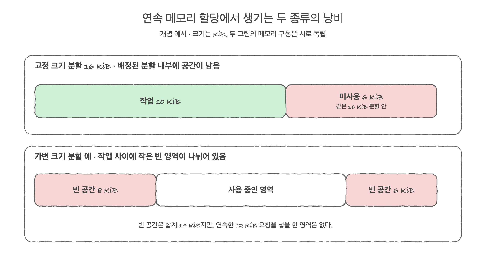
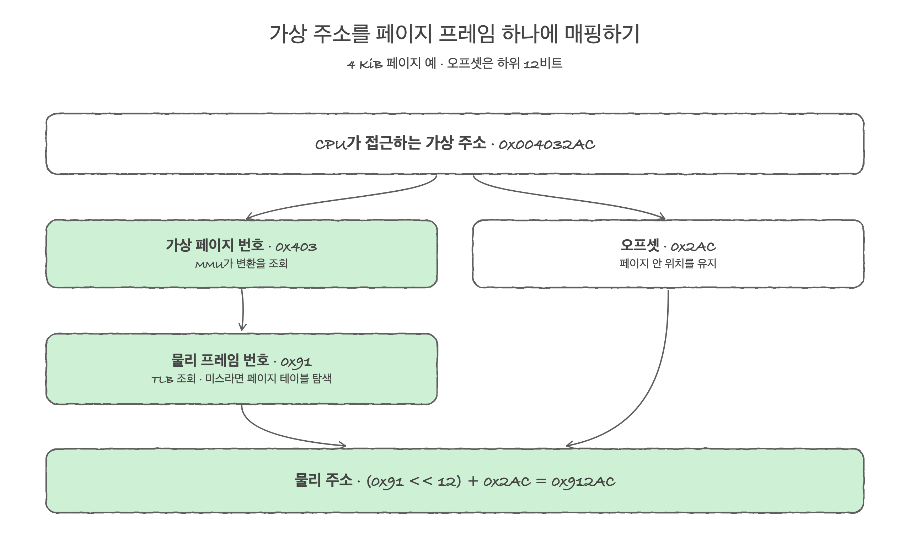
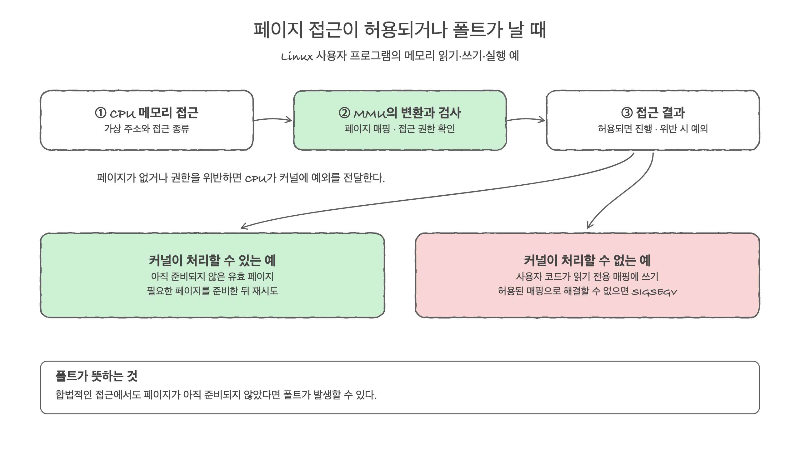

# 메모리 관리와 페이징

## 1. 메모리 관리 개요

페이징을 사용하는 시스템에서 운영체제는 프로세스가 사용할 가상 주소 범위와 권한을 관리하고, 물리 메모리를 할당하거나 회수한다. 커널이 페이지 테이블에 가상 페이지와 물리 프레임의 매핑을 기록하면, 메모리 관리 장치(MMU)는 그 정보를 바탕으로 가상 주소를 물리 주소로 변환하고 접근 권한을 검사한다. [Linux 메모리 관리 개요](https://docs.kernel.org/admin-guide/mm/concepts.html#virtual-memory-primer) · [Linux 페이지 테이블](https://docs.kernel.org/mm/page_tables.html)

## 2. 절대 주소와 상대 주소

절대 주소는 선택한 주소 공간에서 위치를 주소값으로 직접 지정하고, 상대 주소는 기준점에서 얼마나 떨어져 있는지를 오프셋으로 표현한다. 절대·상대는 주소를 표현하는 방식이고, 가상·물리는 주소가 어느 공간에 속하는지를 나타낸다. 따라서 프로그램이 절대 주소 형식으로 지정한 주소도 가상 주소일 수 있다. [GNU 어셈블러 · x86 메모리 참조](https://sourceware.org/binutils/docs/as/i386_002dMemory.html) · [Linux 가상 메모리 개요](https://docs.kernel.org/admin-guide/mm/concepts.html#virtual-memory-primer)

초기 동적 재배치 모델인 **베이스·한계(base and bounds)** 방식에서는 프로세스가 만든 가상 주소를 시작점 `0`으로부터의 오프셋으로 취급한다. 하드웨어는 `0 <= offset < limit`를 만족하는 접근에 `base + offset`을 적용하고, 범위를 벗어나면 예외를 발생시킨다. 예를 들어 베이스가 `0x4000`, 한계가 `0x1000`이면 오프셋 `0x0140`은 물리 주소 `0x4140`이 된다. [OSTEP · 동적 재배치](https://pages.cs.wisc.edu/~remzi/OSTEP/vm-mechanism.pdf)

x86-64의 위치 독립 코드에서는 명령어와 같은 모듈 안의 데이터가 함께 이동할 때 RIP 상대 주소 지정을 사용할 수 있다. 예를 들어 다음 명령어의 주소가 `0x1000`이고 데이터가 `0x1020`에 있다면 변위는 `0x20`이다. 둘을 함께 옮겨 다음 명령어가 `0x5000`에 놓이면 같은 변위로 `0x5020`을 참조한다. [GNU 어셈블러 · RIP 상대 주소 지정](https://sourceware.org/binutils/docs/as/i386_002dMemory.html) · [x86-64 psABI · 위치 독립 코드 모델](https://gitlab.com/x86-psABIs/x86-64-ABI/-/blob/master/x86-64-ABI/low-level-sys-info.tex)

## 3. 오버레이와 스와핑

**오버레이(overlay)**는 한 프로그램에서 동시에 필요하지 않은 부분을 같은 메모리 영역에 번갈아 적재하는 방식이다. IBM System/360의 예에서는 루트 부분을 메모리에 유지하고, 함께 실행할 필요가 없는 두 서브루틴에 같은 적재 주소를 배정해 호출 순서에 따라 교대로 불러왔다. [IBM System/360 FORTRAN 프로그래머 가이드 · Linkage Editor Overlay Feature](https://bitsavers.computerhistory.org/pdf/ibm/360/fortran/GC28-6817-2_OS360_FORTRAN_IV_G_and_H_Programmers_Guide_197006.pdf)

**고전적 스와핑(swapping)**은 운영체제가 프로세스의 메모리 이미지를 단위로 하여 RAM과 디스크 사이에서 옮기는 방식이다. Ritchie와 Thompson이 설명한 초기 UNIX에서는 실행할 프로세스의 이미지가 RAM에 있어야 했으며, 더 높은 우선순위의 활성 프로세스를 위해 다른 프로세스의 이미지를 디스크로 내보낼 수 있었다. [Ritchie·Thompson · The UNIX Time-Sharing System, V. Processes and Images](https://www.nokia.com/bell-labs/about/dennis-m-ritchie/cacm.html)

오늘날 Linux의 메모리 회수는 페이지 단위로 이루어진다. 커널은 원본에서 다시 읽을 수 있는 깨끗한 파일 캐시 페이지를 버리거나, 스왑 공간을 사용할 수 있을 때 보존해야 할 익명 페이지를 스왑으로 내보낼 수 있다. [Linux 익명 메모리](https://docs.kernel.org/admin-guide/mm/concepts.html#anonymous-memory) · [Linux 메모리 회수](https://docs.kernel.org/admin-guide/mm/concepts.html#reclaim)

## 4. 연속 메모리 할당

연속 할당 모델에서는 프로세스에 물리적으로 이어진 구간 하나를 준다. **고정 분할**은 미리 크기를 정한 파티션을 배정한다. 16 KiB 파티션을 10 KiB 프로세스에 통째로 배정하면 파티션 안에 남는 6 KiB가 **내부 단편화**다. [OSTEP · 동적 재배치의 고정 슬롯과 내부 단편화](https://pages.cs.wisc.edu/~remzi/OSTEP/vm-mechanism.pdf)



내부 단편화와 외부 단편화의 차이를 크기 예시로 표시했다. [OSTEP · 동적 재배치의 고정 슬롯과 내부 단편화](https://pages.cs.wisc.edu/~remzi/OSTEP/vm-mechanism.pdf) · [OSTEP · 가변 크기 할당과 외부 단편화](https://pages.cs.wisc.edu/~remzi/OSTEP/vm-freespace.pdf)

**가변 분할**은 요청 크기에 맞는 연속 구간을 빈 공간에서 잘라 배정한다. 할당과 반환을 반복하면 빈 공간이 여러 조각으로 나뉠 수 있다. 예를 들어 8 KiB와 6 KiB의 빈 구간이 서로 떨어져 있으면 총 14 KiB가 비어 있어도 연속된 12 KiB 요청을 처리할 수 없다. 이렇게 할당된 구간 바깥의 빈 공간이 흩어지는 현상이 **외부 단편화**다. [OSTEP · 가변 크기 할당과 외부 단편화](https://pages.cs.wisc.edu/~remzi/OSTEP/vm-freespace.pdf)

## 5. 가상 메모리

가상 메모리는 프로그램이 사용하는 주소와 실제 물리 메모리의 배치를 분리한다. 서로 다른 주소 공간의 같은 가상 주소를 다른 프레임에 연결해 격리할 수 있고, 공유 메모리처럼 함께 쓸 데이터는 서로 다른 주소 공간에 같은 프레임을 매핑할 수 있다. [Linux 가상 메모리 개요](https://docs.kernel.org/admin-guide/mm/concepts.html#virtual-memory-primer) · [Linux 프로세스 주소 공간](https://docs.kernel.org/mm/process_addrs.html)

**요구 페이징(demand paging)**은 접근이 필요한 시점에 페이지를 물리 메모리에 준비한다. 예를 들어 Linux의 일반적인 익명 매핑은 먼저 접근 가능한 가상 주소 범위를 만들고, 처음 쓰는 페이지에 실제 프레임을 할당할 수 있다. 따라서 가상 주소 범위를 확보한 크기와 RAM에 상주하는 크기는 따로 봐야 한다. [Linux 가상 메모리 개요](https://docs.kernel.org/admin-guide/mm/concepts.html#virtual-memory-primer) · [Linux 익명 메모리](https://docs.kernel.org/admin-guide/mm/concepts.html#anonymous-memory)

## 6. 페이징과 주소 변환

페이징은 가상 주소 공간을 **페이지(page)**로, 물리 메모리를 같은 크기의 **프레임(frame)**으로 나눈다. 연속된 가상 페이지를 서로 떨어진 물리 프레임에 배치할 수 있다. 주소를 변환할 때는 가상 페이지 번호(VPN)를 물리 프레임 번호(PFN)로 바꾸고 페이지 안의 오프셋은 유지한다. [OSTEP · 페이징과 주소 변환](https://pages.cs.wisc.edu/~remzi/OSTEP/vm-paging.pdf)

MMU는 주소 변환 정보를 캐시하는 **TLB(Translation Lookaside Buffer)**를 조회한다. TLB에 매핑이 있고 접근이 허용되면 페이지 테이블 순회를 생략한다. x86-64에서 TLB 미스가 발생하면 하드웨어가 페이지 테이블을 순회해 매핑을 찾을 수 있다. 유효한 매핑과 필요한 권한이 있으면 TLB 미스 뒤에도 접근을 계속할 수 있다. [Linux 페이지 테이블](https://docs.kernel.org/mm/page_tables.html) · [Intel SDM Vol. 3A · Caching Translation Information](https://cdrdv2-public.intel.com/929359/253668-093-sdm-vol-3a.pdf)

**다단계 페이지 테이블**은 VPN의 비트들을 단계별 인덱스로 사용한다. 상위 엔트리부터 하위 테이블을 따라가며, 기본 페이지를 매핑하는 최하위 엔트리(PTE)에서 프레임 번호와 관련 속성을 얻는다. 사용하지 않는 주소 범위는 하위 테이블을 만들지 않아 테이블 메모리를 절약할 수 있다. [Linux 페이지 테이블 계층](https://docs.kernel.org/mm/page_tables.html) · [OSTEP · Multi-level Page Tables](https://pages.cs.wisc.edu/~remzi/OSTEP/vm-smalltables.pdf)

다음은 페이지 크기가 4 KiB(`0x1000`)이고, 가상 주소 `0x004032AC`의 페이지가 PFN `0x91`에 매핑되어 있으며 접근이 허용된 경우의 계산 예다. 4 KiB에서는 주소의 하위 12비트가 오프셋이다. [Linux 페이지 프레임 번호 설명](https://docs.kernel.org/mm/page_tables.html) · [OSTEP · 가상 페이지 번호와 오프셋](https://pages.cs.wisc.edu/~remzi/OSTEP/vm-paging.pdf)

```text
가상 페이지 번호  0x004032AC >> 12     = 0x403
페이지 오프셋     0x004032AC & 0xFFF   = 0x2AC
프레임 시작 주소  0x91 × 0x1000        = 0x91000
물리 주소         0x91000 + 0x2AC      = 0x912AC
```



예시 페이지 프레임 매핑에서 가상 페이지 번호가 바뀌고 오프셋이 유지되는 과정이다. [OSTEP · 페이징과 주소 변환](https://pages.cs.wisc.edu/~remzi/OSTEP/vm-paging.pdf) · [Intel SDM Vol. 3A · Caching Translation Information](https://cdrdv2-public.intel.com/929359/253668-093-sdm-vol-3a.pdf) · [Linux 페이지 프레임 번호 설명](https://docs.kernel.org/mm/page_tables.html)

## 7. 가상 메모리 접근 권한

메모리 보호에서는 읽기(R), 쓰기(W), 명령어 실행(X)을 구분한다. Linux의 `mprotect()`는 이러한 접근 유형을 매핑 권한으로 지정하며, 실제 하드웨어에서 권한이 서로 독립적인지는 아키텍처와 설정에 따라 달라진다. x86-64에서는 페이지 변환의 사용자·슈퍼바이저(U/S) 권한으로 사용자 모드의 커널 전용 매핑 접근을 막는다. 실행 금지 기능이 활성화된 경우 XD(NX) 비트는 데이터를 읽을 수 있는 페이지에서도 명령어 인출을 차단할 수 있다. [Linux `mprotect(2)`](https://man7.org/linux/man-pages/man2/mprotect.2.html) · [Intel SDM Vol. 3A · Access Rights](https://cdrdv2-public.intel.com/929359/253668-093-sdm-vol-3a.pdf)



유효한 지연 할당 폴트와 접근 권한 위반의 처리 결과를 비교했다. [Linux 페이지 폴트 처리](https://docs.kernel.org/mm/page_tables.html) · [Linux `sigaction(2)` · SEGV_MAPERR와 SEGV_ACCERR](https://man7.org/linux/man-pages/man2/sigaction.2.html) · [Intel SDM Vol. 3A · Access Rights](https://cdrdv2-public.intel.com/929359/253668-093-sdm-vol-3a.pdf)

**페이지 폴트**는 CPU가 현재 매핑으로 접근을 진행할 수 없을 때 커널에 전달하는 예외다. Linux 커널은 접근이 허용된 범위라면 필요한 페이지를 준비해 명령을 재시도할 수 있다. 예를 들어 쓰기 시 복사(COW) 때문에 읽기 전용으로 둔 페이지에 허용된 쓰기가 발생하면, 커널은 쓰기 가능한 매핑을 준비한다. 사용자 주소가 매핑되지 않았거나 매핑이 해당 접근을 허용하지 않으면 Linux는 현재 스레드에 `SIGSEGV`를 전달한다. [Linux 페이지 폴트 처리](https://docs.kernel.org/mm/page_tables.html) · [Linux `sigaction(2)` · SEGV_MAPERR와 SEGV_ACCERR](https://man7.org/linux/man-pages/man2/sigaction.2.html)

Linux에서 RSS는 상주 메모리 크기를 나타내며, `getrusage()`는 페이지 폴트를 I/O 필요 여부에 따라 minor와 major로 센다. 두 지표의 해석 예시는 [메모리 관리와 가상 메모리 면접 문서](../interview/operation-system-interview/04_memory_management_and_virtual_memory.md)에 있다. [Linux `/proc` · VmRSS](https://docs.kernel.org/filesystems/proc.html) · [Linux `getrusage(2)`](https://man7.org/linux/man-pages/man2/getrusage.2.html)
