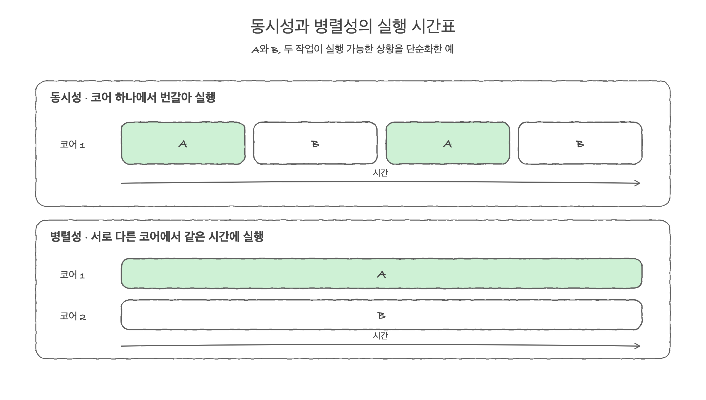
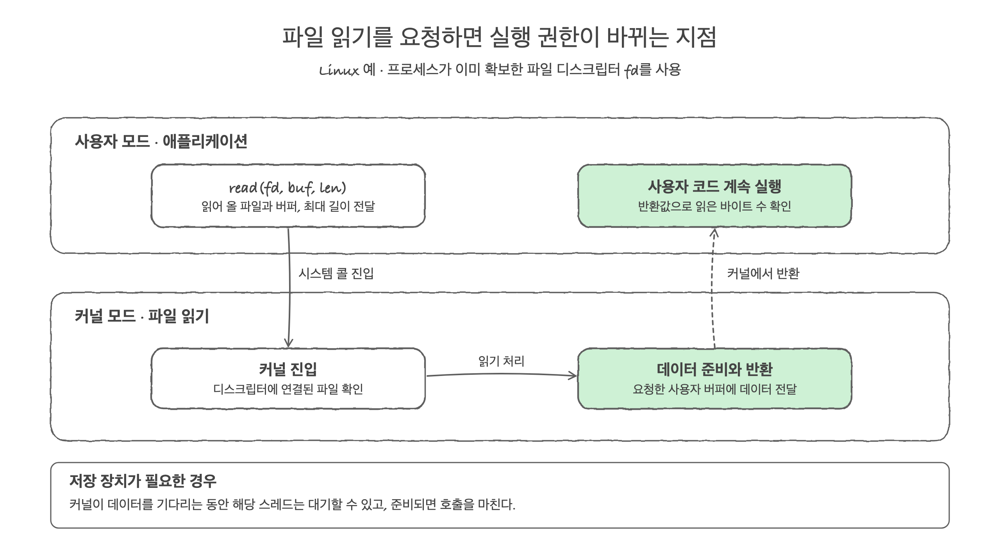
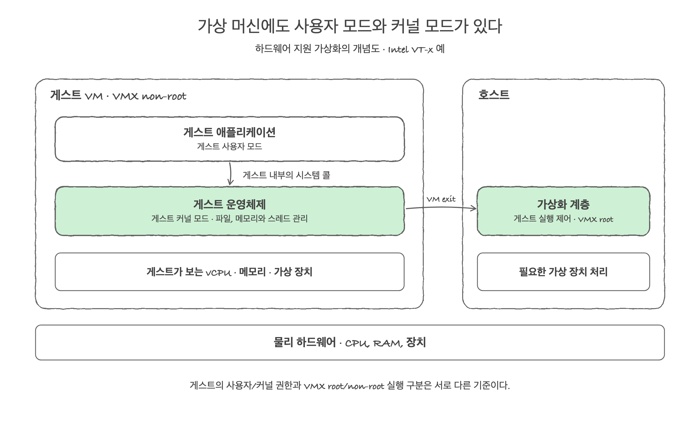
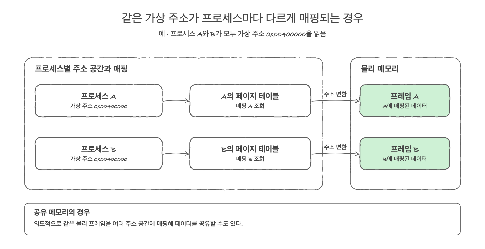

# 운영체제가 프로그램과 하드웨어를 연결하는 방식

## 1. 동시성과 병렬성

**동시성**은 여러 작업이 겹치는 시간 동안 진행될 수 있게 실행을 구성하는 성질이다. 코어 하나에서도 스케줄러가 두 스레드를 번갈아 실행하면 두 작업이 동시적으로 진행된다. **병렬성**은 여러 작업이 실제로 같은 시점에 실행되는 성질이다. 실행 가능한 두 스레드를 서로 다른 코어에 배치하면 CPU에서 병렬로 처리할 수 있다. [Go Blog · Concurrency is not parallelism](https://go.dev/blog/waza-talk) · [OSTEP §7 CPU 스케줄링](https://pages.cs.wisc.edu/~remzi/OSTEP/cpu-sched.pdf) · [OSTEP §26 동시성](https://pages.cs.wisc.edu/~remzi/OSTEP/threads-intro.pdf)

같은 두 작업이 CPU 시간을 나눠 쓰거나 서로 다른 코어에서 병렬로 실행되는 예다. [Go Blog · Concurrency is not parallelism](https://go.dev/blog/waza-talk) · [OSTEP §7 CPU 스케줄링](https://pages.cs.wisc.edu/~remzi/OSTEP/cpu-sched.pdf) · [OSTEP §26 동시성](https://pages.cs.wisc.edu/~remzi/OSTEP/threads-intro.pdf)

예를 들어 요청 A가 소켓 응답을 기다리는 동안 요청 B가 실행될 수 있다. 요청을 함께 진행시키는 데는 코어 하나로도 충분할 수 있다. 독립된 CPU 계산 두 개를 같은 시간에 실행하려면 실행 자원도 둘 이상 필요하다. 코어 수와 별개로, 공유 상태에 접근하는 코드에는 실행 순서에 따른 오류가 생길 수 있다. 준비 큐와 선점 예제는 [CPU 스케줄링과 동기화](03_understanding_scheduling_ipc_and_synchronization.md)에서 이어서 볼 수 있다. [OSTEP §4.4 프로세스 상태](https://pages.cs.wisc.edu/~remzi/OSTEP/cpu-intro.pdf) · [OSTEP §26.3 경쟁 상태](https://pages.cs.wisc.edu/~remzi/OSTEP/threads-intro.pdf)

## 2. 원자성, 동기화와 교착 상태

**원자성**은 공유 상태의 한 연산이 다른 실행 주체에게 중간 상태로 드러나지 않고 한 단계처럼 수행되는 성질이다. 카운터 증가처럼 읽기·계산·쓰기로 이루어진 연산에는 원자적 증가 연산을 쓸 수 있다. 큐의 항목과 개수처럼 함께 바꿔야 하는 상태라면 같은 뮤텍스로 전체 임계 구역을 보호한다. 여기서 다루는 원자성의 범위는 스레드가 관찰하는 메모리 갱신이다. [OSTEP §26.3 공유 카운터와 원자성](https://pages.cs.wisc.edu/~remzi/OSTEP/threads-intro.pdf) · [POSIX pthread_mutex_lock](https://man7.org/linux/man-pages/man3/pthread_mutex_lock.3p.html)

**동기화**는 여러 실행 주체가 공유 상태를 접근하는 순서나 조건을 맞추는 일이다. 뮤텍스는 동시에 같은 임계 구역으로 들어가는 일을 막고, 조건 변수는 큐에 항목이 생기는 등 필요한 상태가 될 때까지 작업을 기다리게 할 수 있다. 여러 락을 사용할 때는 T1이 A를 가진 채 B를 기다리고 T2가 B를 가진 채 A를 기다리는 교착 상태를 살핀다. 모든 경로가 같은 순서로 두 락을 획득하면 이런 순환 대기를 막을 수 있다. [POSIX pthread_cond_wait](https://man7.org/linux/man-pages/man3/pthread_cond_wait.3p.html) · [OSTEP §32.3 교착 상태와 락 순서](https://pages.cs.wisc.edu/~remzi/OSTEP/threads-bugs.pdf)

## 3. CPU, 메모리, 장치와 프로세스

CPU는 명령을 실행하고, RAM은 실행 중에 사용하는 코드와 데이터를 담는다. 저장 장치는 파일을 보존하고, 네트워크 인터페이스는 패킷을 송수신한다. 커널은 스케줄러, 메모리 관리자, 파일 시스템, 드라이버를 통해 이 자원을 여러 실행 주체에 제공한다. 장치가 전송을 맡는 경우의 데이터 경로는 [인터럽트와 DMA](01_understanding_interrupts_dma_and_device_io.md)에서 볼 수 있다. [OSTEP §4 프로세스의 추상화](https://pages.cs.wisc.edu/~remzi/OSTEP/cpu-intro.pdf) · [OSTEP §36.2 시스템 구조와 I/O 장치](https://pages.cs.wisc.edu/~remzi/OSTEP/file-devices.pdf) · [Linux 커널 · 가상 메모리 개요](https://docs.kernel.org/admin-guide/mm/concepts.html#virtual-memory-primer)

실행 파일을 띄우면 운영체제는 실행 중인 프로그램을 **프로세스**로 관리한다. 같은 실행 파일을 두 번 띄워도 각 프로세스는 별도의 실행 상태와 주소 공간을 가질 수 있다. 한 프로세스 안의 스레드는 주소 공간을 함께 쓰면서도 각각 프로그램 카운터, 레지스터 상태, 호출 스택을 갖는다. 프로세스를 프로그램의 실행 중인 ‘아바타’로 떠올리면, 디스크에 보관된 파일과 실행에 필요한 상태를 구분하기 쉽다. [OSTEP §4.1–4.3 프로세스와 생성](https://pages.cs.wisc.edu/~remzi/OSTEP/cpu-intro.pdf) · [OSTEP §26 스레드의 실행 상태](https://pages.cs.wisc.edu/~remzi/OSTEP/threads-intro.pdf) · [Linux 커널 · Process Addresses](https://docs.kernel.org/mm/process_addrs.html)

## 4. 프로세스의 자원 요청을 운영체제가 처리하는 방식

‘국가와 국민’에 비유하면, 운영체제는 자원 이용 규칙을 집행하고 프로세스는 규칙에 따라 파일이나 장치의 사용을 요청하는 주체에 가깝다. 실제 시스템에서 요청의 통로는 **시스템 콜**이다. 예를 들어 앱이 파일을 열 때 Linux의 `open()`은 접근이 허용되면 파일 디스크립터를 반환한다. 접근 권한이 없으면 `EACCES` 같은 오류를 받을 수 있다. [OSTEP §6.2 보호 모드와 시스템 콜](https://pages.cs.wisc.edu/~remzi/OSTEP/cpu-mechanisms.pdf) · [Linux open(2) · 반환값과 EACCES](https://man7.org/linux/man-pages/man2/open.2.html)

이미 열어 둔 파일을 `read(fd, buf, len)`으로 읽을 때는 커널이 디스크립터를 통해 열린 대상을 찾고, 읽은 데이터를 사용자 버퍼에 돌려준다. 성공하면 요청한 크기보다 적은 바이트가 반환될 수도 있다. 파일을 여는 권한과 읽기 요청의 결과를 따로 확인하면, 권한 오류와 EOF를 구분할 수 있다. [Linux open(2) · 파일 디스크립터](https://man7.org/linux/man-pages/man2/open.2.html) · [Linux read(2) · 동작과 반환값](https://man7.org/linux/man-pages/man2/read.2.html)

파일 읽기를 따라가며 사용자 모드에서 커널 모드로 진입하고 돌아오는 경로를 표시했다. [OSTEP §6.2 보호 모드와 시스템 콜](https://pages.cs.wisc.edu/~remzi/OSTEP/cpu-mechanisms.pdf) · [Linux open(2) · 파일 디스크립터](https://man7.org/linux/man-pages/man2/open.2.html) · [Linux read(2) · 동작과 반환값](https://man7.org/linux/man-pages/man2/read.2.html)

## 5. 사용자 모드, 커널 모드와 가상화

**사용자 모드**에서는 애플리케이션이 자신의 주소 공간에 허용된 접근과 일반 명령을 실행한다. **커널 모드**에서는 운영체제가 페이지 테이블과 장치 접근처럼 높은 권한이 필요한 작업을 처리한다. 시스템 콜은 정해진 진입점을 통해 실행을 커널로 넘긴다. 커널은 요청을 처리한 뒤 반환 경로를 거쳐 사용자 코드 실행을 이어갈 수 있다. 장치 인터럽트도 별도의 경로로 커널에 진입한다. 권한 모드 전환은 더 높은 권한의 코드를 실행할 수 있게 바꾸는 일이고, 문맥 교환은 CPU에 실행시킬 스레드를 바꾸는 일이다. [OSTEP §6.2–6.3 보호 모드와 실행 전환](https://pages.cs.wisc.edu/~remzi/OSTEP/cpu-mechanisms.pdf) · [Linux 커널 · 시스템 콜과 인터럽트 진입](https://docs.kernel.org/core-api/entry.html)

**시스템 가상화**는 게스트 운영체제가 사용할 vCPU, 메모리, 장치를 갖춘 가상 머신을 제공한다. 예를 들어 Linux 호스트에서 QEMU는 가상 머신을 구성하고 KVM을 가속기로 사용할 수 있다. KVM API로 가상 CPU를 만들고 실행하며, 일부 장치 처리가 필요하면 가상 머신을 관리하는 호스트 구성 요소가 제어를 받는다. [QEMU · 시스템 에뮬레이션 소개](https://www.qemu.org/docs/master/system/introduction.html) · [Linux KVM API · 가상 CPU 생성과 KVM_RUN](https://docs.kernel.org/virt/kvm/api.html)

게스트의 앱과 커널도 각각 사용자 모드와 커널 모드로 나뉜다. Intel VT-x를 예로 들면, 게스트 커널은 VMX non-root에서 높은 권한 수준으로 실행될 수 있다. VMX root/non-root와 사용자/커널 권한 수준은 별개의 구분이다. 그래서 게스트 커널이 자기 프로세스의 시스템 콜을 처리하는 경우와, 가상화 설정에 따라 게스트 실행이 호스트로 넘어가는 VM exit를 구분해야 한다. [Intel · Privilege domains and VMX transitions](https://www.intel.com/content/www/us/en/developer/articles/technical/software-security-guidance/technical-documentation/hardware-behavior-related-to-speculative-execution.html) · [Linux KVM API · kvm_run의 exit_reason](https://docs.kernel.org/virt/kvm/api.html#the-kvm-run-structure)

게스트 내부의 권한 모드 전환과 게스트에서 호스트로 제어가 넘어가는 VM exit를 구분했다. [QEMU · 시스템 에뮬레이션 소개](https://www.qemu.org/docs/master/system/introduction.html) · [Intel · Privilege domains and VMX transitions](https://www.intel.com/content/www/us/en/developer/articles/technical/software-security-guidance/technical-documentation/hardware-behavior-related-to-speculative-execution.html) · [Linux KVM API · kvm_run의 exit_reason](https://docs.kernel.org/virt/kvm/api.html#the-kvm-run-structure)

## 6. 가상 메모리가 프로세스별 주소 공간을 제공하는 방법

가상 메모리 환경에서 프로그램은 **가상 주소**로 메모리를 읽고 쓴다. 커널이 각 주소 공간의 매핑을 관리하고 CPU의 MMU가 가상 주소를 **물리 주소**로 변환해 접근 권한을 검사한다. 예를 들어 두 프로세스가 같은 가상 주소를 사용해도 서로 다른 물리 프레임을 읽을 수 있다. 서로 공유하도록 설정한 메모리는 두 주소 공간에서 같은 물리 프레임으로 매핑할 수도 있다. [Linux 커널 · 가상 메모리 개요](https://docs.kernel.org/admin-guide/mm/concepts.html#virtual-memory-primer) · [Linux 커널 · 페이지 테이블과 주소 변환](https://docs.kernel.org/mm/page_tables.html)

같은 가상 주소를 사용해도 프로세스마다 주소 변환 결과가 달라질 수 있다. [Linux 커널 · 가상 메모리 개요](https://docs.kernel.org/admin-guide/mm/concepts.html#virtual-memory-primer) · [Linux 커널 · 페이지 테이블과 주소 변환](https://docs.kernel.org/mm/page_tables.html)

가상 머신에서는 게스트 운영체제가 사용하는 주소 변환 위에 게스트 물리 주소를 호스트 물리 주소로 변환하는 단계가 더해질 수 있다. 예를 들어 x86 하드웨어의 2단계 페이징 경로는 게스트 가상 주소 → 게스트 물리 주소 → 호스트 물리 주소로 이어진다. 한 운영체제 안에서의 페이지 크기, TLB, 접근 권한 계산은 [메모리 관리와 페이징](04_understanding_memory_management_and_paging.md)에서 볼 수 있다. [Linux KVM x86 MMU · 주소 변환과 TDP](https://docs.kernel.org/virt/kvm/x86/mmu.html)
