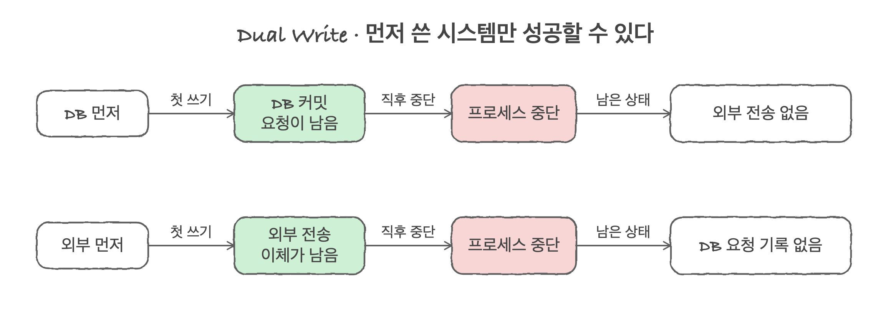

# 외부 시스템이 지급 실패를 복잡하게 만드는 이유

## 1. 호출자의 관측과 상대 시스템의 상태가 어긋난다

네트워크 호출은 요청 전송, 원격 처리, 응답 수신으로 나뉜다. 두 실행에서 각각 요청을 보내기 직전에 차단하거나 원격 처리 뒤 응답을 유실시켜도, 호출자에게는 같은 타임아웃으로 보일 수 있다. [AWS 타임아웃과 재시도](https://aws.amazon.com/builders-library/timeouts-retries-and-backoff-with-jitter/)

## 2. 중복 위험은 원격 부작용에서 생긴다

기존 송금 제출이 성공했는지 모른 채 새 거래를 발행하면 두 거래가 모두 포함될 수 있다. StablePay는 `payout_id`, 시도 ID, 체인 ID, 트랜잭션 해시로 앞선 시도를 먼저 대조한다. 한 노드의 응답 지연이나 기록 미조회는 미전송의 증거로 쓰기 어렵다. [AWS 타임아웃과 재시도](https://aws.amazon.com/builders-library/timeouts-retries-and-backoff-with-jitter/) · [AWS 멱등 재시도](https://aws.amazon.com/builders-library/making-retries-safe-with-idempotent-APIs/) · [Ethereum eth_getTransactionReceipt](https://ethereum.org/developers/docs/apis/json-rpc/#eth-gettransactionreceipt)

그림의 근거 · [AWS Transactional Outbox](https://docs.aws.amazon.com/prescriptive-guidance/latest/cloud-design-patterns/transactional-outbox.html)

## 3. 장애를 관찰할 위치를 정한다

로컬 RPC의 호출 결과만 늦추고 체인 처리는 진행되는 조건을 만든다. API 로그, Worker의 시도 상태, 영수증 조회 결과를 같은 식별자로 맞춰 보고, 타임아웃 횟수와 실제 성공 송금 건수가 다르게 집계되는지 확인한다. [Ethereum 개발 네트워크](https://ethereum.org/developers/docs/development-networks/) · [AWS 타임아웃과 재시도](https://aws.amazon.com/builders-library/timeouts-retries-and-backoff-with-jitter/) · [Ethereum eth_getTransactionReceipt](https://ethereum.org/developers/docs/apis/json-rpc/#eth-gettransactionreceipt)
