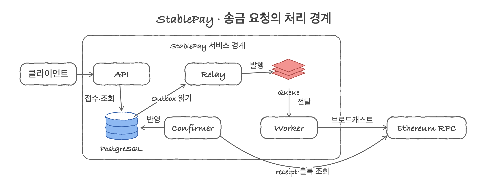

# StablePay 구성과 이더리움 송금 용어

## 1. 지급 접수, 송금 제출, 결과 확인을 분리한다

StablePay는 로컬 이더리움 체인과 테스트 계정에서 지급 흐름을 설명하는 예시다. API는 PostgreSQL에 `payout_request`와 `outbox`를 함께 저장하고, Relay는 커밋된 이벤트를 Queue로 보낸다. 송금 Worker가 `payout_attempt`를 준비해 Ethereum RPC로 제출하고, Confirmer가 영수증과 확정 기준을 확인해 요청과 `payout_status_history`를 갱신한다. [Ethereum 개발 네트워크](https://ethereum.org/developers/docs/development-networks/) · [AWS Transactional Outbox](https://docs.aws.amazon.com/prescriptive-guidance/latest/cloud-design-patterns/transactional-outbox.html) · [Ethereum eth_sendRawTransaction](https://ethereum.org/developers/docs/apis/json-rpc/#eth-sendrawtransaction) · [Ethereum eth_getTransactionReceipt](https://ethereum.org/developers/docs/apis/json-rpc/#eth-gettransactionreceipt)

그림의 근거 · [AWS Transactional Outbox](https://docs.aws.amazon.com/prescriptive-guidance/latest/cloud-design-patterns/transactional-outbox.html) · [Ethereum eth_getTransactionReceipt](https://ethereum.org/developers/docs/apis/json-rpc/#eth-gettransactionreceipt)

## 2. nonce, 해시, 영수증을 읽는다

Ethereum의 nonce는 발신 계정별로 증가하는 거래 번호다. 서명된 트랜잭션을 제출하면 RPC가 거래 해시를 반환할 수 있고, 영수증은 해당 해시로 조회한다. 영수증의 `status`는 실행 성공 `0x1` 또는 실패 `0x0`를 나타낸다. [Ethereum 트랜잭션](https://ethereum.org/developers/docs/transactions/) · [Ethereum eth_sendRawTransaction](https://ethereum.org/developers/docs/apis/json-rpc/#eth-sendrawtransaction) · [Ethereum eth_getTransactionReceipt](https://ethereum.org/developers/docs/apis/json-rpc/#eth-gettransactionreceipt)

## 3. 포함과 확정을 따로 기록한다

StablePay 실습에서 제출 결과를 확인한 시도는 `PENDING`, 블록에 포함된 성공 시도는 `INCLUDED`, 구성한 확정 기준을 충족한 시도는 `FINALIZED`로 기록한다. 로컬 체인에서의 확정 규칙은 실습 환경에 명시하고, Ethereum PoS의 합의상 확정성은 공식 체크포인트 기준에서 확인한다. [Ethereum eth_getTransactionReceipt](https://ethereum.org/developers/docs/apis/json-rpc/#eth-gettransactionreceipt) · [Ethereum PoS 확정성](https://ethereum.org/developers/docs/consensus-mechanisms/pos/#finality) · [Ethereum 개발 네트워크](https://ethereum.org/developers/docs/development-networks/)

로컬 체인의 블록 생성을 제어할 수 있는 구성에서 송금 한 건을 보낸다. 해시를 기록한 직후와 블록을 생성한 뒤에 각각 영수증을 조회하고, Confirmer의 확정 판정 시점을 비교한다. [Ethereum 개발 네트워크](https://ethereum.org/developers/docs/development-networks/) · [Ethereum eth_getTransactionReceipt](https://ethereum.org/developers/docs/apis/json-rpc/#eth-gettransactionreceipt) · [Ethereum PoS 확정성](https://ethereum.org/developers/docs/consensus-mechanisms/pos/#finality)
