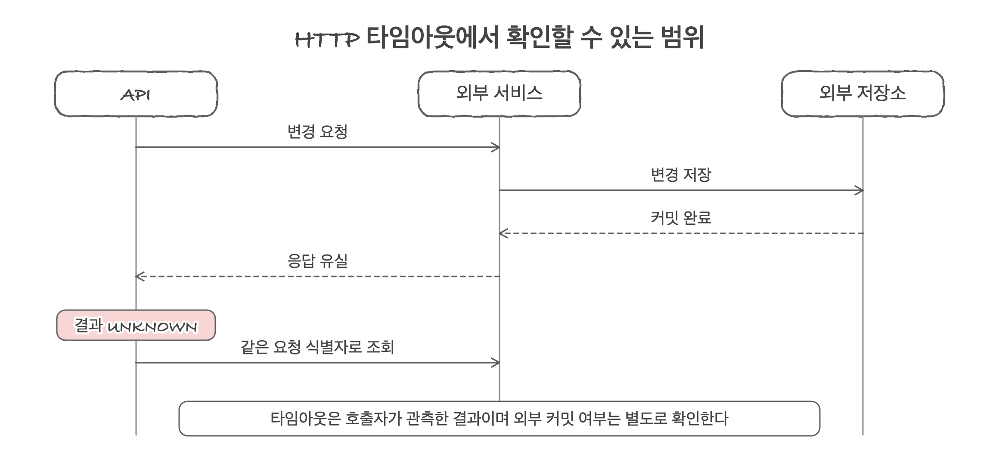

# HTTP 요청과 응답으로 지급 API 계약 정하기

## 1. 지급 접수와 지급 상태 조회를 나눈다

예시 `POST /payouts`는 수신자·자산·금액과 호출자 범위의 멱등 키를 받아 지급을 접수한다. `GET /payouts/{payout_id}`는 이미 접수된 요청의 현재 업무 상태를 조회한다. 상태 조회에서는 송금이 시작되지 않게 설계한다. [RFC 9110 POST](https://www.rfc-editor.org/rfc/rfc9110.html#section-9.3.3) · [RFC 9110 GET](https://www.rfc-editor.org/rfc/rfc9110.html#section-9.3.1) · [AWS 멱등 재시도](https://aws.amazon.com/builders-library/making-retries-safe-with-idempotent-APIs/)

## 2. 202에 접수된 요청 ID와 조회 경로를 담는다

HTTP `202 Accepted`는 처리를 받아들였고 아직 완료되지 않았음을 뜻한다. StablePay는 요청과 Outbox가 커밋된 뒤 `202`를 보내고 본문에 `payout_id`와 상태를, `Location`에 조회 URI를 제공한다. [RFC 9110의 202](https://www.rfc-editor.org/rfc/rfc9110.html#section-15.3.3) · [AWS Transactional Outbox](https://docs.aws.amazon.com/prescriptive-guidance/latest/cloud-design-patterns/transactional-outbox.html)

```http
HTTP/1.1 202 Accepted
Location: /payouts/po_123
Content-Type: application/json

{"payout_id":"po_123","status":"ACCEPTED"}
```



그림의 근거 · [AWS 타임아웃과 재시도](https://aws.amazon.com/builders-library/timeouts-retries-and-backoff-with-jitter/)

## 3. 응답을 받지 못한 고객의 다음 행동을 정한다

접수 커밋 직후 API 응답을 끊고 같은 호출자·멱등 키·요청 내용으로 다시 호출한다. 저장된 `payout_id`가 돌아오는지 확인한 뒤 조회 API로 현재 상태를 확인한다. 같은 키로 금액을 바꾼 호출은 StablePay에서 충돌로 처리한다. [RFC 9110의 멱등 메서드](https://www.rfc-editor.org/rfc/rfc9110.html#section-9.2.2) · [AWS 멱등 재시도](https://aws.amazon.com/builders-library/making-retries-safe-with-idempotent-APIs/)
