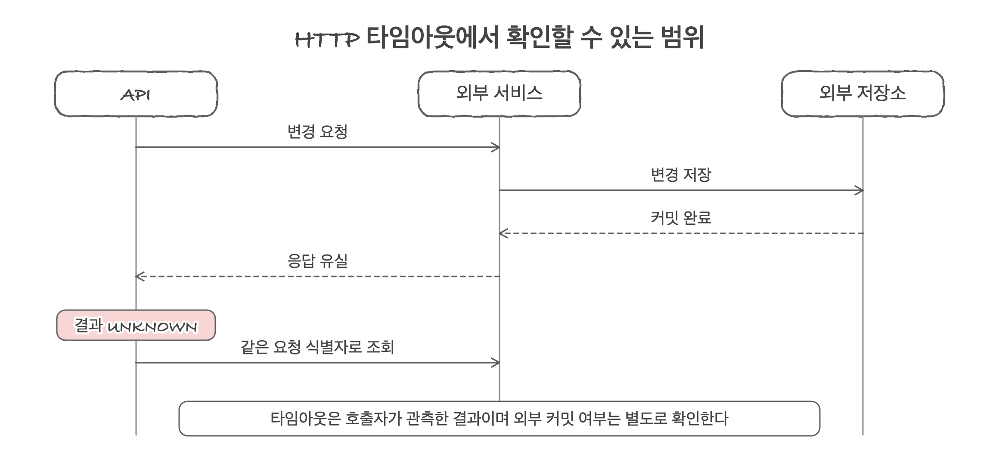

# TypeScript에서 async·await로 외부 실패 다루기

## 1. 같은 함수 안에서 거부와 HTTP 오류를 구분한다

`await`는 Promise가 거부되면 해당 지점에서 예외를 발생시킨다. 표준 `fetch`는 네트워크 오류 등에서 거부되며, 서버에서 HTTP `4xx`나 `5xx` 응답을 받으면 `Response`를 반환한다. 따라서 `try/catch`와 `response.ok` 검사가 각각 필요하다. [ECMAScript Await](https://tc39.es/ecma262/multipage/control-abstraction-objects.html#await) · [Fetch 표준](https://fetch.spec.whatwg.org/#fetch-method)

## 2. 전송 결과와 RPC 결과를 따로 읽는다

HTTP 성공 상태에서도 JSON-RPC 응답에 `error`가 들어갈 수 있다. 본문을 런타임에서 검사해 응답의 `id`, `result` 또는 `error`를 구분하고, 오류의 의미는 RPC 메서드의 계약으로 해석한다. `catch`의 변수를 `unknown`으로 다루면 오류 정보를 읽기 전에 값을 좁혀야 한다. [JSON-RPC 2.0](https://www.jsonrpc.org/specification#response_object) · [TypeScript catch 타입](https://www.typescriptlang.org/tsconfig/useUnknownInCatchVariables.html)

```ts
async function receiveRpc(url: URL, init: RequestInit) {
  let response: Response;
  try {
    response = await fetch(url, init);
  } catch (error: unknown) {
    return { kind: "transport_error", error } as const;
  }
  if (!response.ok) {
    return { kind: "http_error", status: response.status } as const;
  }
  try {
    const body: unknown = await response.json();
    return { kind: "rpc_body", body } as const;
  } catch (error: unknown) {
    return { kind: "unreadable_body", error } as const;
  }
}
```



그림의 근거 · [ECMAScript Await](https://tc39.es/ecma262/multipage/control-abstraction-objects.html#await) · [AWS 타임아웃과 재시도](https://aws.amazon.com/builders-library/timeouts-retries-and-backoff-with-jitter/)

## 3. 예외 처리와 업무 상태 전이를 연결한다

위 함수의 `kind`는 호출자가 받은 정보다. 서명된 거래 제출 뒤 전송 오류나 읽을 수 없는 본문을 만났다면 Worker는 `BROADCAST_UNKNOWN`을 기록하고, 이미 영속화한 거래 해시로 확인을 시작한다. 로컬 응답을 연결 끊김·HTTP 500·JSON-RPC 오류로 바꿔 세 분기가 구분되는지 점검한다. [AWS 타임아웃과 재시도](https://aws.amazon.com/builders-library/timeouts-retries-and-backoff-with-jitter/) · [JSON-RPC 2.0](https://www.jsonrpc.org/specification#response_object) · [Ethereum eth_getTransactionReceipt](https://ethereum.org/developers/docs/apis/json-rpc/#eth-gettransactionreceipt)
