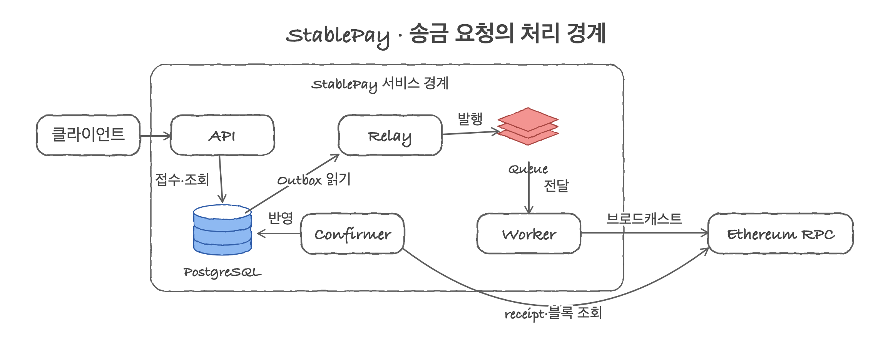

# Docker Compose로 지급 장애 실습 환경 격리하기

## 1. 로컬 서비스의 주소와 실행 경계를 정한다

Compose v2 기본 네트워크에서는 같은 프로젝트의 컨테이너가 서비스 이름으로 서로 연결된다. 예시 API와 Worker는 `db:5432` 및 로컬 `chain` 서비스를 사용한다. 호스트에서 접근할 API 포트만 루프백에 공개하고 DB·Queue·RPC는 내부 주소로 유지한다. [Docker Compose 네트워크](https://docs.docker.com/compose/how-tos/networking/)



그림의 근거 · [Docker Compose 네트워크](https://docs.docker.com/compose/how-tos/networking/) · [Ethereum 개발 네트워크](https://ethereum.org/developers/docs/development-networks/)

## 2. 준비 상태와 실습 데이터를 관리한다

DB에 `healthcheck`를 두고, 이를 사용하는 서비스는 `depends_on`의 `service_healthy` 조건으로 시작을 기다리게 한다. 런타임의 연결 재시도는 별도로 설계한다. 네트워크 및 계정은 로컬 개발용으로 설정하고, Worker는 시작할 때 RPC의 `eth_chainId`를 예상값과 비교한다. [Docker Compose 시작 순서](https://docs.docker.com/compose/how-tos/startup-order/) · [Ethereum 개발 네트워크](https://ethereum.org/developers/docs/development-networks/) · [Ethereum eth_chainId](https://ethereum.org/developers/docs/apis/json-rpc/#eth-chainid)

PostgreSQL 데이터를 이름 있는 실습 볼륨에 두면 컨테이너를 내려도 상태를 재관측할 수 있다. `docker compose down -v`는 Compose에 선언된 이름 있는 볼륨과 컨테이너에 연결된 익명 볼륨을 삭제하므로, 테스트 DB와 로컬 체인을 지워도 되는 초기화 단계에서만 사용한다. [Docker Compose down](https://docs.docker.com/reference/cli/docker/compose/down/)

## 3. 구성 파일을 준비한 뒤 Worker 장애를 재현한다

별도 실습용 Compose 파일에서 아래 순서로 구성과 실행 상태를 확인한다. Worker를 중지한 상태에서 접수한 요청과 작업 기록이 DB에 남고, Worker를 다시 시작하면 처리할 수 있는지 확인한다. [Docker Compose 네트워크](https://docs.docker.com/compose/how-tos/networking/) · [AWS Transactional Outbox](https://docs.aws.amazon.com/prescriptive-guidance/latest/cloud-design-patterns/transactional-outbox.html)

```sh
docker compose -p stablepay-lab config
docker compose -p stablepay-lab up -d
docker compose -p stablepay-lab ps
docker compose -p stablepay-lab stop worker
docker compose -p stablepay-lab start worker
```
