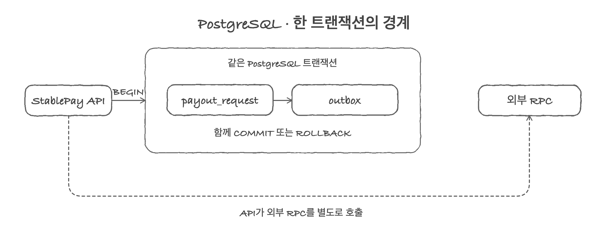

# PostgreSQL 트랜잭션과 유일성 제약으로 지급 접수 보호하기

## 1. 지급 요청과 작업 의도를 함께 커밋한다

PostgreSQL 18에서는 같은 트랜잭션 블록의 변경이 함께 커밋되거나 함께 롤백된다. StablePay의 새 지급을 접수할 때는 `payout_request`, 최초 `payout_status_history`, `outbox`를 한 트랜잭션에 기록한다. [PostgreSQL 18 트랜잭션](https://www.postgresql.org/docs/18/tutorial-transactions.html) · [AWS Transactional Outbox](https://docs.aws.amazon.com/prescriptive-guidance/latest/cloud-design-patterns/transactional-outbox.html)



그림의 근거 · [PostgreSQL 18 트랜잭션](https://www.postgresql.org/docs/18/tutorial-transactions.html) · [AWS Transactional Outbox](https://docs.aws.amazon.com/prescriptive-guidance/latest/cloud-design-patterns/transactional-outbox.html)

## 2. 호출자 범위의 키와 요청 내용을 함께 검사한다

`UNIQUE (client_id, idempotency_key)`로 키 조합의 중복을 막고 두 열에 `NOT NULL`을 선언한다. PostgreSQL의 기본 유일성 규칙에서는 두 NULL을 서로 다른 값으로 취급한다. [PostgreSQL 18 유일성 제약](https://www.postgresql.org/docs/18/ddl-constraints.html#DDL-CONSTRAINTS-UNIQUE-CONSTRAINTS)

```sql
ALTER TABLE payout_request
  ALTER COLUMN client_id SET NOT NULL,
  ALTER COLUMN idempotency_key SET NOT NULL,
  ADD CONSTRAINT payout_request_client_key_unique UNIQUE (client_id, idempotency_key);
```

`INSERT ... ON CONFLICT (client_id, idempotency_key) DO NOTHING RETURNING payout_id`가 행을 반환할 때만 새 상태 이력과 Outbox를 삽입한다. 충돌한 요청은 `READ COMMITTED`에서 다음 SQL 문으로 기존 행을 조회한다. 정규화한 요청 내용이 같으면 같은 `payout_id`를 반환하고, 다르면 충돌로 응답한다. [PostgreSQL 18 INSERT](https://www.postgresql.org/docs/18/sql-insert.html) · [PostgreSQL 18 READ COMMITTED](https://www.postgresql.org/docs/18/transaction-iso.html#XACT-READ-COMMITTED) · [AWS 멱등 재시도](https://aws.amazon.com/builders-library/making-retries-safe-with-idempotent-APIs/) · [AWS Transactional Outbox](https://docs.aws.amazon.com/prescriptive-guidance/latest/cloud-design-patterns/transactional-outbox.html)

## 3. 두 접수를 동시에 보내 제약을 확인한다

같은 호출자와 같은 키로 동일 입력을 동시에 접수한다. 요청 행과 최초 상태 이력, 작업 이벤트가 한 건씩 생성되는지 확인한 뒤, 같은 키에 다른 금액을 넣어 기존 요청이 수정되지 않는지 확인한다. [PostgreSQL 18 유일성 제약](https://www.postgresql.org/docs/18/ddl-constraints.html#DDL-CONSTRAINTS-UNIQUE-CONSTRAINTS) · [AWS 멱등 재시도](https://aws.amazon.com/builders-library/making-retries-safe-with-idempotent-APIs/) · [AWS Transactional Outbox](https://docs.aws.amazon.com/prescriptive-guidance/latest/cloud-design-patterns/transactional-outbox.html)
