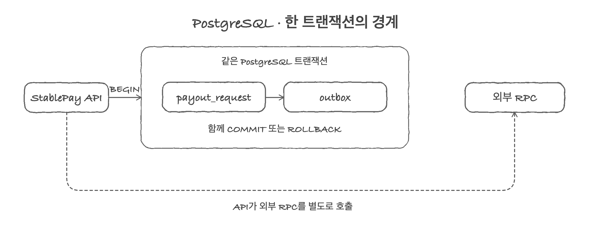

# PostgreSQL 트랜잭션이 보장하는 범위

## 1. 같은 데이터베이스 작업을 한 연결에 묶는다

PostgreSQL 트랜잭션 블록은 같은 세션의 `BEGIN`에서 `COMMIT` 또는 `ROLLBACK`까지 수행한 SQL 작업을 다룬다. 풀을 사용한다면 트랜잭션을 연 연결에서 요청·이력·Outbox를 저장하고 같은 연결로 종료한다. [PostgreSQL 18 트랜잭션](https://www.postgresql.org/docs/18/tutorial-transactions.html)

그림의 근거 · [PostgreSQL 18 트랜잭션](https://www.postgresql.org/docs/18/tutorial-transactions.html) · [AWS Transactional Outbox](https://docs.aws.amazon.com/prescriptive-guidance/latest/cloud-design-patterns/transactional-outbox.html)

## 2. 외부 호출의 결과는 별도 경계에 둔다

애플리케이션이 `BEGIN`과 `COMMIT` 사이에 RPC를 호출해도 외부 제출은 PostgreSQL의 변경에 포함되지 않는다. 외부 호출을 기다리는 동안 이미 얻은 DB 행 잠금이 트랜잭션 종료까지 남아 다른 갱신이 지연될 수도 있다. [PostgreSQL 18 트랜잭션](https://www.postgresql.org/docs/18/tutorial-transactions.html) · [PostgreSQL 18 잠금](https://www.postgresql.org/docs/18/explicit-locking.html#LOCKING-ROWS) · [AWS Transactional Outbox](https://docs.aws.amazon.com/prescriptive-guidance/latest/cloud-design-patterns/transactional-outbox.html)

## 3. 같은 ROLLBACK에서 결과가 다르게 남는지 본다

첫 번째 실습에서는 요청과 Outbox를 넣은 뒤 롤백하고 두 테이블에 새 행이 없는지 확인한다. 두 번째는 로컬 RPC에 제출하고 영수증이 확인된 시점에 DB만 롤백한다. 요청 행이 사라져도 로컬 체인 영수증은 조회할 수 있다. [PostgreSQL 18 트랜잭션](https://www.postgresql.org/docs/18/tutorial-transactions.html) · [Ethereum eth_sendRawTransaction](https://ethereum.org/developers/docs/apis/json-rpc/#eth-sendrawtransaction) · [Ethereum eth_getTransactionReceipt](https://ethereum.org/developers/docs/apis/json-rpc/#eth-gettransactionreceipt) · [Ethereum 개발 네트워크](https://ethereum.org/developers/docs/development-networks/)
