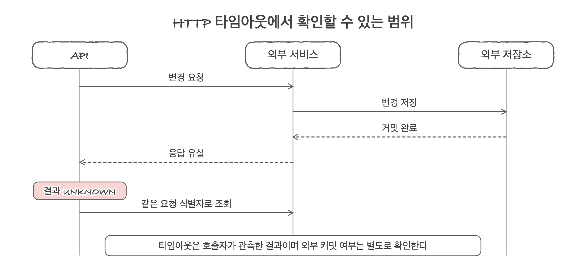

# 타임아웃을 지급 결과 미확인으로 처리하기

## 1. 제한 시간과 실행 결과를 구분한다

호출 타임아웃은 제한 시간 안에 응답을 확인하지 못했다는 관측이다. 게이트웨이의 HTTP `504` 역시 업스트림의 응답을 제때 받지 못했다는 뜻이다. 원격 송금이 실행됐는지는 기존 시도 식별자로 확인한다. [AWS 타임아웃과 재시도](https://aws.amazon.com/builders-library/timeouts-retries-and-backoff-with-jitter/) · [RFC 9110의 504](https://www.rfc-editor.org/rfc/rfc9110.html#section-15.6.5) · [Ethereum eth_getTransactionReceipt](https://ethereum.org/developers/docs/apis/json-rpc/#eth-gettransactionreceipt)

그림의 근거 · [AWS 타임아웃과 재시도](https://aws.amazon.com/builders-library/timeouts-retries-and-backoff-with-jitter/)

## 2. 기존 거래를 조회하고 확인 근거를 남긴다

서명된 데이터를 제출하기 전에 그 데이터로 계산한 거래 해시를 시도에 기록한다. 제출 뒤 타임아웃은 `BROADCAST_UNKNOWN`으로 두고 Confirmer가 해당 해시로 영수증을 조회한다. 영수증 `null`은 조회 시점에 영수증이 없다는 의미이므로 단독으로 `PROVEN_NOT_SENT`의 근거가 될 수 없다. [Ethereum eth_sendRawTransaction](https://ethereum.org/developers/docs/apis/json-rpc/#eth-sendrawtransaction) · [Ethereum eth_getTransactionReceipt](https://ethereum.org/developers/docs/apis/json-rpc/#eth-gettransactionreceipt) · [AWS 타임아웃과 재시도](https://aws.amazon.com/builders-library/timeouts-retries-and-backoff-with-jitter/)

확인되지 않는 시도는 관측 기한 내 다시 조회하고, 기한이 지나면 원래 시도와 식별자를 보존한 채 요청을 `REVIEW_REQUIRED`로 올린다. 새 송금 여부는 원래 거래가 지급 효과를 낼 수 없다는 근거를 확인한 후 판단한다. [AWS 타임아웃과 재시도](https://aws.amazon.com/builders-library/timeouts-retries-and-backoff-with-jitter/) · [AWS 멱등 재시도](https://aws.amazon.com/builders-library/making-retries-safe-with-idempotent-APIs/) · [Ethereum eth_getTransactionReceipt](https://ethereum.org/developers/docs/apis/json-rpc/#eth-gettransactionreceipt)

## 3. 같은 타임아웃을 서로 다른 방식으로 만든다

로컬 체인에서 제출 전 차단과 제출 뒤 응답 유실을 각각 재현한다. 두 실행 모두 처음에는 미확인으로 남는지 보고, 후자의 영수증이 관측되면 같은 `payout_id`로 이어지는지 확인한다. [Ethereum 개발 네트워크](https://ethereum.org/developers/docs/development-networks/) · [AWS 타임아웃과 재시도](https://aws.amazon.com/builders-library/timeouts-retries-and-backoff-with-jitter/) · [Ethereum eth_getTransactionReceipt](https://ethereum.org/developers/docs/apis/json-rpc/#eth-gettransactionreceipt)
