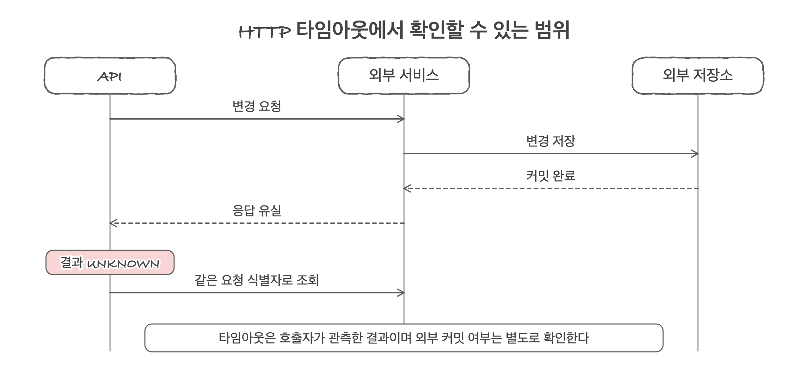

# Exactly-once의 범위를 전달과 지급 효과로 나누기

## 1. 한 번이라는 표현에 대상과 경계를 붙인다

메시지 전달 횟수, 소비자의 DB 반영 횟수, 체인의 성공 지급 효과는 각각 다른 측정값이다. 예를 들어 Kafka 4.1은 트랜잭션 producer와 `read_committed` 소비를 사용할 때 Kafka 토픽을 읽고 처리해 다시 Kafka 토픽에 쓰는 범위의 exactly-once를 지원한다. 외부 대상에 적용하려면 그 대상의 협력이 필요하다. [Kafka 4.1 메시지 전달 보장](https://kafka.apache.org/41/design/design/#message-delivery-semantics) · [AWS Transactional Outbox](https://docs.aws.amazon.com/prescriptive-guidance/latest/cloud-design-patterns/transactional-outbox.html)

## 2. 중복 전달에서도 같은 지급 건으로 수렴하게 한다

Outbox의 Relay는 같은 이벤트를 다시 전달할 수 있다. StablePay는 요청의 `payout_id`와 시도에 저장한 거래를 중심으로 중복 작업을 대조하고, 미확인 제출은 확인 흐름으로 보낸다. 접수 성공과 작업 기록은 같은 커밋으로 보장한다. 중복 전달을 받아도 같은 시도를 확인하고, 지급 완료는 외부 지급이 확정된 뒤 반영한다. [AWS Transactional Outbox](https://docs.aws.amazon.com/prescriptive-guidance/latest/cloud-design-patterns/transactional-outbox.html) · [AWS 멱등 재시도](https://aws.amazon.com/builders-library/making-retries-safe-with-idempotent-APIs/) · [Ethereum eth_getTransactionReceipt](https://ethereum.org/developers/docs/apis/json-rpc/#eth-gettransactionreceipt)

그림의 근거 · [AWS 타임아웃과 재시도](https://aws.amazon.com/builders-library/timeouts-retries-and-backoff-with-jitter/)

## 3. 전달과 효과를 각각 세어 본다

같은 이벤트를 두 번 전달한 뒤 송금 RPC 응답을 한 차례 유실시킨다. Queue 전달 수와 RPC 호출 수를 기록하고, 같은 `payout_id`에 연결된 확정 성공 효과와 `COMPLETED` 전이는 각각 한 건인지 확인한다. [AWS Transactional Outbox](https://docs.aws.amazon.com/prescriptive-guidance/latest/cloud-design-patterns/transactional-outbox.html) · [AWS 타임아웃과 재시도](https://aws.amazon.com/builders-library/timeouts-retries-and-backoff-with-jitter/) · [Ethereum eth_getTransactionReceipt](https://ethereum.org/developers/docs/apis/json-rpc/#eth-gettransactionreceipt) · [Ethereum PoS 확정성](https://ethereum.org/developers/docs/consensus-mechanisms/pos/#finality)
