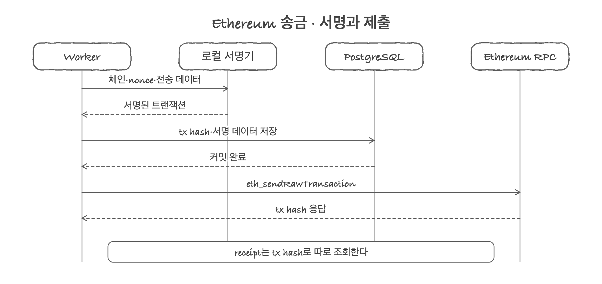

# Ethereum 계정, 키, 주소와 서명

StablePay의 transfer Worker는 송신용 외부 소유 계정(EOA)으로 지급 트랜잭션을 서명한다. 수신인 주소는 지급의 목적지이며, 서명 권한은 송신 계정의 개인키에 있다. [Ethereum 계정](https://ethereum.org/en/developers/docs/accounts/) · [Ethereum 트랜잭션](https://ethereum.org/en/developers/docs/transactions/)

## 1. 개인키, 공개키, 주소의 관계를 이해한다

EOA 공개키는 개인키에서 도출한다. 주소는 공개키에 대한 Keccak-256 해시의 마지막 20바이트이며, 보통 `0x`와 16진수 40자리로 표기한다. 주소는 수신인 식별자로 공유하고, 실습의 서명기는 테스트 계정 개인키를 로컬에서 사용한다. [Ethereum 계정](https://ethereum.org/en/developers/docs/accounts/)

## 2. 지급 입력을 검증한 뒤 서명한다

Worker는 서명 전에 요청에 기록된 체인, 자산, 금액, 수신인을 실행 입력과 대조한다. EIP-1559 트랜잭션 서명에는 체인 ID, nonce, 수수료 한도, gas 한도, 목적지, ETH 값, calldata 등이 반영된다. ERC-20 지급에서는 `to`가 토큰 컨트랙트이고 수신인과 수량은 `transfer` calldata에 들어간다. [EIP-1559](https://eips.ethereum.org/EIPS/eip-1559) · [ERC-20 표준](https://eips.ethereum.org/EIPS/eip-20)

서명되면 직렬화한 타입 2 트랜잭션에서 해시를 계산할 수 있다. Worker는 요청 ID와 해시를 연결해 두고, Confirmer는 그 해시를 사용해 이후의 전송·포함 관측을 연결한다. [Geth 트랜잭션 해시 구현](https://github.com/ethereum/go-ethereum/blob/v1.16.7/core/types/transaction.go) · [Ethereum RPC 전송](https://ethereum.org/developers/docs/apis/json-rpc/#eth-sendrawtransaction) · [Ethereum RPC 영수증](https://ethereum.org/developers/docs/apis/json-rpc/#eth-gettransactionreceipt)

## 3. 서명 직전과 직후를 구분해 관찰한다

로컬에서 테스트 계정으로 서명만 하고 송신인 주소를 복구한다. 그다음 수신인 주소를 바꾼 입력을 별도로 서명해 해시가 달라지는지 비교한다. 전송 전 두 해시를 같은 로컬 노드에서 조회해 영수증이 없음을 확인한다. [viem signTransaction](https://viem.sh/docs/actions/wallet/signTransaction) · [viem recoverTransactionAddress](https://viem.sh/docs/utilities/recoverTransactionAddress) · [viem keccak256](https://viem.sh/docs/utilities/keccak256) · [Ethereum RPC 영수증](https://ethereum.org/developers/docs/apis/json-rpc/#eth-gettransactionreceipt)

