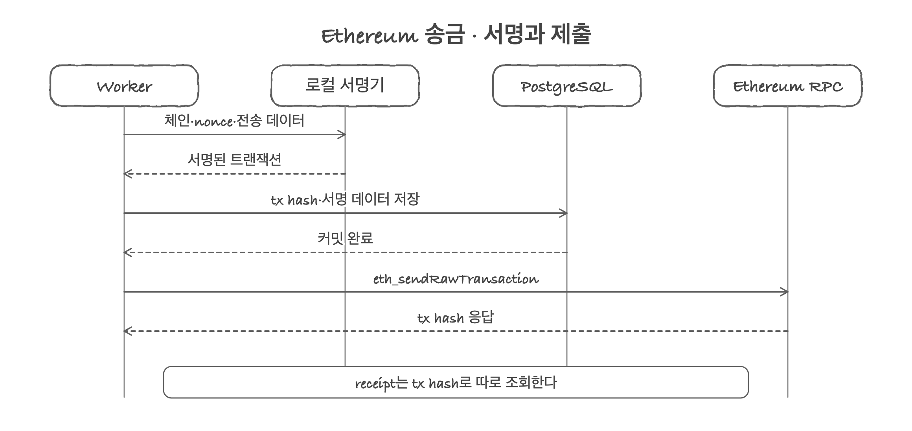

# Ethereum 가스, nonce와 영수증

## 1. 가스 사용량과 수수료를 읽는다

`gasLimit`은 허용할 가스 사용량의 상한이다. EIP-1559 트랜잭션은 가스당 최대 수수료와 최대 팁을 설정하고, 실제 실행 수수료는 영수증의 `gasUsed × effectiveGasPrice`로 계산한다. 실행에 실패해도 이미 사용한 가스에는 비용이 생긴다. [Ethereum 가스](https://ethereum.org/en/developers/docs/gas/) · [EIP-1559](https://eips.ethereum.org/EIPS/eip-1559) · [Ethereum RPC 영수증](https://ethereum.org/developers/docs/apis/json-rpc/#eth-gettransactionreceipt)

ETH나 토큰의 지급액과 수수료를 별도 열로 기록한다. 예를 들어 `gasUsed = 21_000`, `effectiveGasPrice = 20 gwei`인 ETH 송금의 실행 수수료는 `0.00042 ETH`다. [Ethereum 가스](https://ethereum.org/en/developers/docs/gas/) · [Ethereum RPC 영수증](https://ethereum.org/developers/docs/apis/json-rpc/#eth-gettransactionreceipt)

## 2. 같은 송신 계정의 nonce 할당을 조정한다

nonce는 송신 계정의 트랜잭션 순서를 나타낸다. 두 Worker가 같은 송신 계정의 다음 nonce를 동시에 읽으면 두 지급에 같은 값을 고를 수 있다. StablePay는 같은 체인·송신 계정의 할당을 직렬화하고, 각 nonce가 어느 지급 실행 시도에 속하는지 전송 전에 기록한다. [Ethereum 트랜잭션](https://ethereum.org/en/developers/docs/transactions/) · [EIP-1559](https://eips.ethereum.org/EIPS/eip-1559) · [PostgreSQL 18 제약](https://www.postgresql.org/docs/18/ddl-constraints.html)

## 3. 해시, 영수증, 실행 결과를 따로 확인한다

RPC 제출 응답의 해시는 이후 조회에 쓸 식별자다. `eth_getTransactionReceipt`는 대기 중인 거래의 영수증을 반환하지 않으며, 포함된 트랜잭션의 영수증은 `blockHash`, `blockNumber`, `logs`와 실행 `status`를 담는다. Byzantium 이후 `0x1`은 최상위 호출 성공, `0x0`은 실패다. [Ethereum RPC 전송](https://ethereum.org/developers/docs/apis/json-rpc/#eth-sendrawtransaction) · [Ethereum RPC 영수증](https://ethereum.org/developers/docs/apis/json-rpc/#eth-gettransactionreceipt) · [EIP-658](https://eips.ethereum.org/EIPS/eip-658)

Anvil을 `--no-mining`으로 시작하고 서명 거래를 전송한다. 해시를 얻은 직후와 블록을 수동으로 생성한 뒤에 각각 영수증을 조회한다. 처음에는 `null`, 채굴 뒤에는 같은 해시의 가스 사용량과 실행 상태가 관측되는지 확인한다. [Foundry Anvil 명령](https://www.getfoundry.sh/reference/anvil/anvil) · [Ethereum RPC 전송](https://ethereum.org/developers/docs/apis/json-rpc/#eth-sendrawtransaction) · [Ethereum RPC 영수증](https://ethereum.org/developers/docs/apis/json-rpc/#eth-gettransactionreceipt)

