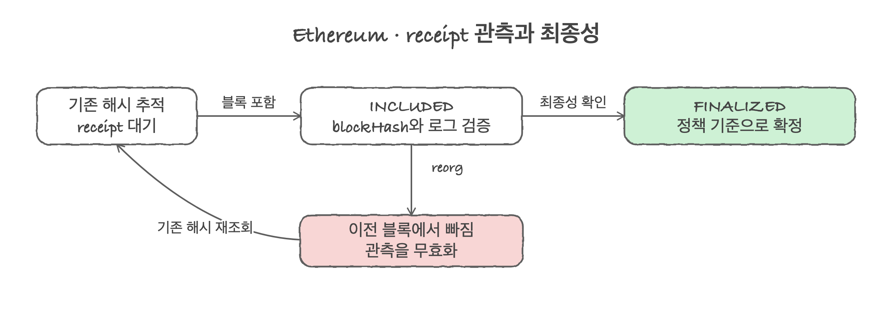

# Ethereum 체인 재구성과 지급 확정

## 1. 어떤 블록에서 영수증을 관측했는지 기록한다

재구성(reorg)은 노드가 채택한 체인 분기가 바뀌는 일이다. 아직 최종화되지 않은 체인 끝의 블록은 같은 높이의 다른 블록으로 바뀔 수 있다. Confirmer는 `tx_hash`와 함께 관측한 `blockNumber`, `blockHash`를 보관해 이전 포함과 새 포함을 구분한다. [Ethereum 지분증명](https://ethereum.org/en/developers/docs/consensus-mechanisms/pos/) · [Ethereum RPC 영수증](https://ethereum.org/developers/docs/apis/json-rpc/#eth-gettransactionreceipt)

## 2. 포함과 최종화를 별도의 전이로 처리한다

StablePay는 영수증을 처음 확인하면 실행 시도를 `INCLUDED`로 둔다. 영수증 블록 높이의 현재 정규 블록 해시를 대조하고, 그 블록이 같은 정규 체인의 `finalized` 블록 높이 이하이며 지급 내용까지 일치할 때 성공을 확정한다. 이 예제는 Ethereum L1의 `finalized` 태그를 사용하는 정책을 택한다. [Ethereum RPC 블록 조회](https://ethereum.org/developers/docs/apis/json-rpc/#eth-getblockbynumber) · [Ethereum RPC 영수증](https://ethereum.org/developers/docs/apis/json-rpc/#eth-gettransactionreceipt) · [Ethereum 지분증명](https://ethereum.org/en/developers/docs/consensus-mechanisms/pos/)

영수증의 블록이 정규 체인에서 이탈하면 해당 포함 기록과 무효화 이유를 이력에 추가한다. 같은 해시로 다시 조회해 대기 거래로 확인되면 `PENDING`으로 돌아가고, 불확실하면 `BROADCAST_UNKNOWN`으로 대조를 계속한다. 이후 새 블록에서 다시 발견하면 그 블록 해시를 가진 새 포함으로 기록한다. [Ethereum RPC 트랜잭션 조회](https://ethereum.org/developers/docs/apis/json-rpc/#eth-gettransactionbyhash) · [Ethereum RPC 영수증](https://ethereum.org/developers/docs/apis/json-rpc/#eth-gettransactionreceipt) · [Ethereum RPC 블록 조회](https://ethereum.org/developers/docs/apis/json-rpc/#eth-getblockbynumber) · [Ethereum 지분증명](https://ethereum.org/en/developers/docs/consensus-mechanisms/pos/)

## 3. 같은 해시가 다른 블록에 나타나는 경우를 재현한다

RPC 테스트 대역에 `(100, A)`의 성공 영수증, 높이 100의 블록이 `B`로 바뀐 뒤의 `null` 영수증, `(102, C)`의 성공 영수증을 차례로 응답시킨다. 최종화 높이가 101일 때에는 지급이 `PROCESSING`이고, 높이 102가 최종화된 뒤에만 `COMPLETED`와 완료 후속 작업이 한 번 기록되는지 확인한다. [Ethereum RPC 블록 조회](https://ethereum.org/developers/docs/apis/json-rpc/#eth-getblockbynumber) · [Ethereum RPC 영수증](https://ethereum.org/developers/docs/apis/json-rpc/#eth-gettransactionreceipt) · [Ethereum 지분증명](https://ethereum.org/en/developers/docs/consensus-mechanisms/pos/) · [PostgreSQL 18 트랜잭션](https://www.postgresql.org/docs/18/tutorial-transactions.html)

