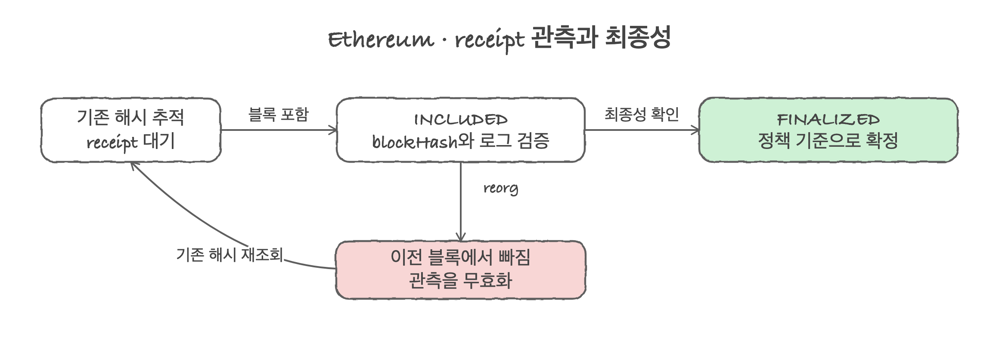

# ERC-20 지급량과 Transfer 이벤트 검증

## 1. 표시 단위를 최소 단위 정수로 바꾼다

ERC-20의 `transfer`는 최소 단위의 `uint256` 정수를 받는다. 선택 메서드인 `decimals()`는 사용자에게 표시할 때 적용할 소수 자릿수다. 예를 들어 6자리 토큰의 `12.345678`은 `12345678`, 같은 표시값의 18자리 토큰은 `12345678000000000000`이다. [ERC-20 표준](https://eips.ethereum.org/EIPS/eip-20)

StablePay는 체인 ID와 컨트랙트 주소로 지원 자산을 식별하고 해당 자산의 검증된 소수 자릿수를 사용한다. 입력 금액을 문자열에서 정수로 변환하고, 지원 소수 자릿수를 초과하면 입력을 거절한다. 예를 들어 6자리 토큰의 `0.0000001`은 다시 입력받는다. [ERC-20 표준](https://eips.ethereum.org/EIPS/eip-20)

## 2. 영수증에서 요청과 일치하는 이동을 검증한다

ERC-20 표준은 `transfer`가 `false`를 반환할 수 있다고 명시한다. 영수증의 성공 상태는 최상위 호출의 실행 결과를 알려준다. Confirmer는 정확한 수량을 전송하는 지원 토큰에 대해 성공 영수증과 함께 로그를 낸 토큰 컨트랙트 주소 및 `Transfer(from, to, value)`를 기대 송신인·수신인·최소 단위 금액과 대조한다. [ERC-20 표준](https://eips.ethereum.org/EIPS/eip-20) · [EIP-658](https://eips.ethereum.org/EIPS/eip-658) · [Ethereum RPC 영수증](https://ethereum.org/developers/docs/apis/json-rpc/#eth-gettransactionreceipt)

기대와 일치하는 로그가 없거나 복수여서 어느 로그가 지급 증거인지 판단할 수 없으면 `REVIEW_REQUIRED`로 기록한다. 일치하는 로그는 `tx_hash`, `block_hash`, `log_index`와 함께 기록하고 정규 체인 최종화까지 확인한다. [ERC-20 표준](https://eips.ethereum.org/EIPS/eip-20) · [Ethereum RPC 블록 조회](https://ethereum.org/developers/docs/apis/json-rpc/#eth-getblockbynumber) · [Ethereum RPC 영수증](https://ethereum.org/developers/docs/apis/json-rpc/#eth-gettransactionreceipt)

## 3. 같은 이벤트 이름을 가진 다른 토큰을 섞어 본다

테스트 영수증에 같은 수신인과 금액을 가진 다른 컨트랙트의 `Transfer`를 넣는다. 이어 지원 컨트랙트의 실제 이벤트를 추가해 선택 결과가 달라지는지 확인한다. 요청한 금액과 실제 이동량이 다른 수수료 부과형 토큰도 입력하여 정확한 수량 계약에서는 자동 완료가 보류되는지 확인한다. [ERC-20 표준](https://eips.ethereum.org/EIPS/eip-20) · [Ethereum RPC 영수증](https://ethereum.org/developers/docs/apis/json-rpc/#eth-gettransactionreceipt)

