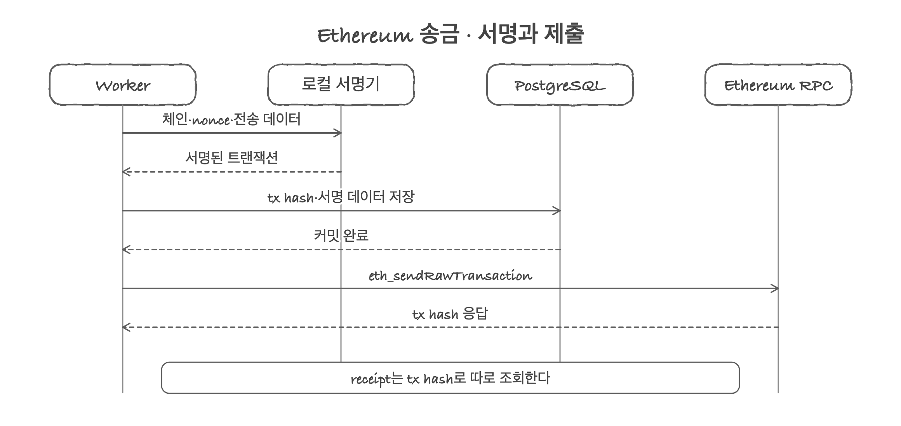

# viem으로 로컬 Ethereum 트랜잭션 서명하고 전송하기

## 1. 로컬 테스트 네트워크를 준비한다

Anvil을 시작하고 출력의 첫 번째 테스트 계정 개인키와 두 번째 계정 주소를 복사한다. 실습에서는 Anvil이 기본 지급한 테스트 ETH와 루프백 RPC를 사용한다. [Foundry Anvil 명령](https://www.getfoundry.sh/reference/anvil/anvil) · [viem 로컬 테스트 계정](https://viem.sh/docs/accounts/local/privateKeyToAccount)

```sh
anvil --host 127.0.0.1 --port 8545 --chain-id 31337
```

다른 터미널의 빈 실습 디렉터리에서 `npm install viem@2.57.16`을 실행한다. 아래 스크립트를 `send-local.mjs`로 저장하고 해당 테스트 값을 `TEST_PRIVATE_KEY`, `TEST_RECIPIENT` 환경 변수로 전달해 `node send-local.mjs`를 실행한다. [viem 로컬 테스트 계정](https://viem.sh/docs/accounts/local/privateKeyToAccount) · [viem prepareTransactionRequest](https://viem.sh/docs/actions/wallet/prepareTransactionRequest)

## 2. 준비, 서명, 전송을 분리해서 실행한다

`prepareTransactionRequest`는 nonce·가스 한도·수수료 등을 채우고, `signTransaction`은 서명된 직렬 바이트를 돌려준다. 타입 2 트랜잭션의 해시를 그 바이트에서 계산할 수 있으므로 실제 서비스에서는 `payout_attempt`와 해시, 재전송용 바이트의 보호된 저장을 전송보다 먼저 커밋한다. [viem prepareTransactionRequest](https://viem.sh/docs/actions/wallet/prepareTransactionRequest) · [viem signTransaction](https://viem.sh/docs/actions/wallet/signTransaction) · [viem keccak256](https://viem.sh/docs/utilities/keccak256) · [Geth 트랜잭션 해시 구현](https://github.com/ethereum/go-ethereum/blob/v1.16.7/core/types/transaction.go) · [PostgreSQL 18 트랜잭션](https://www.postgresql.org/docs/18/tutorial-transactions.html)

```js
import assert from 'node:assert/strict'
import {
  createPublicClient, createWalletClient, http, isAddress, keccak256,
} from 'viem'
import { privateKeyToAccount } from 'viem/accounts'
import { foundry } from 'viem/chains'

const privateKey = process.env.TEST_PRIVATE_KEY
const recipient = process.env.TEST_RECIPIENT
assert.match(privateKey ?? '', /^0x[0-9a-fA-F]{64}$/)
assert.ok(recipient && isAddress(recipient))

const account = privateKeyToAccount(privateKey)
const transport = http('http://127.0.0.1:8545', { retryCount: 0 })
const publicClient = createPublicClient({ chain: foundry, transport })
const walletClient = createWalletClient({ account, chain: foundry, transport })
assert.equal(await publicClient.getChainId(), 31337)

const request = await walletClient.prepareTransactionRequest({
  to: recipient,
  value: 1_000_000_000_000n,
  type: 'eip1559',
})
const serializedTransaction = await walletClient.signTransaction(request)
const expectedHash = keccak256(serializedTransaction)
console.log({ expectedHash, nonce: request.nonce })

if (!process.argv.includes('--sign-only')) {
  const hash = await walletClient.sendRawTransaction({ serializedTransaction })
  assert.equal(hash, expectedHash)
  const receipt = await publicClient.waitForTransactionReceipt({ hash, timeout: 10_000 })
  assert.equal(receipt.status, 'success')
  console.log({ hash, blockHash: receipt.blockHash, gasUsed: receipt.gasUsed.toString() })
}
```

## 3. 전송 응답을 잃어도 해시로 조회한다

한 번은 일반 실행으로 지급을 보낸 뒤 응답이 유실됐다고 가정한다. 전송 전 출력한 해시로 `eth_getTransactionReceipt`를 호출하고 수신인 잔액을 관찰한다. 이어 `node send-local.mjs --sign-only`로 서명 단계에서 종료해 새 해시의 영수증 조회 결과가 `null`임을 확인한다. 실제로 제출을 시작한 시도의 결과가 불명확하면 `BROADCAST_UNKNOWN`에서 같은 해시로 대조를 이어 간다. [viem sendRawTransaction](https://viem.sh/docs/actions/wallet/sendRawTransaction) · [viem waitForTransactionReceipt](https://viem.sh/docs/actions/public/waitForTransactionReceipt) · [Ethereum RPC 영수증](https://ethereum.org/developers/docs/apis/json-rpc/#eth-gettransactionreceipt) · [AWS 타임아웃과 재시도](https://aws.amazon.com/builders-library/timeouts-retries-and-backoff-with-jitter/)


