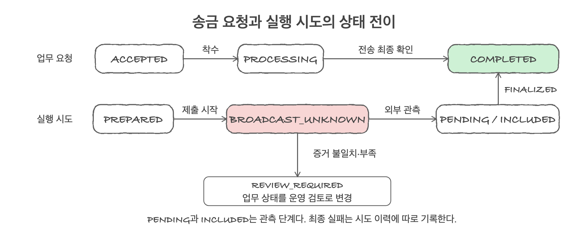

# 지급 요청과 실행 시도 분리하기

## 1. 지급 의도와 실행 식별자를 정한다

`payout_request`의 `payout_id`는 가맹점의 한 지급 의도를 식별한다. 체인·자산·수신인·최소 단위 금액을 요청에 저장하고, 커밋 뒤 `202 Accepted`와 `GET /payouts/{payout_id}` 조회 주소를 돌려준다. [HTTP 202 Accepted](https://www.rfc-editor.org/rfc/rfc9110.html#name-202-accepted) · [Microsoft 비동기 요청-응답](https://learn.microsoft.com/en-us/azure/architecture/patterns/asynchronous-request-reply) · [ERC-20 표준](https://eips.ethereum.org/EIPS/eip-20)

`payout_attempt`는 한 요청의 개별 지급 실행을 나타낸다. `payout_id`를 외래 키로 연결하고, 시도별 `attempt_id`, 순번, 송신 주소, nonce, 서명 해시, 상태를 저장한다. 새 실행이 필요하더라도 API에서 조회하는 `payout_id`는 유지한다. [PostgreSQL 18 제약](https://www.postgresql.org/docs/18/ddl-constraints.html) · [Ethereum 트랜잭션](https://ethereum.org/en/developers/docs/transactions/) · [Ethereum RPC 전송](https://ethereum.org/developers/docs/apis/json-rpc/#eth-sendrawtransaction)

## 2. 전달 재시도와 새 실행 시도를 구분한다

Relay가 발행한 메시지가 Queue에서 재전달되면 Worker는 `payout_id`로 실행 시도를 먼저 조회한다. 이미 서명된 시도의 제출이 불확실하면 기존 해시를 대조하고, 다시 제출할 때 같은 서명 바이트를 사용한다. 새 시도는 새 서명이 허용된 경우에만 만들고, 이전 시도는 남겨 둔다. [AWS Transactional Outbox](https://docs.aws.amazon.com/prescriptive-guidance/latest/cloud-design-patterns/transactional-outbox.html) · [AWS 멱등 재시도 설계](https://aws.amazon.com/builders-library/making-retries-safe-with-idempotent-APIs/) · [Ethereum RPC 전송](https://ethereum.org/developers/docs/apis/json-rpc/#eth-sendrawtransaction) · [Ethereum RPC 영수증](https://ethereum.org/developers/docs/apis/json-rpc/#eth-gettransactionreceipt)

예를 들어 시도 `a-1`의 서명 전에 검증 실패가 발생했고 송신 가능한 바이트가 생성되지 않았다는 기록이 있다. 원인을 해소한 뒤 시도 `a-2`를 같은 지급에 연결하면 두 실행의 판단 근거를 함께 조회할 수 있다. [PostgreSQL 18 제약](https://www.postgresql.org/docs/18/ddl-constraints.html) · [Microsoft Event Sourcing](https://learn.microsoft.com/en-us/azure/architecture/patterns/event-sourcing)

## 3. 한 지급의 여러 기록을 조회한다

같은 생성 요청을 두 번 보내고 Queue 메시지도 두 번 전달해 `payout_request`와 최초 실행 시도가 각각 한 건인지 확인한다. 그다음 제출 전 실패를 증명할 수 있는 경로를 실행하고, 새 시도를 만들었을 때 요청 한 건에 시도 두 건과 첫 실패 이력이 조회되는지 비교한다. [AWS 멱등 재시도 설계](https://aws.amazon.com/builders-library/making-retries-safe-with-idempotent-APIs/) · [AWS Transactional Outbox](https://docs.aws.amazon.com/prescriptive-guidance/latest/cloud-design-patterns/transactional-outbox.html) · [PostgreSQL 18 제약](https://www.postgresql.org/docs/18/ddl-constraints.html) · [Microsoft Event Sourcing](https://learn.microsoft.com/en-us/azure/architecture/patterns/event-sourcing)

