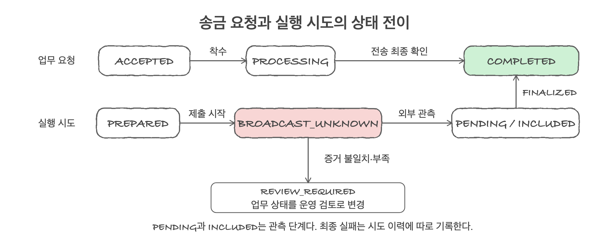

# 지급 요청과 실행 시도의 상태 전이 설계하기

## 1. 요청 상태는 고객에게 제공하는 진행 결과다

`ACCEPTED`는 검증된 요청의 저장이 끝난 상태다. Worker가 실행을 준비하면 `PROCESSING`, Confirmer가 기대 지급의 성공 및 최종화를 확인하면 `COMPLETED`로 바꾼다. 지급이 일어나지 않았다는 근거를 확보하고 정책상 더 진행할 수 없으면 `FAILED`, 모순이나 대조 기한 초과로 판단이 필요하면 `REVIEW_REQUIRED`로 보낸다. [HTTP 202 Accepted](https://www.rfc-editor.org/rfc/rfc9110.html#name-202-accepted) · [Microsoft 비동기 요청-응답](https://learn.microsoft.com/en-us/azure/architecture/patterns/asynchronous-request-reply) · [Ethereum RPC 블록 조회](https://ethereum.org/developers/docs/apis/json-rpc/#eth-getblockbynumber) · [Ethereum RPC 영수증](https://ethereum.org/developers/docs/apis/json-rpc/#eth-gettransactionreceipt) · [AWS 타임아웃과 재시도](https://aws.amazon.com/builders-library/timeouts-retries-and-backoff-with-jitter/)

## 2. 실행 시도 상태는 확인된 증거를 나타낸다

- `PREPARED`에는 지급 입력·nonce·서명 바이트·해시를 저장한다. Worker는 RPC를 호출하기 전에 조건부 갱신으로 제출 시작을 기록하고 상태를 `BROADCAST_UNKNOWN`으로 전이한다. 이 기록 뒤 Worker가 종료되어도 다른 Worker는 이미 제출했을 가능성을 고려해 같은 해시를 확인한다. [EIP-1559](https://eips.ethereum.org/EIPS/eip-1559) · [Geth 트랜잭션 해시 구현](https://github.com/ethereum/go-ethereum/blob/v1.16.7/core/types/transaction.go) · [PostgreSQL 18 트랜잭션](https://www.postgresql.org/docs/18/tutorial-transactions.html) · [PostgreSQL 18 UPDATE](https://www.postgresql.org/docs/18/sql-update.html) · [Ethereum RPC 전송](https://ethereum.org/developers/docs/apis/json-rpc/#eth-sendrawtransaction)
- `PENDING`은 제출 응답을 받았거나 RPC에서 미포함 거래를 확인한 상태다. `INCLUDED`에는 성공 여부와 블록 해시를 담는다. 재구성으로 포함이 사라지면 같은 해시의 대기 여부에 따라 `PENDING` 또는 `BROADCAST_UNKNOWN`으로 돌아간다. [Ethereum RPC 전송](https://ethereum.org/developers/docs/apis/json-rpc/#eth-sendrawtransaction) · [Ethereum RPC 트랜잭션 조회](https://ethereum.org/developers/docs/apis/json-rpc/#eth-gettransactionbyhash) · [Ethereum RPC 영수증](https://ethereum.org/developers/docs/apis/json-rpc/#eth-gettransactionreceipt) · [Ethereum 지분증명](https://ethereum.org/en/developers/docs/consensus-mechanisms/pos/)
- `FINALIZED`는 일치하는 성공 지급의 블록을 최종화까지 확인한 상태다. `REVERTED`는 실패 영수증이 정규 체인에서 최종화된 상태다. `PROVEN_NOT_SENT`는 제출 이전의 실패를 기록으로 입증하고 해당 서명 바이트의 제출 권한을 차단한 시도에 사용한다. [EIP-658](https://eips.ethereum.org/EIPS/eip-658) · [Ethereum RPC 블록 조회](https://ethereum.org/developers/docs/apis/json-rpc/#eth-getblockbynumber) · [Ethereum RPC 영수증](https://ethereum.org/developers/docs/apis/json-rpc/#eth-gettransactionreceipt) · [PostgreSQL 18 UPDATE](https://www.postgresql.org/docs/18/sql-update.html)

## 3. 늦은 메시지가 상태를 덮어쓰는지 확인한다

실행 상태를 갱신할 때 기존 상태 또는 버전을 조건으로 건다. 성공한 전이와 사유는 `payout_status_history`에 같은 트랜잭션으로 추가한다. Confirmer의 `FINALIZED` 처리 직후 Worker의 늦은 `PENDING` 갱신과 동일 최종화 관측을 다시 실행해 현재 상태가 보존되고 성공 전이 이력이 한 번만 추가되는지 확인한다. [PostgreSQL 18 UPDATE](https://www.postgresql.org/docs/18/sql-update.html) · [PostgreSQL 18 격리 수준](https://www.postgresql.org/docs/18/transaction-iso.html) · [PostgreSQL 18 트랜잭션](https://www.postgresql.org/docs/18/tutorial-transactions.html) · [Microsoft Event Sourcing](https://learn.microsoft.com/en-us/azure/architecture/patterns/event-sourcing)

