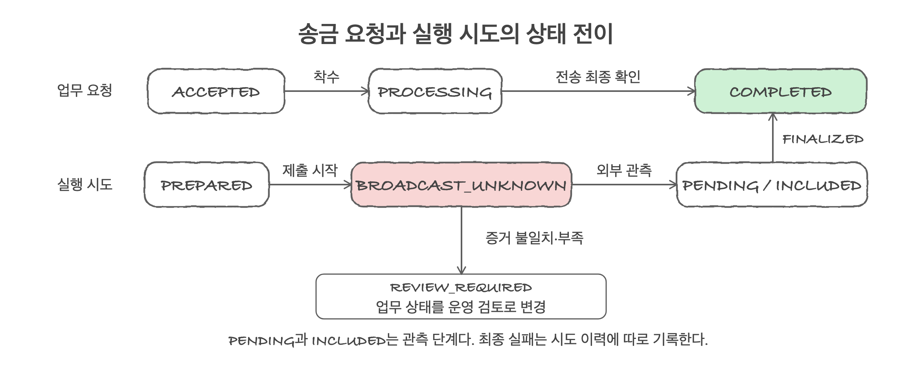

# 데이터베이스와 체인 상태를 이력으로 대조하기

## 1. 내부 기록과 외부 관측을 같은 식별자로 연결한다

PostgreSQL에서는 접수된 요청, 실행 시도, 처리 권한을 읽는다. Ethereum RPC에서는 실행 시도의 `tx_hash`를 사용해 대기 거래나 영수증을 조회한다. 대조에 쓰는 키는 `payout_id`, `attempt_id`, `chain_id`, `tx_hash`이고, 포함 여부를 판정할 때는 블록 높이와 해시도 함께 사용한다. [PostgreSQL 18 제약](https://www.postgresql.org/docs/18/ddl-constraints.html) · [Ethereum RPC 트랜잭션 조회](https://ethereum.org/developers/docs/apis/json-rpc/#eth-gettransactionbyhash) · [Ethereum RPC 영수증](https://ethereum.org/developers/docs/apis/json-rpc/#eth-gettransactionreceipt) · [Ethereum RPC 블록 조회](https://ethereum.org/developers/docs/apis/json-rpc/#eth-getblockbynumber)

- 내부 `PROCESSING`과 성공 영수증이 관찰되면 요청 데이터와 로그를 대조한다. 현재 정규 체인과 최종화 여부를 확인한 뒤 일치하는 지급을 완료한다. [ERC-20 표준](https://eips.ethereum.org/EIPS/eip-20) · [EIP-658](https://eips.ethereum.org/EIPS/eip-658) · [Ethereum RPC 영수증](https://ethereum.org/developers/docs/apis/json-rpc/#eth-gettransactionreceipt) · [Ethereum RPC 블록 조회](https://ethereum.org/developers/docs/apis/json-rpc/#eth-getblockbynumber)
- 내부 `BROADCAST_UNKNOWN`과 `null` 영수증이 만나면 같은 해시로 대기 여부부터 확인한다. 조회에서 보이지 않는다는 이유만으로 새 nonce를 발급하면 먼저 제출된 거래와 새 거래가 모두 실행될 수 있다. [Ethereum RPC 트랜잭션 조회](https://ethereum.org/developers/docs/apis/json-rpc/#eth-gettransactionbyhash) · [Ethereum RPC 영수증](https://ethereum.org/developers/docs/apis/json-rpc/#eth-gettransactionreceipt) · [Ethereum 트랜잭션](https://ethereum.org/en/developers/docs/transactions/) · [AWS 타임아웃과 재시도](https://aws.amazon.com/builders-library/timeouts-retries-and-backoff-with-jitter/)
- 내부 `COMPLETED`와 모순되는 관측이 오면 조회 대상 체인, RPC의 최신 상태, 블록 해시를 확인해 사건을 기록한다. 재실행으로 해결하기 전에 기존 지급 증거를 다시 대조한다. [Ethereum RPC 블록 조회](https://ethereum.org/developers/docs/apis/json-rpc/#eth-getblockbynumber) · [Ethereum RPC 영수증](https://ethereum.org/developers/docs/apis/json-rpc/#eth-gettransactionreceipt) · [AWS 멱등 재시도 설계](https://aws.amazon.com/builders-library/making-retries-safe-with-idempotent-APIs/)

## 2. 현재 상태와 상태를 바꾼 이유를 같이 저장한다

`payout_status_history`는 추가 전용으로 둔다. `payout_id`, 해당 시도의 `attempt_id`, 이전·다음 상태, 사유 코드, 관측 시각, 관측 주체, 거래·블록 해시를 기록한다. 현재 상태의 조건부 변경이 성공한 경우 그 전이 이력을 같은 PostgreSQL 트랜잭션으로 커밋한다. [Microsoft Event Sourcing](https://learn.microsoft.com/en-us/azure/architecture/patterns/event-sourcing) · [PostgreSQL 18 UPDATE](https://www.postgresql.org/docs/18/sql-update.html) · [PostgreSQL 18 트랜잭션](https://www.postgresql.org/docs/18/tutorial-transactions.html)

## 3. 장애 타임라인을 복원한다

RPC가 전송을 받고 응답을 끊는 테스트를 실행한다. DB에는 제출 시작과 응답 타임아웃이 남고, 체인이 먼저 포함한 경우 Confirmer의 뒤늦은 영수증 관측도 같은 시도에서 찾을 수 있어야 한다. 운영자가 이력만 읽고 어떤 사실을 언제 알았는지 순서대로 설명할 수 있는지 검증한다. [AWS 타임아웃과 재시도](https://aws.amazon.com/builders-library/timeouts-retries-and-backoff-with-jitter/) · [Ethereum RPC 영수증](https://ethereum.org/developers/docs/apis/json-rpc/#eth-gettransactionreceipt) · [Microsoft Event Sourcing](https://learn.microsoft.com/en-us/azure/architecture/patterns/event-sourcing)

