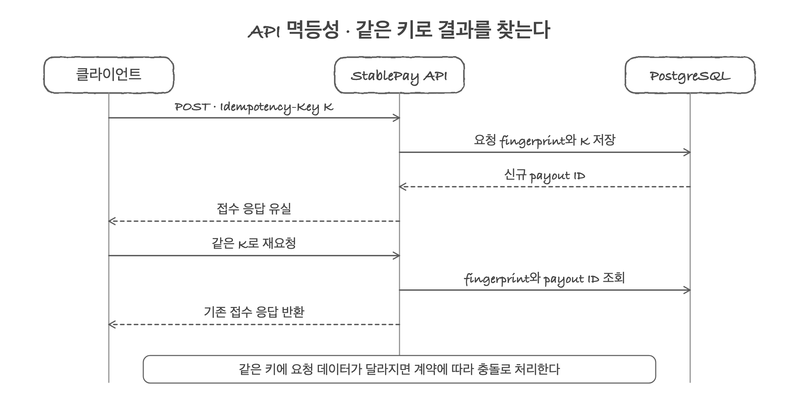

# 지급 생성 API의 Idempotency-Key 설계

## 1. 가맹점이 같은 지급 의도를 다시 전달할 수 있게 한다

`POST /payouts`의 StablePay 계약은 `Idempotency-Key`로 재전송을 식별한다. 키는 인증으로 확인한 가맹점과 API 경로의 범위에서 유효하다. 같은 키에 같은 요청이면 처음 저장된 `202 Accepted` 접수 응답과 기존 `payout_id`를 반환하고, 같은 키에 다른 요청이면 `409 Conflict`를 반환한다. [Stripe 멱등 요청](https://docs.stripe.com/api/idempotent_requests) · [AWS 멱등 재시도 설계](https://aws.amazon.com/builders-library/making-retries-safe-with-idempotent-APIs/) · [HTTP 202 Accepted](https://www.rfc-editor.org/rfc/rfc9110.html#name-202-accepted) · [HTTP 409 Conflict](https://www.rfc-editor.org/rfc/rfc9110.html#name-409-conflict)

금액은 최소 단위 정수로, 자산은 체인 ID와 컨트랙트 주소로 정규화한다. 수신인과 지급에 영향을 주는 다른 필드도 일관되게 정규화한 뒤 이 값을 저장하거나 이 값들의 정규 직렬화에 대한 해시를 저장해 새 요청과 비교한다. 키 보존 기간과 늦은 재전송의 처리 정책도 API 계약에 공개한다. [ERC-20 표준](https://eips.ethereum.org/EIPS/eip-20) · [AWS 멱등 재시도 설계](https://aws.amazon.com/builders-library/making-retries-safe-with-idempotent-APIs/)

## 2. 동시 요청의 승자는 고유 제약으로 정한다

`POST /payouts`에 전용인 `payout_request`에는 `(merchant_id, idempotency_key)` 복합 `UNIQUE`를 둔다. 여러 경로가 접수 테이블을 공유한다면 경로도 키에 포함한다. 키 구성 열은 `NOT NULL`로 둔다. 새 요청에는 `INSERT … ON CONFLICT DO NOTHING RETURNING`을 수행한다. 삽입한 세션만 지급과 최초 접수 응답을 커밋한다. [PostgreSQL 18 제약](https://www.postgresql.org/docs/18/ddl-constraints.html) · [PostgreSQL 18 INSERT](https://www.postgresql.org/docs/18/sql-insert.html) · [PostgreSQL 18 트랜잭션](https://www.postgresql.org/docs/18/tutorial-transactions.html) · [AWS 멱등 재시도 설계](https://aws.amazon.com/builders-library/making-retries-safe-with-idempotent-APIs/)

PostgreSQL의 `READ COMMITTED`에서는 다른 세션의 충돌 행이 INSERT 문장의 스냅숏에 보이지 않아도 `DO NOTHING`이 실행될 수 있다. 반환 행이 없으면 후속 SELECT 문장으로 기존 행을 읽어 요청 내용을 비교하고, 이미 저장된 응답 또는 충돌 응답을 돌려준다. [PostgreSQL 18 격리 수준](https://www.postgresql.org/docs/18/transaction-iso.html) · [PostgreSQL 18 INSERT](https://www.postgresql.org/docs/18/sql-insert.html) · [AWS 멱등 재시도 설계](https://aws.amazon.com/builders-library/making-retries-safe-with-idempotent-APIs/)

## 3. 응답 유실과 서로 다른 요청의 경합을 재현한다

두 클라이언트가 같은 키로 동시에 호출한다. 한 번은 같은 본문으로 보내 지급 행이 한 건이며 두 응답의 `payout_id`가 같은지 확인한다. 다음에는 금액만 바꿔 새 지급 없이 `409`가 나오는지 확인한다. 최초 커밋 직후 응답을 끊고 원래 요청을 보내면 같은 `payout_id`로 상태를 조회할 수 있어야 한다. [AWS 멱등 재시도 설계](https://aws.amazon.com/builders-library/making-retries-safe-with-idempotent-APIs/) · [PostgreSQL 18 제약](https://www.postgresql.org/docs/18/ddl-constraints.html) · [HTTP 409 Conflict](https://www.rfc-editor.org/rfc/rfc9110.html#name-409-conflict)

