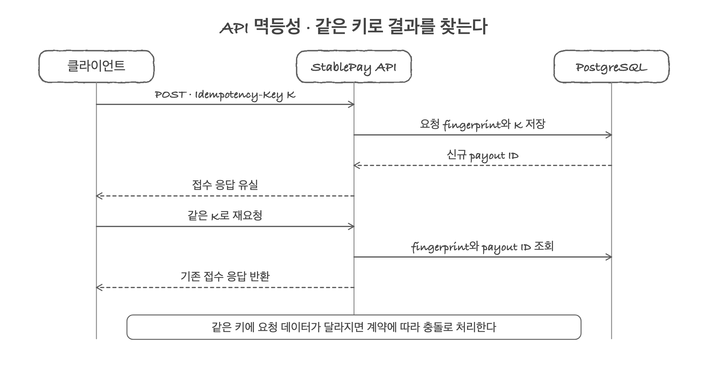

# 중복 지급을 막는 재시도와 실패 이력

## 1. 재시도마다 같은 업무 요청과 실행 근거를 사용한다

클라이언트는 기존 `Idempotency-Key`와 동일한 내용을 사용한다. Queue 재전달은 기존 `payout_id`와 처리 중인 `attempt_id`를 찾는다. RPC 제출 직후 타임아웃이 나면 기록된 `tx_hash`로 먼저 조회하고, 재제출이 허용된 상태라면 저장된 같은 서명 바이트를 전송한다. 타입 2에서 같은 바이트는 같은 거래 해시를 유지한다. [AWS 멱등 재시도 설계](https://aws.amazon.com/builders-library/making-retries-safe-with-idempotent-APIs/) · [AWS Transactional Outbox](https://docs.aws.amazon.com/prescriptive-guidance/latest/cloud-design-patterns/transactional-outbox.html) · [Geth 트랜잭션 해시 구현](https://github.com/ethereum/go-ethereum/blob/v1.16.7/core/types/transaction.go) · [Ethereum RPC 전송](https://ethereum.org/developers/docs/apis/json-rpc/#eth-sendrawtransaction) · [Ethereum RPC 영수증](https://ethereum.org/developers/docs/apis/json-rpc/#eth-gettransactionreceipt)

백오프와 지터를 적용하는 반복 조회에는 횟수와 시간 예산을 둔다. 예산이 초과되면 자동 재시도를 멈추고 지급 요청을 `REVIEW_REQUIRED`로 넘겨 대조한다. 기존 실행의 `PROVEN_NOT_SENT`나 최종화된 `REVERTED`처럼 중복 지급 가능성을 해소한 근거가 있을 때만 정책에 따라 새 실행을 검토한다. [AWS 타임아웃과 재시도](https://aws.amazon.com/builders-library/timeouts-retries-and-backoff-with-jitter/) · [Ethereum RPC 영수증](https://ethereum.org/developers/docs/apis/json-rpc/#eth-gettransactionreceipt) · [EIP-658](https://eips.ethereum.org/EIPS/eip-658) · [Ethereum RPC 블록 조회](https://ethereum.org/developers/docs/apis/json-rpc/#eth-getblockbynumber)

## 2. 성공만 고쳐 쓰면 이전 장애를 잃는다

시도별 실패와 관측을 `payout_status_history`에 추가한다. `RPC_TIMEOUT`, `REORG_DETECTED`, `RECEIPT_REVERTED`처럼 사유를 기록하고, 시각·시도 ID·관련 해시를 남긴다. 나중에 성공해도 어떤 시도나 관측에서 어떤 문제가 발생했는지 이력에서 추적한다. [Microsoft Event Sourcing](https://learn.microsoft.com/en-us/azure/architecture/patterns/event-sourcing) · [AWS 타임아웃과 재시도](https://aws.amazon.com/builders-library/timeouts-retries-and-backoff-with-jitter/) · [Ethereum RPC 영수증](https://ethereum.org/developers/docs/apis/json-rpc/#eth-gettransactionreceipt) · [Ethereum 지분증명](https://ethereum.org/en/developers/docs/consensus-mechanisms/pos/)

완료 상태와 완료 알림용 `outbox`는 같은 DB 트랜잭션으로 커밋한다. Confirmer가 같은 영수증을 중복 반영할 때에는 조건부 전이와 완료 이벤트 고유 키로 같은 지급의 완료 이벤트가 중복 삽입되지 않게 한다. Relay나 Queue가 완료 메시지를 재전달하는 경우에는 후속 소비자도 이벤트 ID로 중복 효과를 방어한다. [PostgreSQL 18 UPDATE](https://www.postgresql.org/docs/18/sql-update.html) · [PostgreSQL 18 제약](https://www.postgresql.org/docs/18/ddl-constraints.html) · [PostgreSQL 18 트랜잭션](https://www.postgresql.org/docs/18/tutorial-transactions.html) · [AWS Transactional Outbox](https://docs.aws.amazon.com/prescriptive-guidance/latest/cloud-design-patterns/transactional-outbox.html)

## 3. 재시도 횟수와 실제 지급 수를 따로 센다

첫 전송에서 RPC 응답을 유실시키고 같은 메시지를 두 번 전달한다. 기존 해시의 영수증을 대조한 뒤 요청 한 건, 실제 지급 한 건, 완료 이벤트 한 건과 타임아웃 이력이 남는지 확인한다. 제출 이전에 실패한 경우에는 실패 시도와 다음 시도를 서로 다른 `attempt_id`로 찾아 비교한다. [AWS 멱등 재시도 설계](https://aws.amazon.com/builders-library/making-retries-safe-with-idempotent-APIs/) · [AWS Transactional Outbox](https://docs.aws.amazon.com/prescriptive-guidance/latest/cloud-design-patterns/transactional-outbox.html) · [Ethereum RPC 영수증](https://ethereum.org/developers/docs/apis/json-rpc/#eth-gettransactionreceipt) · [Microsoft Event Sourcing](https://learn.microsoft.com/en-us/azure/architecture/patterns/event-sourcing)

