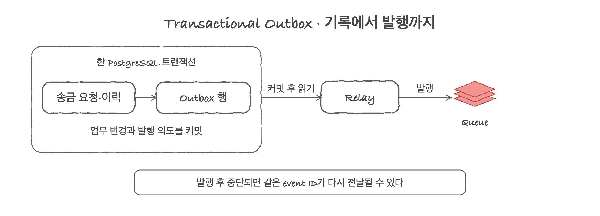

# 아웃박스가 보장하는 범위

StablePay API가 지급 요청을 저장한 뒤 Queue에 직접 발행하면 그 사이에 중단될 수 있다. Transactional Outbox는 지급 요청과 발행할 이벤트를 같은 PostgreSQL 트랜잭션에 저장해, 재시작한 Relay가 발행할 일을 DB에서 다시 찾게 한다. [AWS Transactional Outbox](https://docs.aws.amazon.com/prescriptive-guidance/latest/cloud-design-patterns/transactional-outbox.html)

## 1. 두 번 쓰는 순서만 바꿔 본다

DB를 먼저 커밋하고 API 프로세스를 종료하면 `ACCEPTED` 요청은 남고 Queue에는 작업이 없다. 먼저 발행하고 DB에서 롤백하면 Worker가 존재하지 않는 요청을 받는다. 두 가지 중단을 각각 재현하면 DB 커밋과 Queue 발행이 별도의 성공 조건임을 확인할 수 있다. [AWS Transactional Outbox](https://docs.aws.amazon.com/prescriptive-guidance/latest/cloud-design-patterns/transactional-outbox.html)

## 2. 요청과 발행 의도를 함께 확정한다

동일 트랜잭션에서 `payout_request`와 `outbox`를 기록한다. 롤백하면 둘 다 사라지고 커밋하면 둘 다 남는다. 다른 트랜잭션에서 조회하는 Relay는 커밋된 Outbox 행을 읽어 Queue에 보낸다. [PostgreSQL 18 트랜잭션](https://www.postgresql.org/docs/18/tutorial-transactions.html) · [AWS Transactional Outbox](https://docs.aws.amazon.com/prescriptive-guidance/latest/cloud-design-patterns/transactional-outbox.html)

## 3. 지연과 중복을 운영 범위에 포함한다

API 접수와 Queue 발행 사이에는 지연이 생긴다. 발행 실패를 다시 시도할 수 있도록 Outbox 행을 보존하고 미발행 행의 건수와 최장 대기 시간을 추적한다. 발행 확인 응답이 유실되면 같은 이벤트를 다시 보낼 수 있으므로 Worker가 `event_id`로 중복을 처리한다. [AWS Transactional Outbox](https://docs.aws.amazon.com/prescriptive-guidance/latest/cloud-design-patterns/transactional-outbox.html) · [AWS 타임아웃·백오프·지터](https://aws.amazon.com/builders-library/timeouts-retries-and-backoff-with-jitter/)

Relay를 멈춘 채 지급을 접수하고 DB에서 `ACCEPTED`와 미발행 건을 확인한다. Relay 재시작 이후 동일 `event_id`가 도착하고 Worker가 업무 효과를 한 번만 반영하는지 검사한다. [AWS Transactional Outbox](https://docs.aws.amazon.com/prescriptive-guidance/latest/cloud-design-patterns/transactional-outbox.html) · [AWS 멱등 재시도](https://aws.amazon.com/builders-library/making-retries-safe-with-idempotent-APIs/)
