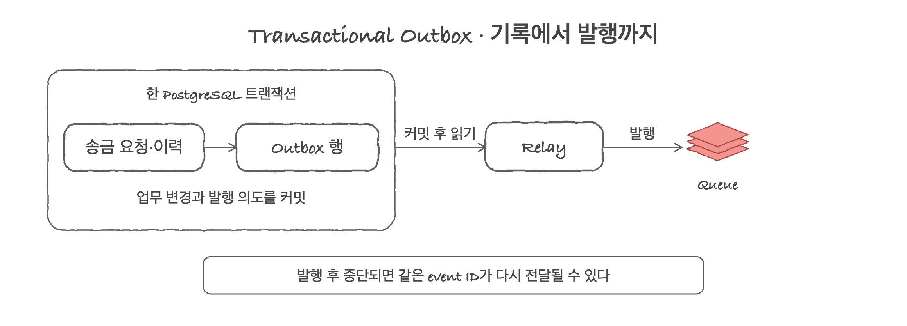

# 지급 요청·이력·아웃박스를 한 트랜잭션에 저장하기

## 1. 접수 한 건이 만드는 세 행을 정한다

StablePay API가 지급을 처음 접수하면 `payout_request`에 `payout_id`와 `ACCEPTED`를, `payout_status_history`에 최초 상태와 발생 시각을, `outbox`에 `PayoutAccepted` 이벤트와 고정 `event_id`를 넣는다. 세 쓰기는 동일 PostgreSQL 연결의 트랜잭션에서 커밋한다. [PostgreSQL 18 트랜잭션](https://www.postgresql.org/docs/18/tutorial-transactions.html) · [AWS Transactional Outbox](https://docs.aws.amazon.com/prescriptive-guidance/latest/cloud-design-patterns/transactional-outbox.html)

## 2. 재요청에는 생성 경로를 다시 타지 않는다

가맹점 범위의 `(merchant_id, idempotency_key)`를 유일하게 저장한다. 같은 키와 같은 정규화 입력으로 재요청하면 기존 `payout_id`를 반환한다. 목적지·금액·자산처럼 지급 의도를 바꾸는 필드가 다르면 충돌로 응답한다. 최초로 접수에 성공한 트랜잭션만 이력과 이벤트를 생성한다. [PostgreSQL 18 제약](https://www.postgresql.org/docs/18/ddl-constraints.html) · [AWS 멱등 재시도](https://aws.amazon.com/builders-library/making-retries-safe-with-idempotent-APIs/) · [AWS Transactional Outbox](https://docs.aws.amazon.com/prescriptive-guidance/latest/cloud-design-patterns/transactional-outbox.html)

## 3. 접수 응답과 롤백을 시험한다

Outbox 삽입 직전에 DB 오류를 일으켜 세 테이블에 해당 지급 행이 하나도 남지 않는지 검사한다. 커밋 직후 응답을 끊은 테스트에서는 동일 키로 접수를 재시도하고 요청·초기 이력·이벤트가 각각 한 건으로 유지되는지 검사한다. API는 커밋을 확인한 뒤 접수 결과를 반환한다. [PostgreSQL 18 트랜잭션](https://www.postgresql.org/docs/18/tutorial-transactions.html) · [AWS 멱등 재시도](https://aws.amazon.com/builders-library/making-retries-safe-with-idempotent-APIs/)
