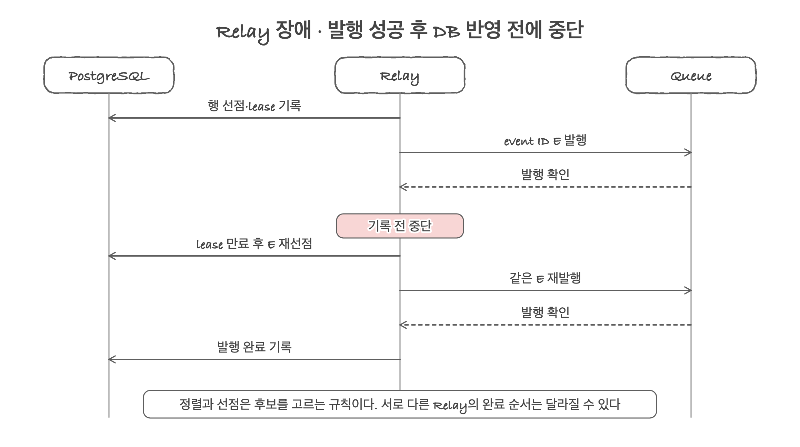

# 릴레이 배치 선점과 이벤트 순서

## 1. 잠긴 행을 건너뛰고 처리할 배치를 고른다

Relay는 발행 가능 시각이 지난 미발행 행을 `ORDER BY available_at, event_id`로 조회한다. 유일한 `event_id`가 같은 시각의 동률을 해소한다. `FOR UPDATE SKIP LOCKED`는 즉시 잠글 수 없는 행을 건너뛰므로 여러 Relay가 Queue처럼 사용하는 테이블에 적합하다. [PostgreSQL 18 SELECT](https://www.postgresql.org/docs/18/sql-select.html)

```sql
SELECT event_id
FROM outbox
WHERE published_at IS NULL
  AND available_at <= now()
  AND (lease_until IS NULL OR lease_until <= now())
ORDER BY available_at, event_id
LIMIT 50
FOR UPDATE SKIP LOCKED;
```

선택한 행에 선점 토큰과 만료 시각을 같은 짧은 트랜잭션에서 저장하고 커밋한다. Queue 호출은 커밋 이후 수행하며 발행 표시는 선점 토큰이 일치할 때만 갱신한다. 만료 후 재선점을 허용해도 이전 Relay의 외부 전송이 늦게 도착할 수 있으므로 같은 `event_id`를 유지한다. [PostgreSQL 18 트랜잭션](https://www.postgresql.org/docs/18/tutorial-transactions.html) · [AWS Transactional Outbox](https://docs.aws.amazon.com/prescriptive-guidance/latest/cloud-design-patterns/transactional-outbox.html) · [AWS 멱등 재시도](https://aws.amazon.com/builders-library/making-retries-safe-with-idempotent-APIs/)



## 2. 지급별 순서는 별도의 조건으로 둔다

배치 정렬은 조회 시점에 선점할 수 있는 후보의 순서다. Relay A가 지급 `P1`의 순번 1을 선점한 사이 Relay B가 순번 2를 가져가면 먼저 전송할 수 있다. 지급별 순번이 필수면 `payout_id`별 단조 순번을 저장하고, 선행 순번의 발행을 확인한 행만 다음 선점 후보로 둔다. Worker가 순서를 요구한다면 Queue의 순서 보장과 소비자에서 빠진 순번을 보류하는 조건도 함께 정한다. [PostgreSQL 18 SELECT](https://www.postgresql.org/docs/18/sql-select.html) · [AWS Transactional Outbox](https://docs.aws.amazon.com/prescriptive-guidance/latest/cloud-design-patterns/transactional-outbox.html)

## 3. 잠금 경합을 두 세션으로 재현한다

두 Relay에서 선점 쿼리를 실행하고 A의 트랜잭션을 열린 채 둔다. B가 잠긴 `P1`의 순번 1을 건너뛰어 다른 지급을 가져가는지 확인한다. 지급별 선행 조건을 켠 테스트에서는 `P1`의 순번 2도 선점되지 않는지 확인한다. [PostgreSQL 18 SELECT](https://www.postgresql.org/docs/18/sql-select.html) · [AWS Transactional Outbox](https://docs.aws.amazon.com/prescriptive-guidance/latest/cloud-design-patterns/transactional-outbox.html)
