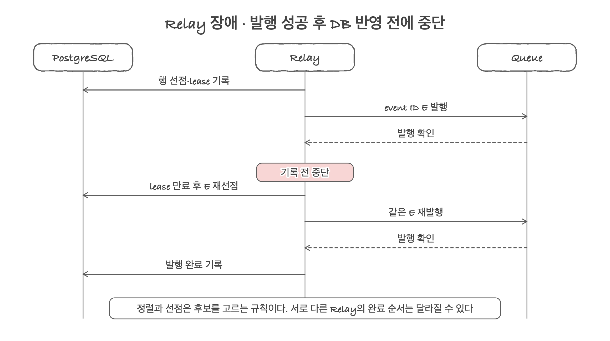

# 릴레이가 중단되면 같은 이벤트를 다시 발행한다

## 1. Queue 확인 이후에 발행을 표시한다

Relay는 커밋된 Outbox 행을 선점하고, Queue가 확인 응답을 반환한 후 `published_at`을 저장한다. 이 시각은 Queue 발행을 확인한 기록이다. 지급 완료는 Worker와 Confirmer가 별도의 업무 상태로 반영한다. [AWS Transactional Outbox](https://docs.aws.amazon.com/prescriptive-guidance/latest/cloud-design-patterns/transactional-outbox.html)

## 2. 중단 지점별로 남아 있는 근거를 확인한다

- 선점 커밋 뒤 발행 전에 중단되면 미발행 행이 남는다. 복구한 Relay가 선점 만료 뒤 기존 `event_id`로 보낸다. [AWS Transactional Outbox](https://docs.aws.amazon.com/prescriptive-guidance/latest/cloud-design-patterns/transactional-outbox.html) · [PostgreSQL 18 트랜잭션](https://www.postgresql.org/docs/18/tutorial-transactions.html)
- Queue가 받았고 응답만 유실됐거나 `published_at` 커밋 전에 중단되면 Queue에 원본이 있을 수 있다. 복구 Relay가 같은 `event_id`를 다시 보내고 Worker는 처리 기록과 업무 키를 대조한다. [AWS Transactional Outbox](https://docs.aws.amazon.com/prescriptive-guidance/latest/cloud-design-patterns/transactional-outbox.html) · [AWS 멱등 재시도](https://aws.amazon.com/builders-library/making-retries-safe-with-idempotent-APIs/)
- `published_at` 커밋 뒤 중단되면 Relay의 미발행 조회에서 빠진다. Queue 자체의 재전달에도 Worker의 중복 방지 조건을 그대로 적용한다. [AWS Transactional Outbox](https://docs.aws.amazon.com/prescriptive-guidance/latest/cloud-design-patterns/transactional-outbox.html) · [SQS 표준 큐 재전달](https://docs.aws.amazon.com/AWSSimpleQueueService/latest/SQSDeveloperGuide/standard-queues-at-least-once-delivery.html)

## 3. 발행 응답을 잃어도 지급은 한 번 반영한다

Queue가 메시지를 수락한 직후 응답을 끊는다. 선점 만료 뒤 같은 `event_id`의 발행 시도가 반복될 수 있고, 최종적으로 `published_at`이 남으며 Worker의 로컬 지급 상태 전이는 한 번만 일어나는지 확인한다. [AWS Transactional Outbox](https://docs.aws.amazon.com/prescriptive-guidance/latest/cloud-design-patterns/transactional-outbox.html) · [AWS 멱등 재시도](https://aws.amazon.com/builders-library/making-retries-safe-with-idempotent-APIs/)
