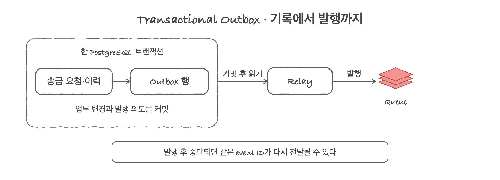

# 데이터 저장 밖의 작업에도 같은 원리를 적용한다

## 1. 같은 업무가 두 시스템의 성공에 의존하는지 찾는다

정산 보고서 준비 완료를 저장하면서 이메일을 보내거나, 지급 상태를 저장하면서 파트너 웹훅을 보내는 흐름도 두 시스템에 걸친다. 이메일을 먼저 보내고 DB가 롤백되면 사용할 수 없는 보고서를 안내하게 되고, DB부터 커밋하고 중단되면 알림을 놓칠 수 있다. [AWS Transactional Outbox](https://docs.aws.amazon.com/prescriptive-guidance/latest/cloud-design-patterns/transactional-outbox.html)

## 2. 복구할 수 있는 의도와 외부 관측을 남긴다

로컬 상태와 후속 작업 의도를 함께 커밋하고, Worker가 일정한 요청 식별자로 외부 작업을 수행한다. 결과 조회나 멱등 키를 제공하는 외부 서비스는 그 계약을 활용해 확인하고, 제공하지 않는 서비스에는 응답 유실 시 운영 대조나 재시도 중단 기준을 정한다. [AWS Transactional Outbox](https://docs.aws.amazon.com/prescriptive-guidance/latest/cloud-design-patterns/transactional-outbox.html) · [AWS 멱등 재시도](https://aws.amazon.com/builders-library/making-retries-safe-with-idempotent-APIs/) · [AWS 타임아웃·백오프·지터](https://aws.amazon.com/builders-library/timeouts-retries-and-backoff-with-jitter/)

## 3. 이어지는 작업에서 확인할 사실을 나눈다

StablePay에서 Queue는 작업 전달을, Ethereum RPC는 체인 트랜잭션 제출을 맡는다. 둘에 대해 각각 확인 상태와 식별자를 남긴다. 보고서 알림 실습에서도 같은 원칙으로 발행 확인과 메일 제공자 응답을 구분하고, 제공자가 수락한 직후 응답을 잃었을 때 어떤 식별자로 조회할 수 있는지 정한다. [AWS Transactional Outbox](https://docs.aws.amazon.com/prescriptive-guidance/latest/cloud-design-patterns/transactional-outbox.html) · [AWS 멱등 재시도](https://aws.amazon.com/builders-library/making-retries-safe-with-idempotent-APIs/) · [Ethereum eth_sendRawTransaction](https://ethereum.org/developers/docs/apis/json-rpc/#eth-sendrawtransaction)
