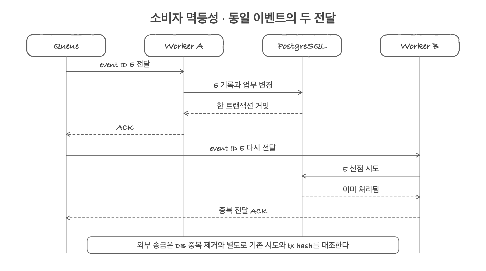

# 중복 메시지를 받아도 지급 실행은 한 번 준비한다

## 1. 메시지 재전달과 지급 중복을 구분한다

같은 `event_id`는 Relay 재발행이나 Queue 재전달로 다시 도착할 수 있다. 예를 들어 SQS 표준 큐에서는 일부 서버가 일시적으로 사본 삭제를 수행하지 못해 소비자가 메시지를 다시 받을 수 있다. StablePay는 메시지 처리 기록에 `(consumer_name, event_id)`를, 지급 실행의 상태 전이에는 `payout_id`를 사용한다. [AWS Transactional Outbox](https://docs.aws.amazon.com/prescriptive-guidance/latest/cloud-design-patterns/transactional-outbox.html) · [SQS 표준 큐 재전달](https://docs.aws.amazon.com/AWSSimpleQueueService/latest/SQSDeveloperGuide/standard-queues-at-least-once-delivery.html) · [PostgreSQL 18 제약](https://www.postgresql.org/docs/18/ddl-constraints.html)

## 2. 처리 기록과 업무 변경을 함께 커밋한다

Worker는 `processed_message` 삽입에 `ON CONFLICT (consumer_name, event_id) DO NOTHING RETURNING event_id`를 사용한다. 삽입한 Worker만 `ACCEPTED → PROCESSING` 조건부 전이와 `payout_attempt` 준비를 진행한다. 같은 지급이 다른 이벤트로 도착해도 조건부 전이가 허용하는 작업자만 시도를 준비한다. 처리 기록과 영속 실행 의도가 커밋된 뒤 Queue 수신을 확인한다. [PostgreSQL 18 INSERT](https://www.postgresql.org/docs/18/sql-insert.html) · [PostgreSQL 18 트랜잭션](https://www.postgresql.org/docs/18/tutorial-transactions.html) · [AWS 멱등 재시도](https://aws.amazon.com/builders-library/making-retries-safe-with-idempotent-APIs/)

DB 커밋 전에 실패하면 처리 기록과 업무 변경이 함께 롤백된다. 커밋 후 수신 확인 전에 중단되면 재전달에서 기존 처리 결과를 확인한다. 외부 실행 전에 수신 확인을 보내는 구조이므로 별도의 실행 작업이 DB에 남은 준비 건을 찾아 이어서 처리할 수 있어야 한다. [PostgreSQL 18 트랜잭션](https://www.postgresql.org/docs/18/tutorial-transactions.html) · [AWS Transactional Outbox](https://docs.aws.amazon.com/prescriptive-guidance/latest/cloud-design-patterns/transactional-outbox.html) · [SQS 가시성 제한 시간](https://docs.aws.amazon.com/AWSSimpleQueueService/latest/SQSDeveloperGuide/sqs-visibility-timeout.html)

## 3. 외부 전송 식별자를 별도로 유지한다

로컬 중복 방지 기록은 외부 RPC 수락 여부까지 알려 주지 않는다. 지급 Worker가 제출하려는 서명 트랜잭션의 해시를 사전에 저장하고, 응답 유실 시 같은 시도로 대조한다. 수신 확인을 끊는 테스트에서 중복 메시지 처리 건수와 신규 `payout_attempt` 생성 건수를 각각 검사한다. [AWS 멱등 재시도](https://aws.amazon.com/builders-library/making-retries-safe-with-idempotent-APIs/) · [Ethereum eth_sendRawTransaction](https://ethereum.org/developers/docs/apis/json-rpc/#eth-sendrawtransaction) · [go-ethereum v1.16.5 트랜잭션 해시](https://raw.githubusercontent.com/ethereum/go-ethereum/v1.16.5/core/types/transaction.go)
