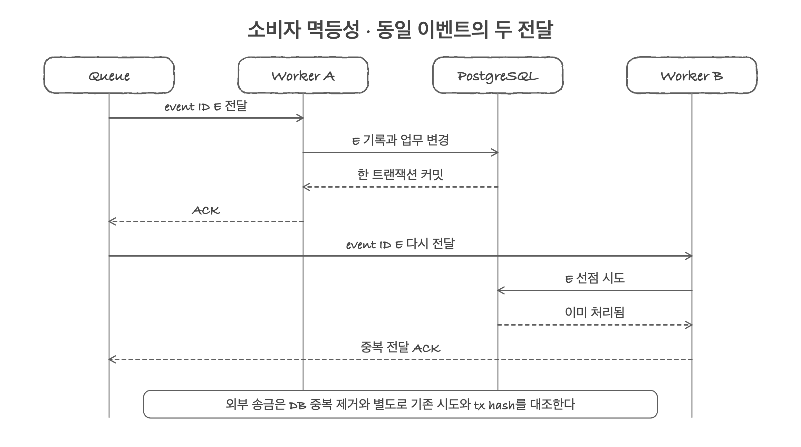

# 메시지 동시성 테스트와 오류 코드 표준화

## 1. 같은 이벤트를 두 작업자에게 동시에 준다

실제 PostgreSQL을 쓰는 테스트에서 두 Worker를 별도 연결로 실행한다. 같은 `event_id`를 전달하고 두 작업자를 처리 기록 삽입 직전에 맞춘다. 처리 기록 한 행, `ACCEPTED → PROCESSING` 이력 한 행, 최초 `payout_attempt` 한 행을 각각 확인한다. [PostgreSQL 18 제약](https://www.postgresql.org/docs/18/ddl-constraints.html) · [PostgreSQL 18 INSERT](https://www.postgresql.org/docs/18/sql-insert.html) · [PostgreSQL 18 트랜잭션](https://www.postgresql.org/docs/18/tutorial-transactions.html)

## 2. DB 오류를 업무 코드로 매핑한다

PostgreSQL 오류는 메시지 문자열 대신 `SQLSTATE`로 읽는다. 유일성 위반 `23505`는 제약 이름까지 확인한다. 예상한 중복 처리 제약에서 동일 이벤트라는 사실을 확인했을 때만 `ALREADY_PROCESSED`로 처리한다. 다른 고유 제약 위반은 조사 대상으로 분류한다. [PostgreSQL 18 SQLSTATE](https://www.postgresql.org/docs/18/errcodes-appendix.html) · [AWS 멱등 재시도](https://aws.amazon.com/builders-library/making-retries-safe-with-idempotent-APIs/)

`40001` 또는 정책상 재시도하는 `40P01`은 `RETRYABLE_TRANSACTION`으로 매핑하고 전체 로컬 트랜잭션을 새로 실행한다. 지원하지 않는 이벤트 버전에는 `INVALID_EVENT`를 반환하고, 제출 응답을 잃은 시도는 `BROADCAST_UNKNOWN`으로 남겨 해시로 대조한다. 오류 분류별로 재시도·격리·대조 경로를 구분한다. [PostgreSQL 18 트랜잭션 재시도](https://www.postgresql.org/docs/18/mvcc-serialization-failure-handling.html) · [AWS Transactional Outbox](https://docs.aws.amazon.com/prescriptive-guidance/latest/cloud-design-patterns/transactional-outbox.html) · [AWS 타임아웃·백오프·지터](https://aws.amazon.com/builders-library/timeouts-retries-and-backoff-with-jitter/) · [Ethereum eth_getTransactionByHash](https://ethereum.org/developers/docs/apis/json-rpc/#eth-gettransactionbyhash)

## 3. 커밋과 수신 확인 사이에도 장애를 넣는다

첫 Worker를 커밋 전에 중단하면 두 번째 Worker가 상태 전이를 완료할 수 있어야 한다. 첫 Worker가 커밋한 뒤 메시지 수신 확인을 끊으면 재전달 경로는 기존 결과를 확인해야 한다. 결과가 최종적으로 같아도 두 장애의 로그와 처리 지표는 별도로 확인한다. [PostgreSQL 18 트랜잭션](https://www.postgresql.org/docs/18/tutorial-transactions.html) · [SQS 가시성 제한 시간](https://docs.aws.amazon.com/AWSSimpleQueueService/latest/SQSDeveloperGuide/sqs-visibility-timeout.html) · [AWS Transactional Outbox](https://docs.aws.amazon.com/prescriptive-guidance/latest/cloud-design-patterns/transactional-outbox.html)
