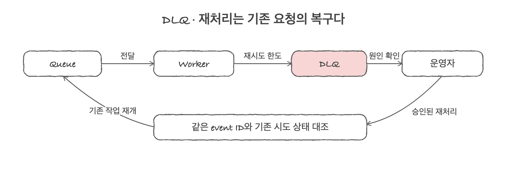

# 백오프·DLQ·관리자 재처리

## 1. 일시 장애만 정해진 예산 안에서 재시도한다

예를 들어 DB 경합이나 일시적인 Queue 연결 오류는 최대 시도 횟수와 전체 기한 안에서 재시도한다. 재시도 번호를 0부터 세어 `min(60초, 1초 × 2^번호)`를 상한으로 두고, 0부터 상한 사이에서 지연을 뽑으면 같은 시각에 실패한 작업의 재시도를 분산할 수 있다. 숫자는 실습 값이다. [PostgreSQL 18 트랜잭션 재시도](https://www.postgresql.org/docs/18/mvcc-serialization-failure-handling.html) · [AWS 타임아웃·백오프·지터](https://aws.amazon.com/builders-library/timeouts-retries-and-backoff-with-jitter/) · [AWS 지수 백오프와 지터](https://aws.amazon.com/blogs/architecture/exponential-backoff-and-jitter/)

이벤트 형식 오류를 반복 수신하면 SQS의 `maxReceiveCount` 정책으로 DLQ에 격리할 수 있다. 외부 송금 응답을 잃은 건은 지급 상태에 미확인으로 남겨 대조한다. DLQ의 수신 횟수와 외부 지급 결과는 별도로 판정한다. [SQS DLQ 정책](https://docs.aws.amazon.com/AWSSimpleQueueService/latest/SQSDeveloperGuide/sqs-dead-letter-queues.html) · [AWS 타임아웃·백오프·지터](https://aws.amazon.com/builders-library/timeouts-retries-and-backoff-with-jitter/) · [Ethereum eth_getTransactionByHash](https://ethereum.org/developers/docs/apis/json-rpc/#eth-gettransactionbyhash)

## 2. 운영자가 지급 상태를 확인한 뒤 재처리한다

지급 ID와 원래 `event_id`로 처리 이력과 `payout_attempt`를 조회한다. 이미 완료한 지급은 실행을 건너뛰고 `BROADCAST_UNKNOWN`은 같은 해시를 대조하는 작업으로 보낸다. 원인이 해소돼 재수신이 필요한 메시지는 같은 업무 `event_id`를 유지해 정상 소비자의 멱등 경로로 돌린다. [AWS 멱등 재시도](https://aws.amazon.com/builders-library/making-retries-safe-with-idempotent-APIs/) · [AWS Transactional Outbox](https://docs.aws.amazon.com/prescriptive-guidance/latest/cloud-design-patterns/transactional-outbox.html) · [Ethereum eth_getTransactionByHash](https://ethereum.org/developers/docs/apis/json-rpc/#eth-gettransactionbyhash)

SQS의 DLQ 재전송은 새 큐 `messageID`와 `enqueueTime`을 부여하며 일괄 작업 중 메시지를 필터링하거나 수정할 수 없다. 건별 승인이 필요하면 운영 도구가 승인 대상 이벤트를 따로 선택하고 승인자·사유·대상·결과를 기록한다. 일괄 재전송은 낮은 속도부터 시작해 원본 Queue와 소비자 적체를 확인하면서 올린다. [SQS DLQ 재전송](https://docs.aws.amazon.com/AWSSimpleQueueService/latest/SQSDeveloperGuide/sqs-configure-dead-letter-queue-redrive.html) · [AWS 멱등 재시도](https://aws.amazon.com/builders-library/making-retries-safe-with-idempotent-APIs/)

## 3. 기존 지급이 재실행되지 않는지 검증한다

오류 수정 뒤 완료 건, 미확인 건, 처음 실행 가능한 건을 각각 재처리한다. 완료 건의 신규 시도가 0건이고 미확인 건이 기존 해시를 사용하며, 처음 실행할 건만 새 시도를 준비하는지 확인한다. [AWS 멱등 재시도](https://aws.amazon.com/builders-library/making-retries-safe-with-idempotent-APIs/) · [Ethereum eth_getTransactionByHash](https://ethereum.org/developers/docs/apis/json-rpc/#eth-gettransactionbyhash) · [AWS Transactional Outbox](https://docs.aws.amazon.com/prescriptive-guidance/latest/cloud-design-patterns/transactional-outbox.html)
