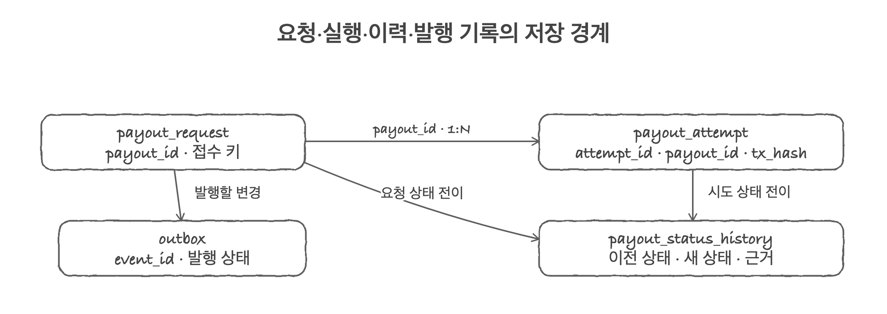

# 지급 요청과 외부 실행 시도의 테이블 설계

## 1. 요청의 의도와 실행의 증거를 따로 저장한다

`payout_request`는 `payout_id`, 가맹점, 자산, 최소 단위의 금액, 목적지, 업무 상태를 가진다. `payout_attempt`는 `attempt_id`, 요청 외래 키, `attempt_no`, 체인 ID, 송신 주소, nonce, 서명 트랜잭션 해시, 실행 상태와 관측 시각을 가진다. 한 지급에서 여러 실행 시도를 이력으로 조회할 수 있다. [PostgreSQL 18 제약](https://www.postgresql.org/docs/18/ddl-constraints.html) · [AWS 멱등 재시도](https://aws.amazon.com/builders-library/making-retries-safe-with-idempotent-APIs/) · [Ethereum eth_getTransactionByHash](https://ethereum.org/developers/docs/apis/json-rpc/#eth-gettransactionbyhash)

## 2. 요청 상태와 시도 상태를 따로 전이한다

요청의 업무 상태는 `ACCEPTED`, `PROCESSING`, `COMPLETED`, `FAILED`, `REVIEW_REQUIRED`로 표현한다. 개별 시도는 `PREPARED`, `BROADCAST_UNKNOWN`, `PENDING`, `INCLUDED` 등 체인에서 관측한 사실을 저장한다. 예를 들어 응답 유실 직후 지급 요청은 `PROCESSING`, 시도는 `BROADCAST_UNKNOWN`에 둔다. [AWS 타임아웃·백오프·지터](https://aws.amazon.com/builders-library/timeouts-retries-and-backoff-with-jitter/) · [Ethereum eth_sendRawTransaction](https://ethereum.org/developers/docs/apis/json-rpc/#eth-sendrawtransaction) · [Ethereum eth_getTransactionByHash](https://ethereum.org/developers/docs/apis/json-rpc/#eth-gettransactionbyhash) · [Ethereum eth_getTransactionReceipt](https://ethereum.org/developers/docs/apis/json-rpc/#eth-gettransactionreceipt)

Confirmer는 지급 조건과 일치하는 성공 영수증이 최종 체인에 포함됐음을 확인할 때 시도를 `FINALIZED`, 요청을 `COMPLETED`로 반영한다. 최종 체인의 실패 영수증은 시도에 `REVERTED`로 남기며, 요청에 재시도가 가능한지는 원인과 지급 정책을 기준으로 판단한다. 요청 상태를 변경할 때 `payout_status_history`와 후속 Outbox 행도 함께 저장한다. [Ethereum eth_getTransactionReceipt](https://ethereum.org/developers/docs/apis/json-rpc/#eth-gettransactionreceipt) · [Ethereum 블록 조회](https://ethereum.org/developers/docs/apis/json-rpc/#eth-getblockbynumber) · [ERC-20 Transfer](https://eips.ethereum.org/EIPS/eip-20#events) · [PostgreSQL 18 트랜잭션](https://www.postgresql.org/docs/18/tutorial-transactions.html) · [AWS Transactional Outbox](https://docs.aws.amazon.com/prescriptive-guidance/latest/cloud-design-patterns/transactional-outbox.html)

## 3. 실행 한 번의 실패로 요청을 잃지 않는다

한 지급의 첫 시도를 `BROADCAST_UNKNOWN`으로 둔 채 두 번째 실행을 요청하는 테스트를 만든다. 신규 실행을 막고 기존 시도로 대조하는지 확인한다. 첫 시도가 확정 실패해 정책상 새 시도가 허용될 때는 같은 `payout_id` 아래에 다음 시도를 추가해 기존 실패 기록을 보존한다. [AWS 멱등 재시도](https://aws.amazon.com/builders-library/making-retries-safe-with-idempotent-APIs/) · [Ethereum eth_getTransactionByHash](https://ethereum.org/developers/docs/apis/json-rpc/#eth-gettransactionbyhash) · [Ethereum eth_getTransactionReceipt](https://ethereum.org/developers/docs/apis/json-rpc/#eth-gettransactionreceipt) · [PostgreSQL 18 제약](https://www.postgresql.org/docs/18/ddl-constraints.html)
