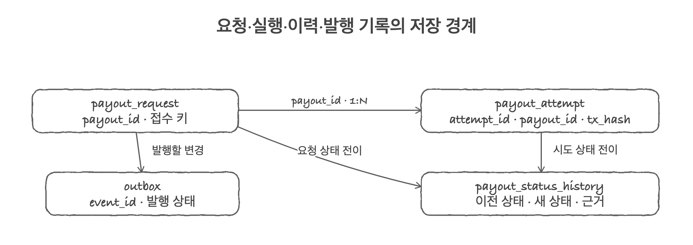

# 고유 식별자와 저장 경계

## 1. 각각의 식별자가 무엇을 고정하는지 정한다

| 저장 경계 | 고유 키 | 충돌의 의미 |
| --- | --- | --- |
| `payout_request` | 기본 키 `payout_id`, 유일한 `(merchant_id, idempotency_key)` | 같은 가맹점의 같은 키면 기존 입력과 대조하고 같은 의도에 기존 `payout_id`를 돌려준다. [PostgreSQL 18 제약](https://www.postgresql.org/docs/18/ddl-constraints.html) · [AWS 멱등 재시도](https://aws.amazon.com/builders-library/making-retries-safe-with-idempotent-APIs/) |
| `payout_attempt` | 기본 키 `attempt_id`, 유일한 `(payout_id, attempt_no)`와 `(chain_id, tx_hash)` | 동일 지급의 같은 순번이나 동일 체인의 같은 서명 트랜잭션을 다른 실행 행에 중복 연결하지 않는다. [PostgreSQL 18 제약](https://www.postgresql.org/docs/18/ddl-constraints.html) · [go-ethereum v1.16.5 트랜잭션 해시](https://raw.githubusercontent.com/ethereum/go-ethereum/v1.16.5/core/types/transaction.go) · [Ethereum eth_getTransactionByHash](https://ethereum.org/developers/docs/apis/json-rpc/#eth-gettransactionbyhash) |
| `outbox`·`processed_message` | 발행은 `event_id`, 소비자별 반영은 `(consumer_name, event_id)` | 발행 재시도에서도 `event_id`를 유지하고 각 소비자가 자기 처리 기록을 관리한다. [AWS Transactional Outbox](https://docs.aws.amazon.com/prescriptive-guidance/latest/cloud-design-patterns/transactional-outbox.html) · [PostgreSQL 18 제약](https://www.postgresql.org/docs/18/ddl-constraints.html) |

## 2. 동시 생성과 외부 중복을 각각 막는다

먼저 조회해서 존재 여부를 확인해도 동시 트랜잭션이 같은 키를 삽입할 수 있으므로 DB 유일 제약으로 결정한다. 요청당 활성 시도를 하나로 제한하는 모델이라면 `PREPARED`, `BROADCAST_UNKNOWN`, `PENDING`, `INCLUDED` 상태를 대상으로 `payout_id`에 부분 유일 인덱스를 둘 수 있다. [PostgreSQL 18 제약](https://www.postgresql.org/docs/18/ddl-constraints.html) · [PostgreSQL 18 부분 인덱스](https://www.postgresql.org/docs/18/indexes-partial.html)

StablePay에서 nonce를 배정하는 범위는 `(chain_id, sender_address)`로 잡는다. 수수료를 조정한 교체 트랜잭션도 모델링한다면 같은 nonce의 여러 해시를 같은 지급에 연결할 수 있도록 nonce 배정의 고유성은 실행 행과 별도의 경계에서 관리한다. [Ethereum eth_sendTransaction](https://ethereum.org/developers/docs/apis/json-rpc/#eth-sendtransaction) · [Ethereum eth_getTransactionByHash](https://ethereum.org/developers/docs/apis/json-rpc/#eth-gettransactionbyhash)

## 3. 제약이 강제하는 조건을 테스트한다

같은 가맹점·같은 키의 생성 요청을 동시에 보내 요청 한 건을 확인하고, 다른 가맹점에서는 같은 문자열 키가 허용되는지 확인한다. 같은 체인과 해시를 다른 시도에 연결하거나 한 지급의 활성 시도를 두 개 커밋하는 경우는 제약이 거절하는지 검사한다. [PostgreSQL 18 제약](https://www.postgresql.org/docs/18/ddl-constraints.html) · [PostgreSQL 18 부분 인덱스](https://www.postgresql.org/docs/18/indexes-partial.html) · [AWS 멱등 재시도](https://aws.amazon.com/builders-library/making-retries-safe-with-idempotent-APIs/)
