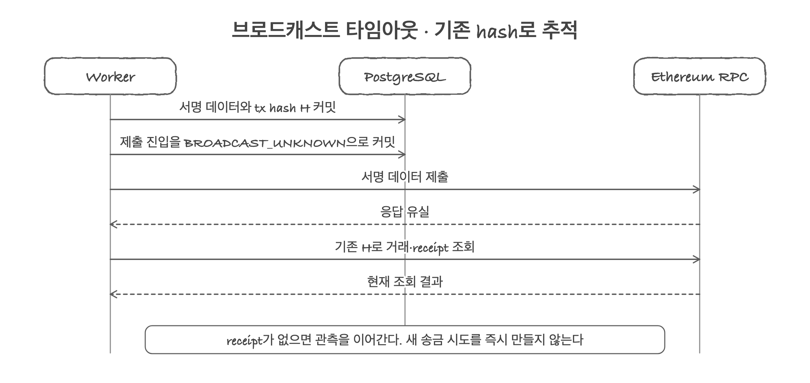

# 전송 타임아웃은 결과 미확인 상태로 남긴다

## 1. Ethereum RPC를 호출하기 전에 해시를 확보한다

Worker는 서명한 EIP-1559 트랜잭션의 해시를 로컬에서 계산할 수 있다. 서명 바이트 또는 재사용 가능한 보관 참조와 해시, 체인 ID, nonce를 `payout_attempt`의 `PREPARED` 상태에 기록한다. 이어서 제출에 진입했음을 `BROADCAST_UNKNOWN`으로 커밋하고 같은 바이트를 `eth_sendRawTransaction`으로 보낸다. [go-ethereum v1.16.5 트랜잭션 해시](https://raw.githubusercontent.com/ethereum/go-ethereum/v1.16.5/core/types/transaction.go) · [Ethereum eth_sendRawTransaction](https://ethereum.org/developers/docs/apis/json-rpc/#eth-sendrawtransaction) · [PostgreSQL 18 트랜잭션](https://www.postgresql.org/docs/18/tutorial-transactions.html)

## 2. 타임아웃 뒤에는 기존 해시를 대조한다

`eth_getTransactionByHash`가 객체를 반환하고 `blockHash`가 `null`이면 그 노드에서 `PENDING`으로 관측한 것이다. `eth_getTransactionReceipt`는 미포함된 거래의 영수증을 반환할 수 없다. 두 조회가 모두 `null`이어도 해당 노드에서 찾지 못한 상태로 남겨 두고, 미제출을 입증하는 근거로 삼지 않는다. [Ethereum eth_getTransactionByHash](https://ethereum.org/developers/docs/apis/json-rpc/#eth-gettransactionbyhash) · [Ethereum eth_getTransactionReceipt](https://ethereum.org/developers/docs/apis/json-rpc/#eth-gettransactionreceipt)

Confirmer는 영수증의 블록과 실행 상태를 대조한다. 정상 ERC-20 지급은 지정된 컨트랙트의 `Transfer` 로그에 담긴 송신자·수취인·수량도 지급 의도와 비교한다. 영수증 높이의 정규 체인 블록 해시가 영수증의 `blockHash`와 일치하고 그 높이가 `finalized` 이하일 때 업무 완료로 반영한다. [Ethereum eth_getTransactionReceipt](https://ethereum.org/developers/docs/apis/json-rpc/#eth-gettransactionreceipt) · [ERC-20 Transfer](https://eips.ethereum.org/EIPS/eip-20#events) · [Ethereum 블록 조회](https://ethereum.org/developers/docs/apis/json-rpc/#eth-getblockbynumber)

## 3. 재전송은 같은 시도 안에서 통제한다

RPC 도달 전에 끊긴 경우와 노드가 수락한 뒤 응답만 끊긴 경우를 모두 테스트한다. 둘 다 기존 해시로 조회하고 정책이 허용할 때 기존 서명 바이트를 재전송한다. 이때 기존 nonce와 해시가 유지되는지 검사한다. 제출 진입 전에 호출이 없었음을 내부에서 입증할 수 있는 경우만 `PROVEN_NOT_SENT`로 다루고, 확인 기한을 넘긴 미확인 건은 `REVIEW_REQUIRED`로 올린다. [PostgreSQL 18 트랜잭션](https://www.postgresql.org/docs/18/tutorial-transactions.html) · [go-ethereum v1.16.5 트랜잭션 해시](https://raw.githubusercontent.com/ethereum/go-ethereum/v1.16.5/core/types/transaction.go) · [Ethereum eth_sendRawTransaction](https://ethereum.org/developers/docs/apis/json-rpc/#eth-sendrawtransaction) · [Ethereum eth_getTransactionByHash](https://ethereum.org/developers/docs/apis/json-rpc/#eth-gettransactionbyhash) · [AWS 타임아웃·백오프·지터](https://aws.amazon.com/builders-library/timeouts-retries-and-backoff-with-jitter/)
