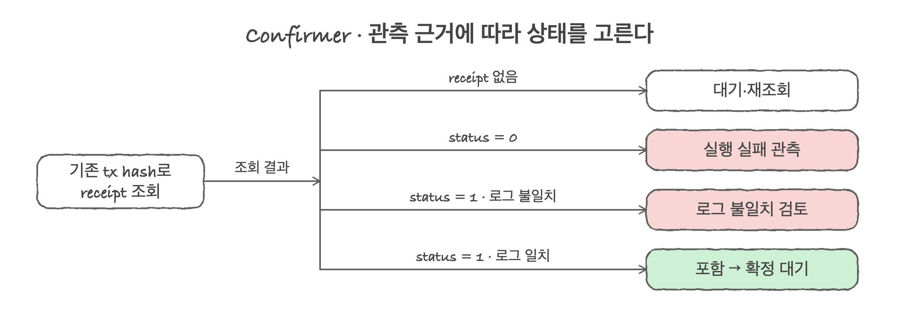

# Pending 송금의 receipt와 로그를 확인하기

StablePay는 전송 대기, RPC 조회 실패, 체인 실행 실패를 서로 다른 관측으로 기록한다. `eth_getTransactionReceipt`가 `null`을 반환하면 그 노드에서 receipt를 아직 찾지 못한 상태다. [Ethereum JSON-RPC · receipt](https://ethereum.org/developers/docs/apis/json-rpc/#eth-gettransactionreceipt)

## 1. 거래를 찾았는지와 블록에 포함됐는지를 나눈다

기존 `tx_hash`로 거래와 receipt를 각각 조회한다. 거래가 보이고 `blockNumber`가 비어 있으면 대기 중인 거래로 관측한다. 거래도 보이지 않으면 RPC 동기화나 전파 지연 등으로 아직 관측하지 못했을 수 있으므로 바로 실패로 닫지 않는다. [Ethereum JSON-RPC · 거래 조회](https://ethereum.org/developers/docs/apis/json-rpc/#eth-gettransactionbyhash) · [Ethereum JSON-RPC · receipt](https://ethereum.org/developers/docs/apis/json-rpc/#eth-gettransactionreceipt)

## 2. receipt가 생기면 토큰 전송을 검증한다

receipt의 `status=0`은 해당 블록에서 실행에 실패했다는 관측이다. `status=1`이면 로그를 읽어 계약 주소, `Transfer`의 송신자·수취인·최소 단위 금액이 요청과 일치하는지 확인한다. 검증에 성공한 포함 상태도 확정 블록 기준을 별도로 통과한다. [Ethereum JSON-RPC · receipt](https://ethereum.org/developers/docs/apis/json-rpc/#eth-gettransactionreceipt) · [ERC-20 · Transfer](https://eips.ethereum.org/EIPS/eip-20#events) · [Ethereum JSON-RPC · 블록 조회](https://ethereum.org/developers/docs/apis/json-rpc/#eth-getblockbynumber)

## 3. 응답이 늦는 경우를 재현한다

로컬 체인에서 블록 생성을 지연시킨 뒤 같은 해시를 폴링한다. receipt 부재 동안 새 시도가 생기지 않는지, 블록 생성 뒤 일치하는 로그가 확인될 때만 `INCLUDED`가 기록되는지 확인한다. [Ethereum JSON-RPC · receipt](https://ethereum.org/developers/docs/apis/json-rpc/#eth-gettransactionreceipt) · [ERC-20 · Transfer](https://eips.ethereum.org/EIPS/eip-20#events)

그림의 근거 · [Ethereum JSON-RPC · receipt](https://ethereum.org/developers/docs/apis/json-rpc/#eth-gettransactionreceipt) · [ERC-20 · Transfer](https://eips.ethereum.org/EIPS/eip-20#events)
