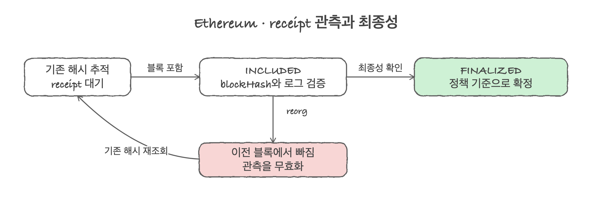

# 송금 완료와 실패의 판정 기준 정하기

StablePay는 송금 증거와 최종성 기준을 모두 만족할 때 요청을 `COMPLETED`로 확정한다. 브로드캐스트 응답과 receipt, 확정 블록은 관측하는 대상이 각각 다르다. [Ethereum JSON-RPC · 거래 조회](https://ethereum.org/developers/docs/apis/json-rpc/#eth-gettransactionbyhash) · [Ethereum JSON-RPC · receipt](https://ethereum.org/developers/docs/apis/json-rpc/#eth-gettransactionreceipt) · [Ethereum · PoS 최종성](https://ethereum.org/developers/docs/consensus-mechanisms/pos/#finality)

## 1. 포함된 블록이 캐노니컬 체인에 남아 있는지 확인한다

Ethereum PoS 예시에서는 receipt의 높이로 조회한 블록 해시가 receipt의 `blockHash`와 일치하고 해당 높이가 `finalized` 헤드 이하인지 확인한다. 높이가 같아도 블록 해시가 달라졌다면 기존 포함 관측을 무효화하고 재조회한다. [Ethereum JSON-RPC · receipt](https://ethereum.org/developers/docs/apis/json-rpc/#eth-gettransactionreceipt) · [Ethereum JSON-RPC · 블록 조회](https://ethereum.org/developers/docs/apis/json-rpc/#eth-getblockbynumber) · [Ethereum · PoS 최종성](https://ethereum.org/developers/docs/consensus-mechanisms/pos/#finality)

## 2. 확정된 실패와 운영 검토를 분리한다

최종성 기준을 통과한 `status=0` receipt는 그 시도의 `REVERTED` 근거가 된다. 요청의 `FAILED` 여부는 다른 활성 시도와 재실행 가능성까지 확인한 뒤 결정한다. 로그 불일치나 서로 다른 RPC 관측은 기존 데이터를 남기고 `REVIEW_REQUIRED`로 보낸다. [Ethereum JSON-RPC · receipt](https://ethereum.org/developers/docs/apis/json-rpc/#eth-gettransactionreceipt) · [Ethereum · PoS 최종성](https://ethereum.org/developers/docs/consensus-mechanisms/pos/#finality) · [AWS · 멱등 재시도](https://aws.amazon.com/builders-library/making-retries-safe-with-idempotent-APIs/)

## 3. SDK가 돌려준 성공의 범위를 확인한다

viem `waitForTransactionReceipt`의 기본 기준은 한 번의 confirmation이다. 대기 시간 초과나 교체 거래 감지가 있을 수 있으므로 반환된 해시와 업무 전송 내용을 대조하고 최종성 정책을 추가로 적용한다. [viem · receipt 대기](https://viem.sh/docs/actions/public/waitForTransactionReceipt) · [ERC-20 · Transfer](https://eips.ethereum.org/EIPS/eip-20#events) · [Ethereum · PoS 최종성](https://ethereum.org/developers/docs/consensus-mechanisms/pos/#finality)

그림의 근거 · [Ethereum JSON-RPC · 블록 조회](https://ethereum.org/developers/docs/apis/json-rpc/#eth-getblockbynumber) · [Ethereum · PoS 최종성](https://ethereum.org/developers/docs/consensus-mechanisms/pos/#finality)
