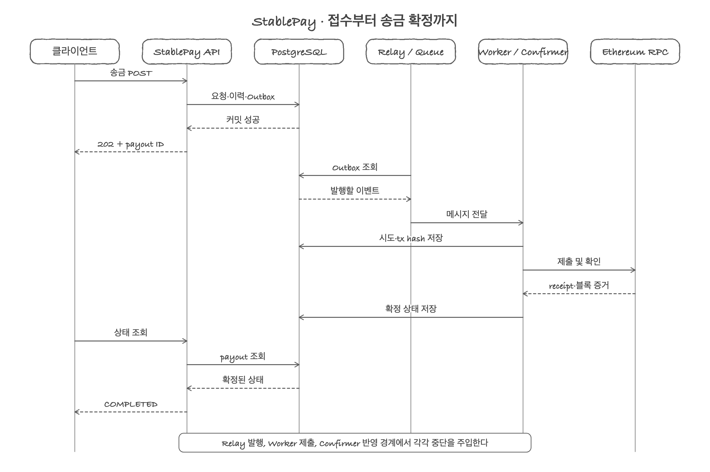

# 송금 API부터 외부 전송까지 통합 테스트하기

송금 생성은 `POST /payouts`, 상태 조회는 `GET /payouts/{payout_id}`로 두는 StablePay 예시다. 접수 응답은 `202 Accepted`와 조회 위치를 반환한다. [Microsoft · 비동기 요청-응답](https://learn.microsoft.com/en-us/azure/architecture/patterns/asynchronous-request-reply)

## 1. 직접 호출로 접수 계약을 확인한다

테스트 계정과 테스트 토큰으로 전송을 요청한 뒤 응답의 `Location`을 조회한다. 같은 `Idempotency-Key`와 같은 요청 본문을 다시 보내 같은 `payout_id`가 반환되고, 금액을 바꿔 보내면 충돌하는지 확인한다. [Microsoft · 비동기 요청-응답](https://learn.microsoft.com/en-us/azure/architecture/patterns/asynchronous-request-reply) · [AWS · 멱등 재시도](https://aws.amazon.com/builders-library/making-retries-safe-with-idempotent-APIs/)

## 2. 비동기 실행의 관측 지점을 잡는다

API에서 응답을 받은 직후 DB에 요청과 발행 의도가 함께 존재하는지 조회한다. 이후 Relay·Worker를 실행하고 시도의 해시로 체인 receipt와 토큰 이동을 확인한다. API 응답만으로 전송 여부를 판정하지 않는다. [AWS · Transactional Outbox](https://docs.aws.amazon.com/prescriptive-guidance/latest/cloud-design-patterns/transactional-outbox.html) · [Ethereum JSON-RPC · receipt](https://ethereum.org/developers/docs/apis/json-rpc/#eth-gettransactionreceipt) · [ERC-20 · Transfer](https://eips.ethereum.org/EIPS/eip-20#events)

## 3. 통합 테스트의 종료 기준을 둔다

같은 내부 요청에 성공한 전송이 1건인지 검증하고, 시간 한도 안에 확정 증거가 없으면 마지막 DB 및 체인 관측을 출력한다. 로컬 환경에 PoS 최종성이 없을 때는 블록 진행을 제어하는 테스트 정책을 따로 사용한다. [AWS · 멱등 재시도](https://aws.amazon.com/builders-library/making-retries-safe-with-idempotent-APIs/) · [Ethereum JSON-RPC · receipt](https://ethereum.org/developers/docs/apis/json-rpc/#eth-gettransactionreceipt) · [Ethereum · PoS 최종성](https://ethereum.org/developers/docs/consensus-mechanisms/pos/#finality)

그림의 근거 · [Microsoft · 비동기 요청-응답](https://learn.microsoft.com/en-us/azure/architecture/patterns/asynchronous-request-reply) · [AWS · Transactional Outbox](https://docs.aws.amazon.com/prescriptive-guidance/latest/cloud-design-patterns/transactional-outbox.html) · [Ethereum JSON-RPC · receipt](https://ethereum.org/developers/docs/apis/json-rpc/#eth-gettransactionreceipt)
