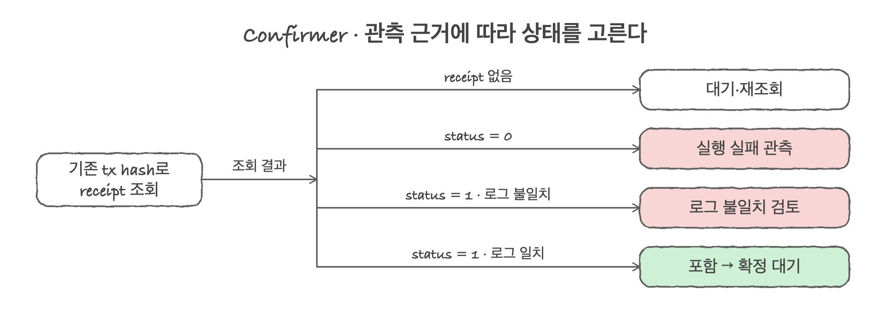

# 외부 도메인의 관측을 송금 상태로 변환하기

같은 `BROADCAST_UNKNOWN` 상태라도 사용한 nonce, receipt, 계약 이벤트에 따라 처리 결과가 달라진다. 외부 관측 원문을 보존하고 업무 상태 변경과 함께 해석 근거를 남긴다. [Ethereum JSON-RPC · 거래 조회](https://ethereum.org/developers/docs/apis/json-rpc/#eth-gettransactionbyhash) · [Ethereum JSON-RPC · receipt](https://ethereum.org/developers/docs/apis/json-rpc/#eth-gettransactionreceipt) · [ERC-20 · Transfer](https://eips.ethereum.org/EIPS/eip-20#events)

## 1. 같은 nonce를 사용한 교체 거래를 구분한다

viem의 교체 감지는 재가격 책정, 취소, 다른 거래로의 교체를 구분한다. 새 해시가 관측되면 승인된 체인·송신 계정·대상 계약과 전송 인자를 기존 시도와 대조한다. 같은 nonce만 확인하고 기존 송금을 완료시키면 취소 거래를 성공으로 오인할 수 있다. [viem · receipt 대기](https://viem.sh/docs/actions/public/waitForTransactionReceipt) · [ERC-20 · Transfer](https://eips.ethereum.org/EIPS/eip-20#events)

## 2. 프로토콜 상태를 그대로 업무 결과에 쓰지 않는다

컨트랙트 호출 자체가 성공해도 기대한 ERC-20 전송 로그가 없다면 `COMPLETED` 조건을 충족하지 못한다. 검증된 테스트 토큰의 전송 로그와 receipt, 최종성이 함께 일치할 때 확정한다. [Ethereum JSON-RPC · receipt](https://ethereum.org/developers/docs/apis/json-rpc/#eth-gettransactionreceipt) · [ERC-20 · Transfer](https://eips.ethereum.org/EIPS/eip-20#events) · [Ethereum · PoS 최종성](https://ethereum.org/developers/docs/consensus-mechanisms/pos/#finality)

## 3. 서로 다른 증거가 들어오는 경우를 재현한다

같은 nonce에서 전송 내용이 같은 교체와 다른 수취인으로의 교체를 각각 준비한다. 같은 요청인지 확인된 해시만 시도 이력에 연결하고, 다른 수취인이 확인되면 자동 완료시키지 않고 검토에 남기는지 테스트한다. [viem · receipt 대기](https://viem.sh/docs/actions/public/waitForTransactionReceipt) · [ERC-20 · Transfer](https://eips.ethereum.org/EIPS/eip-20#events) · [AWS · 멱등 재시도](https://aws.amazon.com/builders-library/making-retries-safe-with-idempotent-APIs/)

그림의 근거 · [Ethereum JSON-RPC · receipt](https://ethereum.org/developers/docs/apis/json-rpc/#eth-gettransactionreceipt) · [ERC-20 · Transfer](https://eips.ethereum.org/EIPS/eip-20#events)
